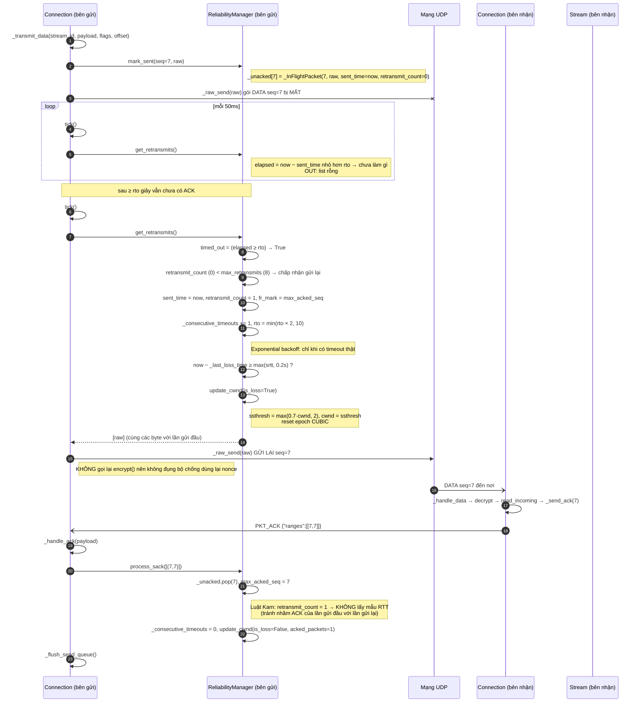
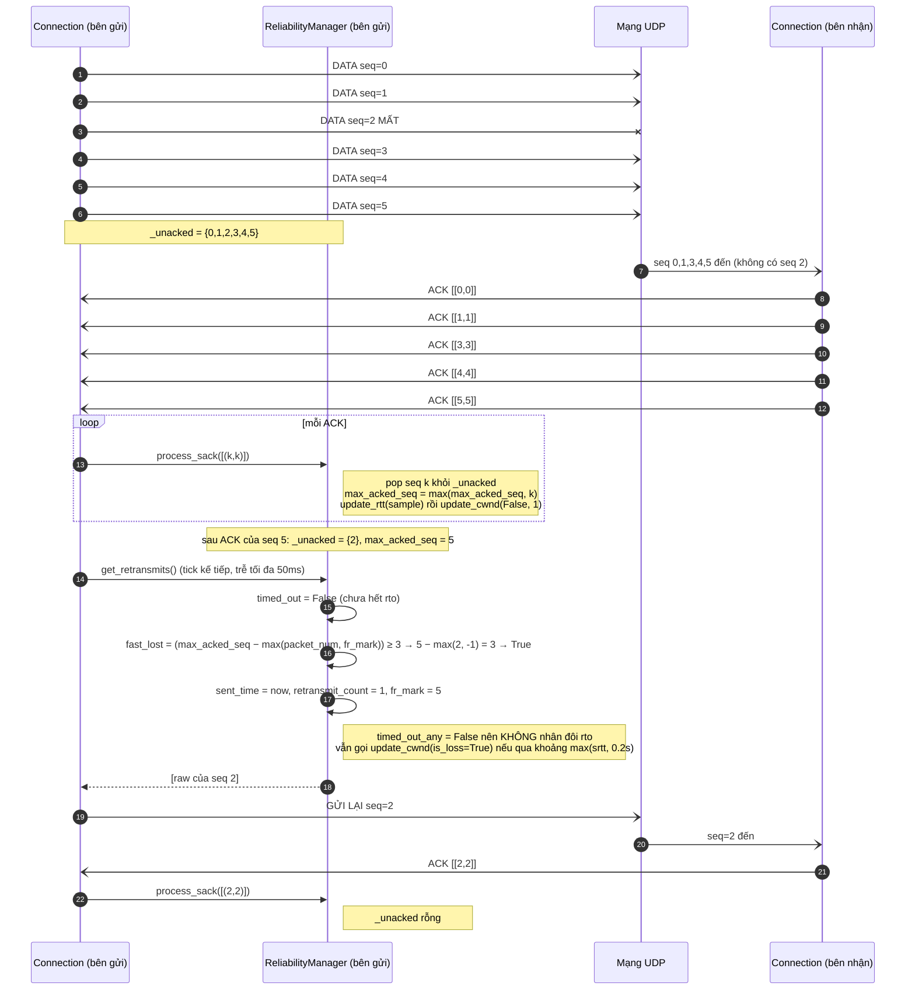
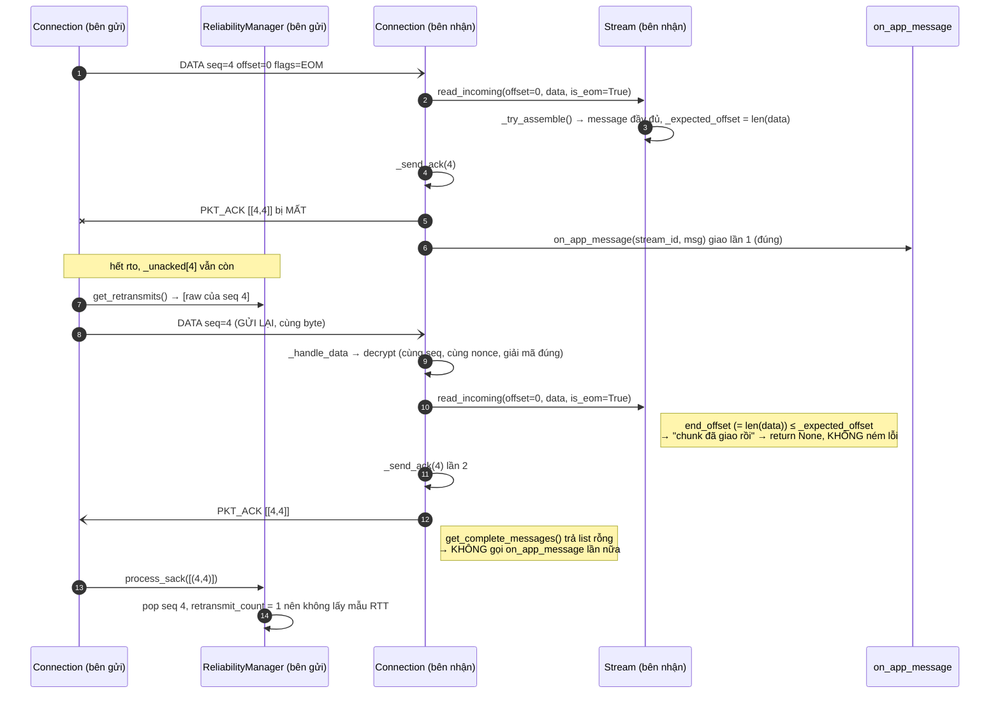
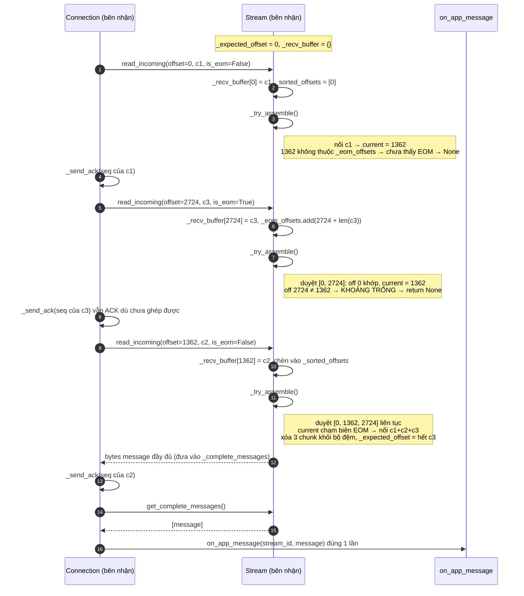
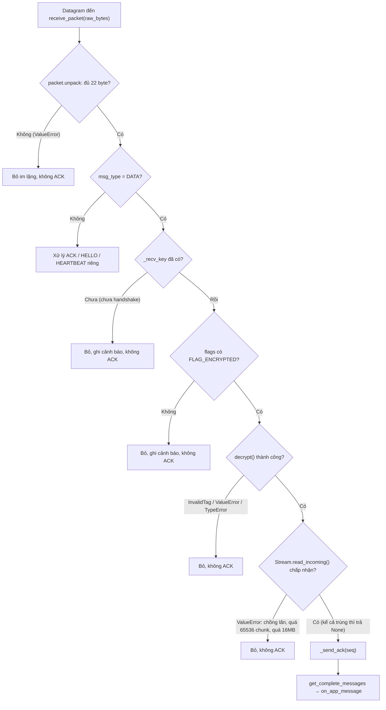
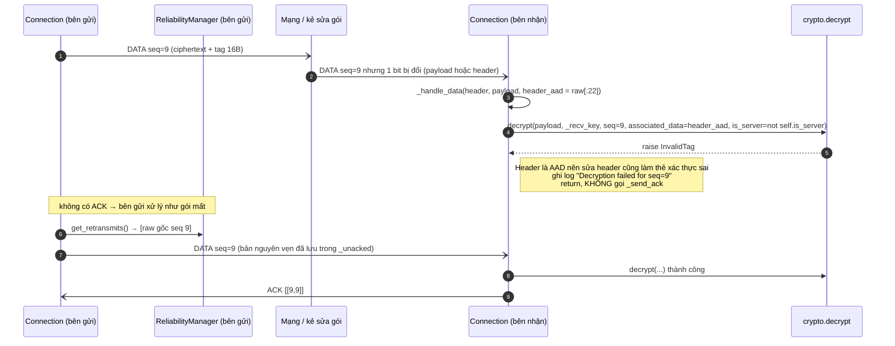
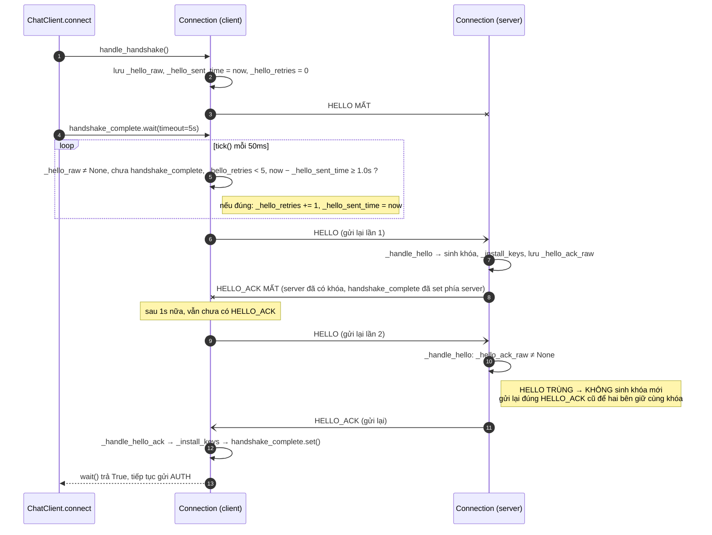
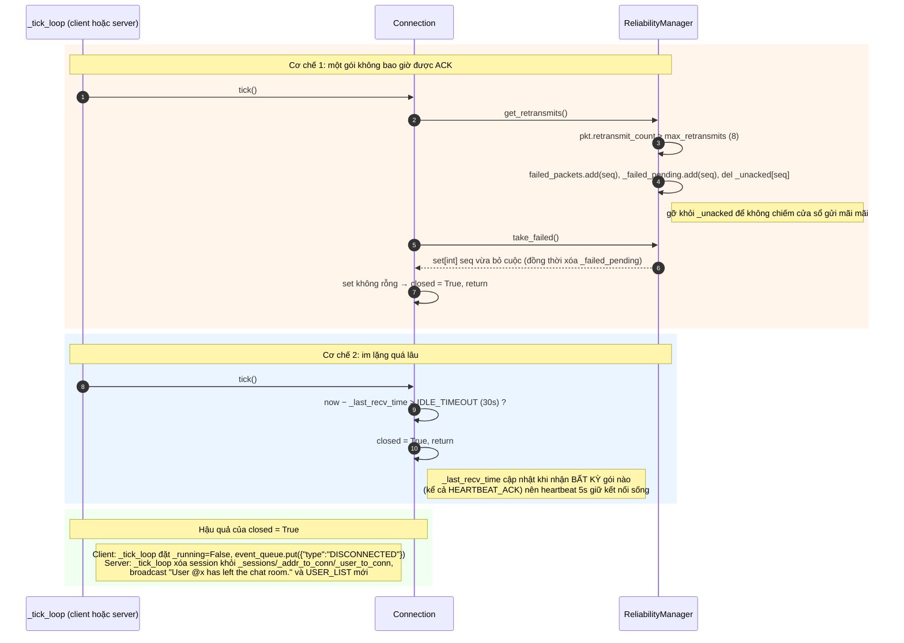
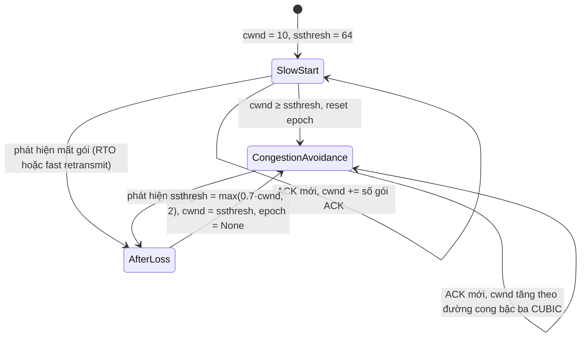

# Cơ chế xử lý mất gói (Packet Loss Handling) — StreamChat

Tài liệu giải thích **từng kịch bản lỗi** và **hàm nào trong code xử lý nó**. Mỗi kịch bản có sequence diagram ở mức hàm.
Nguồn: `src/transport/connection.py`, `src/transport/reliability.py`, `src/transport/stream.py`, `src/common/crypto.py`.

> Mũi tên `-x` trong diagram nghĩa là **gói bị mất trên đường truyền**. Xem bằng VS Code cần extension _Markdown Preview Mermaid Support_, hoặc dán khối vào <https://mermaid.live>.

## Mục lục

1. [Tổng quan: ai làm gì khi có lỗi](#1-tổng-quan)
2. [Biến trạng thái liên quan](#2-biến-trạng-thái-liên-quan)
3. [Kịch bản A — Mất gói DATA, phát hiện bằng timeout (RTO)](#3-kịch-bản-a--mất-gói-data-rto)
4. [Kịch bản B — Mất gói giữa chuỗi, phát hiện sớm bằng SACK (fast retransmit)](#4-kịch-bản-b--fast-retransmit)
5. [Kịch bản C — Mất gói ACK](#5-kịch-bản-c--mất-gói-ack)
6. [Kịch bản D — Gói đến sai thứ tự](#6-kịch-bản-d--gói-đến-sai-thứ-tự)
7. [Kịch bản E — Gói hỏng / bị sửa / bị từ chối](#7-kịch-bản-e--gói-hỏng--bị-từ-chối)
8. [Kịch bản F — Mất HELLO / HELLO_ACK](#8-kịch-bản-f--mất-hello--hello_ack)
9. [Kịch bản G — Từ bỏ: vượt số lần truyền lại hoặc im lặng quá lâu](#9-kịch-bản-g--từ-bỏ)
10. [Phản ứng của RTO và cửa sổ tắc nghẽn (CUBIC)](#10-phản-ứng-của-rto-và-cwnd)
11. [Ví dụ có số: timeline cụ thể](#11-ví-dụ-có-số)
12. [Hạn chế hiện tại & cách tự test mất gói](#12-hạn-chế--cách-test)

---

## 1. Tổng quan

Hệ thống chạy trên UDP (không tự đảm bảo gì), nên độ tin cậy do nhóm tự xây trong tầng `transport`. Nguyên tắc:

- **Bên nhận** chỉ ACK một gói DATA **sau khi gói đó đã được xác thực, giải mã và Stream chấp nhận** (`_handle_data`). Gói lỗi thì **im lặng, không ACK**.
- **Bên gửi** giữ bản sao nguyên văn của mọi DATA chưa được ACK trong `ReliabilityManager._unacked`. Nếu thấy gói "mất" thì gửi lại **đúng các byte cũ** (cùng `seq`, cùng nonce, không mã hóa lại).
- **Gói ACK không bao giờ được truyền lại.** Nếu ACK mất, sự mất mát được bù bằng việc bên gửi truyền lại DATA (xem kịch bản C).

| Sự cố                                         | Ai phát hiện | Cách phát hiện                                     | Hàm xử lý chính                            | Hậu quả                                        |
| --------------------------------------------- | ------------ | -------------------------------------------------- | ------------------------------------------ | ---------------------------------------------- |
| Mất gói DATA                                  | Bên gửi      | Quá `rto` chưa có ACK                              | `get_retransmits`                          | Gửi lại, `rto ×2`, giảm `cwnd`                 |
| Mất gói DATA (giữa chuỗi)                     | Bên gửi      | ≥ 3 gói seq cao hơn đã được ACK                    | `get_retransmits` (`fast_lost`)            | Gửi lại sớm, **không** nhân đôi `rto`          |
| Mất gói ACK                                   | Bên gửi      | Như mất DATA (hết RTO)                             | `get_retransmits`                          | Gửi lại, bên nhận loại trùng ở `read_incoming` |
| Gói đến sai thứ tự                            | Bên nhận     | `offset` không liên tục                            | `Stream.read_incoming`, `_try_assemble`    | Đệm lại, ghép khi đủ                           |
| Gói trùng                                     | Bên nhận     | `end_offset ≤ _expected_offset` hoặc offset đã đệm | `Stream.read_incoming`                     | Bỏ, **vẫn ACK lại**                            |
| Gói bị sửa / sai khóa                         | Bên nhận     | AEAD `InvalidTag`                                  | `crypto.decrypt` trong `_handle_data`      | Bỏ, **không ACK** → bên gửi gửi lại            |
| Gói ngắn hơn 22 byte                          | Bên nhận     | `ValueError`                                       | `packet.unpack` trong `receive_packet`     | Bỏ im lặng                                     |
| Stream từ chối chunk (chồng lấn, tràn bộ đệm) | Bên nhận     | `ValueError`                                       | `read_incoming` → `_handle_data`           | Bỏ, **không ACK**                              |
| Mất HELLO / HELLO_ACK                         | Client       | Chưa `handshake_complete` sau 1s                   | `Connection.tick`                          | Gửi lại HELLO tối đa 5 lần                     |
| Một gói không bao giờ được ACK                | Bên gửi      | `retransmit_count ≥ 8`                             | `get_retransmits` → `take_failed` → `tick` | `closed = True`                                |
| Đối tác biến mất                              | Cả hai       | Không nhận gì trong 30s                            | `Connection.tick` (`IDLE_TIMEOUT`)         | `closed = True`                                |

---

## 2. Biến trạng thái liên quan

| Biến                                               | Ở đâu                | Ý nghĩa                                                                                            |
| -------------------------------------------------- | -------------------- | -------------------------------------------------------------------------------------------------- |
| `_unacked: dict[seq → _InFlightPacket]`            | `ReliabilityManager` | Các gói đã gửi, chưa được ACK. Mỗi phần tử: `raw_data`, `sent_time`, `retransmit_count`, `fr_mark` |
| `rto`                                              | `ReliabilityManager` | Thời gian chờ ACK trước khi coi là mất. Ban đầu `1.0s`, kẹp trong `[0.2, 10]s`                     |
| `srtt`, `rttvar`                                   | `ReliabilityManager` | RTT làm trơn và độ biến thiên (RFC 6298)                                                           |
| `max_acked_seq`                                    | `ReliabilityManager` | `seq` lớn nhất từng được ACK, dùng cho fast retransmit                                             |
| `fr_mark`                                          | `_InFlightPacket`    | Giá trị `max_acked_seq` tại lần truyền lại gần nhất, tránh truyền lại dồn dập                      |
| `FAST_RETRANSMIT_DUPTHRESH = 3`                    | `reliability.py`     | Ngưỡng số gói cao hơn đã ACK để coi gói thấp hơn là mất                                            |
| `max_retransmits = 8`                              | `ReliabilityManager` | Số lần truyền lại tối đa cho một gói                                                               |
| `_last_loss_time`                                  | `ReliabilityManager` | Mốc giảm `cwnd` gần nhất, để chỉ giảm 1 lần mỗi RTT                                                |
| `cwnd`, `ssthresh`, `_w_max`, `_w_last_max`        | `ReliabilityManager` | Trạng thái CUBIC. Ban đầu `cwnd=10`, `ssthresh=64`                                                 |
| `failed_packets`, `_failed_pending`                | `ReliabilityManager` | Các `seq` đã bị bỏ cuộc                                                                            |
| `_tx_queue`                                        | `Connection`         | Hàng đợi DATA chờ cửa sổ `cwnd` mở                                                                 |
| `_expected_offset`, `_recv_buffer`, `_eom_offsets` | `Stream`             | Trạng thái ghép nối phía nhận                                                                      |
| `_hello_raw`, `_hello_retries`, `_hello_sent_time` | `Connection`         | Phục vụ gửi lại HELLO                                                                              |
| `_last_recv_time`                                  | `Connection`         | Lần cuối nhận **bất kỳ** gói nào, dùng cho idle timeout                                            |

Hằng số (`common/constants.py`): `TICK_INTERVAL = 0.05s`, `INITIAL_RTO = 1.0`, `MIN_RTO = 0.2`, `MAX_RTO = 10.0`, `HEARTBEAT_INTERVAL = 5.0`, `IDLE_TIMEOUT = 30.0`.

---

## 3. Kịch bản A — Mất gói DATA (RTO)

Gói `seq=7` bị mất. Không có gói nào sau nó được ACK, nên fast retransmit chưa kích hoạt; bên gửi phải chờ hết `rto`.



**Lưu ý:** `rto` đã bị nhân đôi vẫn giữ nguyên cho tới khi có một **mẫu RTT sạch** (từ gói chưa từng bị truyền lại) làm `update_rtt` tính lại `rto` từ `srtt/rttvar`.

---

## 4. Kịch bản B — Fast retransmit

Bên gửi phát `seq=0..5`, **mất `seq=2`**. Bên nhận ACK được `0,1,3,4,5`. Khi `max_acked_seq = 5` thì `5 − max(2, fr_mark=-1) = 3 ≥ 3` → coi `seq=2` là mất **mà không cần chờ hết RTO**.



**Vì sao có `fr_mark`?** Sau lần truyền lại, `fr_mark = 5`. Nếu bản gửi lại cũng mất, điều kiện fast retransmit tiếp theo là `max_acked_seq − 5 ≥ 3`, tức phải có thêm **3 gói mới** được ACK (`max_acked_seq ≥ 8`). Nhờ vậy không gửi lại liên tục mỗi 50ms. Nếu không có gói mới, RTO sẽ làm nhiệm vụ này.

---

## 5. Kịch bản C — Mất gói ACK

DATA đến nơi và đã được giao cho ứng dụng, nhưng **ACK bị mất**. Bên gửi tưởng DATA mất nên gửi lại. Bên nhận phải **không giao trùng** cho ứng dụng.



**Trường hợp tương tự:** nếu chunk trùng đang nằm trong bộ đệm chờ ghép (chưa giao), nhánh `offset in self._recv_buffer` cũng `return None` — vẫn ACK, không đệm hai lần.

---

## 6. Kịch bản D — Gói đến sai thứ tự

Một message 3 chunk: `c1 (offset 0)`, `c2 (offset 1362)`, `c3 (offset 2724, EOM)`. Thứ tự đến: **c1, c3, c2**. Mỗi chunk đều được ACK ngay khi được chấp nhận, **dù chưa giao được**, nên bên gửi sẽ không truyền lại chunk đã đến — đây chính là **Selective** ACK.



**Head-of-line blocking:** nếu `c2` bị mất, `c1` và `c3` nằm trong bộ đệm cho tới khi `c2` được truyền lại. Việc chặn này **chỉ trong cùng một stream**. File dùng `stream_id` riêng nên không chặn chat trên Stream 0. Tuy nhiên hàng đợi gửi `_tx_queue` và cửa sổ `cwnd` là **dùng chung** cho mọi stream.

---

## 7. Kịch bản E — Gói hỏng / bị từ chối

Các trường hợp bên nhận **không ACK**. Với bên gửi, chúng giống hệt "gói bị mất" nên sẽ được truyền lại theo kịch bản A hoặc B.





**Điều cần nhớ:** bản sao trong `_unacked` là bản **gốc**, nên truyền lại luôn sửa được lỗi do mạng. Nhưng nếu lý do từ chối là **vĩnh viễn** (ví dụ bộ đệm bên nhận đầy, hoặc chunk chồng lấn không bao giờ hợp lệ) thì gói sẽ bị gửi lại đến khi vượt `max_retransmits` rồi đóng kết nối — xem kịch bản G.

---

## 8. Kịch bản F — Mất HELLO / HELLO_ACK



**Giới hạn cần biết:**

- Tối đa 5 lần gửi lại HELLO (`HELLO_MAX_RETRIES`), cách nhau 1.0s. `connect()` chỉ chờ 5.0s, nên nếu cả 5 lần đều thất bại thì `connect()` trả `False`.
- `handle_handshake()` chỉ được gọi khi `_running` còn `False`. Sau khi hết 5 lần thử, các lần bấm đăng nhập tiếp theo **không gửi HELLO mới**, chỉ chờ thêm 5s. Muốn thử lại phải khởi động lại client. Đây là điểm có thể cải thiện.

---

## 9. Kịch bản G — Từ bỏ

Có **hai** cơ chế đóng kết nối khi liên lạc không thành, cùng nằm trong `Connection.tick()`.



**Cái nào xảy ra trước?** Nếu đối tác biến mất hẳn, `_last_recv_time` không được cập nhật nữa nên **idle timeout (30s) thường đến trước**. Ước lượng với `rto` ban đầu 1s và không có mẫu RTT: các lần truyền lại rơi vào khoảng `t ≈ 1, 3, 7, 15, 25 giây`, và gói bị bỏ cuộc ở lần kiểm tra thứ 9 vào khoảng `t ≈ 65s`, muộn hơn 30s rất nhiều. Cơ chế 1 chủ yếu có tác dụng khi đối tác **vẫn sống** (vẫn trả heartbeat) nhưng liên tục từ chối một gói cụ thể (kịch bản E).

---

## 10. Phản ứng của RTO và cwnd

Khi mất gói, bên gửi làm **hai việc độc lập**: tăng thời gian chờ (`rto`) và giảm tốc độ gửi (`cwnd`).



**`update_cwnd(is_loss=True)`** (`reliability.py`):

1. **Fast Convergence:** nếu `cwnd < _w_last_max` thì `_w_max = cwnd × 0.85`, ngược lại `_w_max = cwnd`. Sau đó `_w_last_max = cwnd`.
2. `ssthresh = max(cwnd × 0.7, 2)`, rồi `cwnd = ssthresh`.
3. `_epoch_start = None`, `_k = 0`. Lần ACK kế tiếp sẽ tính lại đường cong: `K = ((W_max − cwnd) / 0.4)^(1/3)`.

**Chống sụp cửa sổ khi mất nhiều gói cùng lúc (ADR-009):** `update_cwnd(is_loss=True)` chỉ được gọi **tối đa một lần mỗi `max(srtt, 0.2s)`**. Nếu 5 gói mất trong cùng một đợt thì `cwnd` chỉ bị nhân `0.7` một lần, không phải `0.7⁵`.

**Khi cwnd giảm, DATA mới vẫn đi nhưng bị hãm:** `can_send()` trả `len(_unacked) < int(cwnd)`. Các DATA vượt cửa sổ nằm trong `_tx_queue` và được đẩy đi bởi `_flush_send_queue()` mỗi khi nhận ACK hoặc `tick()`.

| Thành phần              | Khi có mất gói (RTO)  | Khi mất gói (fast retransmit) | Khi nhận ACK mới                              |
| ----------------------- | --------------------- | ----------------------------- | --------------------------------------------- |
| `rto`                   | `× 2` (tối đa 10s)    | giữ nguyên                    | tính lại từ `srtt/rttvar` nếu có mẫu RTT sạch |
| `cwnd`                  | `× 0.7` (≤ 1 lần/RTT) | `× 0.7` (≤ 1 lần/RTT)         | tăng                                          |
| `_consecutive_timeouts` | `+1`                  | giữ nguyên                    | về 0                                          |

---

## 11. Ví dụ có số

Giả sử đã có vài mẫu RTT nên `srtt = 0.05s`, `rttvar = 0.025s`.

- `rto = srtt + max(0.05, 4 × rttvar) = 0.05 + 0.10 = 0.15s` → bị kẹp lên `MIN_RTO = 0.2s`.
- Giả sử `cwnd = 10`, `ssthresh = 64`.

| Thời điểm        | Sự kiện                                       | Trạng thái sau đó                                                                                                                 |
| ---------------- | --------------------------------------------- | --------------------------------------------------------------------------------------------------------------------------------- |
| t = 0.000s       | Gửi seq 0..5, **seq 2 mất**                   | `_unacked = {0..5}`                                                                                                               |
| t = 0.050s       | ACK 0, 1, 3, 4, 5 về                          | `_unacked = {2}`, `max_acked_seq = 5`                                                                                             |
| t ≈ 0.050–0.100s | `tick()` kế tiếp: `fast_lost = 5 − 2 = 3 ≥ 3` | Gửi lại seq 2. `retransmit_count = 1`, `fr_mark = 5`, `rto = 0.2` (**không nhân đôi**). Giảm cwnd: `ssthresh = 7.0`, `cwnd = 7.0` |
| t ≈ 0.150s       | ACK seq 2 về                                  | `_unacked = {}`. Không lấy mẫu RTT (Karn)                                                                                         |

Nếu **không có gói nào sau seq 2** (seq 2 là gói cuối):

| Thời điểm        | Sự kiện                                    | Trạng thái sau đó                                                                                                                                                                  |
| ---------------- | ------------------------------------------ | ---------------------------------------------------------------------------------------------------------------------------------------------------------------------------------- |
| t = 0.000s       | Gửi seq 2, bị mất                          | `_unacked = {2}`                                                                                                                                                                   |
| t ≈ 0.200–0.250s | Hết `rto = 0.2s`                           | Gửi lại, `rto = 0.4`, `cwnd 10 → 7`                                                                                                                                                |
| t ≈ 0.650s       | Nếu gói gửi lại cũng mất, hết `rto = 0.4s` | Gửi lại lần 2, `rto = 0.8`. Đã qua `0.4s ≥ max(srtt, 0.2s)` kể từ lần giảm trước nên `cwnd` **giảm tiếp**: `7.0 → 4.9`. Nếu hai lần mất cách nhau dưới `0.2s` thì chỉ giảm một lần |

---

## 12. Hạn chế & cách test

### 12.1 Điểm cần ghi vào phần "hạn chế" của báo cáo

- **ACK chỉ chứa 1 seq** (`{"ranges":[[seq,seq]]}`), chưa gộp thành dải liên tục. Hậu quả: nhiều ACK nhỏ, và mất ACK gây truyền lại thừa (kịch bản C), dù vô hại về tính đúng đắn.
- **ACK, HEARTBEAT, HEARTBEAT_ACK không được xác thực** (chỉ DATA có AEAD), nên kẻ tấn công trên đường truyền có thể giả ACK làm bên gửi xóa gói chưa đến nơi.
- **Chưa có flow control phía nhận** (cửa sổ nhận). Bộ đệm `Stream` giới hạn 16MB / 65536 chunk; vượt thì chunk bị từ chối không ACK.
- **Hàng đợi `_tx_queue` dùng chung** mọi stream nên một stream đông có thể làm chậm stream khác.
- Sau khi hết 5 lần gửi lại HELLO, client **không tự thử bắt tay lại** (kịch bản F).

### 12.2 Tự test mất gói

Cách đơn giản: tạm thêm đoạn giả lập rơi gói vào `Connection._raw_send` (`connection.py`), **chỉ để test, đừng commit**:

```python
import random, os
_DROP = float(os.environ.get("DROP_RATE", "0"))   # ví dụ 0.2 = rơi 20%

def _raw_send(self, data: bytes) -> None:
    if _DROP and random.random() < _DROP:
        return                      # giả lập mất gói trên đường truyền
    ...                             # phần gửi thật như cũ
```

Chạy:

```powershell
$env:DROP_RATE = "0.2"
python run_all.py
```

Rồi gửi một file vài MB giữa Alice và Bob và kiểm tra:

1. File nhận về vẫn đúng SHA-256 (client Bob sẽ báo `FILE_ERROR` nếu sai).
2. Log có các dòng `Retransmitting packet on conn …` (từ `tick()`).
3. Thử `DROP_RATE=0.9` để quan sát kịch bản G: kết nối bị đóng và server phát thông báo user đã rời phòng.

Để thấy fast retransmit riêng với RTO, có thể rơi **đúng một gói** (ví dụ gói có `seq == 5` ở lần gửi đầu) khi đang gửi file lớn.
