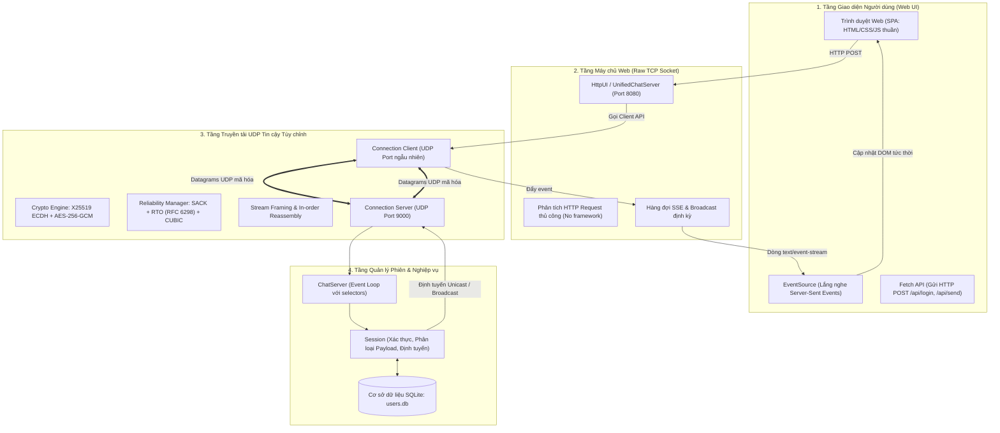
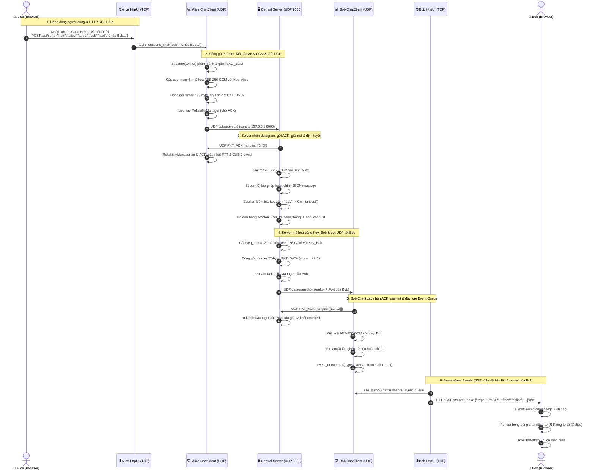

# StreamChat — Distributed Streaming Collaboration Application

Ứng dụng cộng tác Client-Server phân tán hỗ trợ chat thời gian thực và truyền file dựa trên giao thức truyền tải tùy chỉnh trên nền UDP (Selective ACK, kiểm soát tắc nghẽn CUBIC, trao đổi khóa X25519, mã hóa AES-GCM) kết hợp giao diện Web trực quan.

---

> [!IMPORTANT]
> **TÀI LIỆU ÔN TẬP & NGÂN HÀNG 85 CÂU HỎI VẤN ĐÁP MẠNG MÁY TÍNH TOÀN DIỆN**:
> Để nắm vững 100% bản chất kỹ thuật từ các thuật ngữ cốt lõi (ACK, SACK, RTO, CUBIC, Nonce, HoL Blocking, SSE...) đến giải thích từng khối code và các câu hỏi vấn đáp bảo vệ đồ án, mời **MemBau** xem tài liệu tương tác chuyên sâu tại:
> 👉 **[Tài liệu Kỹ thuật & Ngân hàng 85 Câu hỏi Vấn đáp (CODE_EXPLANATION_AND_QUESTIONS.html)](file:///d:/Hoc_Tap/261/MMT/btl1Final/ComputerNetwork_Assignment1/docs/CODE_EXPLANATION_AND_QUESTIONS.html)**

---

## Mục lục

1. [Tổng quan kiến trúc](#1-tổng-quan-kiến-trúc)
2. [Cấu trúc thư mục dự án](#2-cấu-trúc-thư-mục-dự-án)
3. [Yêu cầu môi trường & Cài đặt](#3-yêu-cầu-môi-trường--cài-đặt)
4. [Hướng dẫn khởi chạy nhanh](#4-hướng-dẫn-khởi-chạy-nhanh)
5. [Tài khoản đăng nhập mẫu](#5-tài-khoản-đăng-nhập-mẫu)
6. [Hướng dẫn sử dụng & Kiểm thử tính năng](#6-hướng-dẫn-sử-dụng--kiểm-thử-tính-năng)
7. [Tham số dòng lệnh (CLI Parameters)](#7-tham-số-dòng-lệnh-cli-parameters)
8. [Cách dừng chương trình](#8-cách-dừng-chương-trình)
9. [Chi tiết giải thích tất cả các file và hàm trong hệ thống (Chuẩn SKILL.md)](#9-chi-tiết-giải-thích-tất-cả-các-file-và-hàm-trong-hệ-thống)
10. [Luồng hoạt động toàn hệ thống & Phân tích ví dụ chi tiết (Alice gửi tin nhắn cho Bob)](#10-luồng-hoạt-động-toàn-hệ-thống--phân-tích-ví-dụ-chi-tiết-alice-gửi-tin-nhắn-cho-bob)
11. [Bảo mật, HTTPS & Phòng thủ Nghe lén Wireshark (MITM Analysis)](#11-bảo-mật-https--phòng-thủ-nghe-lén-wireshark-mitm-analysis)
12. [Đóng gói & Phân phối Ứng dụng (Portable Distribution in dist/)](#12-đóng-gói--phân-phối-ứng-dụng-portable-distribution-in-dist)
13. [Tài liệu Học tập & Ngân hàng 85 Câu hỏi Vấn đáp Mạng Máy Tính](#13-tài-liệu-học-tập--ngân-hàng-85-câu-hỏi-vấn-đáp-mạng-máy-tính)

---

## 1. Tổng quan kiến trúc

Hệ thống hoạt động theo mô hình Client-Server phân tán với các thành phần chính:

- **Server trung tâm (`run_server.py`)**:
  - Lắng nghe qua giao thức UDP (mặc định tại `127.0.0.1:9000`).
  - Quản lý phiên (`Session`), điều phối kết nối non-blocking với `selectors`.
  - Thực hiện bắt tay bảo mật (Handshake trao đổi khóa X25519 Diffie-Hellman), mã hóa/giải mã AES-GCM 256-bit.
  - Quản lý lưu trữ bền vững với SQLite (`users.db`): xác thực PBKDF2-HMAC-SHA256 kèm muối (salt), lưu trữ lịch sử tin nhắn và phân trang con trỏ (Cursor-based Pagination).
  - Chuyển tiếp tin nhắn phòng chung (Broadcast), tin nhắn riêng tư (Unicast) và stream dữ liệu file nhị phân.
- **Client (`run_client.py`)**:
  - Giao tiếp dữ liệu UDP bảo mật hai chiều với Server.
  - Tích hợp sẵn một máy chủ HTTP nội bộ (tự động dò cổng trống: `8080`, `8081`...) phục vụ giao diện người dùng (HTML/CSS/JavaScript thuần) và cập nhật dữ liệu thời gian thực thông qua Server-Sent Events (SSE).
  - Hỗ trợ cơ chế khóa phiên đơn cổng (Single-Session Port Lock) và Cookie cô lập theo cổng (Port-isolated Cookies `streamchat_session_{port}`) chống xung đột đa tài khoản trên cùng trình duyệt.
  - Bộ đệm chunk sớm (`early_file_chunks`) bảo đảm nhận file toàn vẹn khi mạng UDP xáo trộn thứ tự gói tin.
- **Cổng Quản trị Web Admin (`admin_server.py`)**:
  - Máy chủ HTTP độc lập tại cổng `9090` giúp quản trị viên thêm, sửa, xóa, tìm kiếm tài khoản người dùng trực quan trên nền SQLite `users.db`.

---

## 2. Cấu trúc thư mục dự án

```text
ComputerNetwork_Assignment1/
├── dist/                               # Gói cài đặt phân phối độc lập (Portable Packages)
│   ├── StreamChat_Client/              # Bản đóng gói dành riêng cho Người dùng / Máy khách
│   │   ├── src/                        # Thư mục mã nguồn client & transport
│   │   ├── run_client.py               # Điểm khởi chạy client
│   │   ├── start_client.bat            # Script 1-click khởi chạy client trên Windows
│   │   ├── start_client.sh             # Script khởi chạy client trên Linux/macOS
│   │   ├── requirements.txt            # Thư viện phụ thuộc client
│   │   └── README_USER.md              # Sổ tay hướng dẫn người dùng cuối
│   ├── StreamChat_Server/              # Bản đóng gói dành riêng cho Quản trị viên Máy chủ
│   │   ├── src/                        # Thư mục mã nguồn server & transport
│   │   ├── run_server.py               # Điểm khởi chạy máy chủ UDP
│   │   ├── admin_server.py             # Cổng web quản trị tài khoản
│   │   ├── start_server.bat            # Script 1-click khởi chạy Server trên Windows
│   │   ├── start_server.sh             # Script khởi chạy Server trên Linux/macOS
│   │   ├── start_admin.bat             # Script 1-click mở cổng Admin Web Portal (Port 9090)
│   │   ├── requirements.txt            # Thư viện phụ thuộc server
│   │   └── README_SERVER.md            # Sổ tay hướng dẫn quản trị máy chủ
│   ├── StreamChat_Client.zip           # Tệp nén phân phối nhanh Client
│   └── StreamChat_Server.zip           # Tệp nén phân phối nhanh Server
├── docs/                               # Tài liệu kỹ thuật & Báo cáo nâng cấp
│   ├── CODE_EXPLANATION_AND_QUESTIONS.html # Hướng dẫn ôn tập tương tác & 85 câu hỏi vấn đáp
│   ├── CHANGES_REPORT.md               # Báo cáo kỹ thuật chi tiết về nâng cấp hệ thống
│   └── WIRESHARK_TEST_GUIDE.md         # Sổ tay kiểm thử bắt gói và phân tích bảo mật Wireshark
├── src/                                # Mã nguồn toàn bộ hệ thống
│   ├── client/                         # Mã nguồn Client & HTTP Web UI Server
│   │   ├── static/                     # Giao diện Web (index.html, style.css, app.js)
│   │   ├── client.py                   # Quản lý kết nối Client UDP, truyền file, bộ đệm chunk sớm
│   │   └── http_ui.py                  # Web Server HTTP/1.1 raw TCP socket, SSE, cookie cô lập
│   ├── common/                         # Định nghĩa giao thức & tiện ích dùng chung
│   │   ├── constants.py                # Header format, cờ (EOM, FIN, SYN), MTU/MSS, hằng số CUBIC
│   │   ├── crypto.py                   # Hàm mã hóa X25519 ECDH & AES-256-GCM
│   │   └── packet.py                   # Đóng gói và bóc tách Header nhị phân 22 bytes
│   ├── server/                         # Mã nguồn Server trung tâm
│   │   ├── database.py                 # SQLite ORM: PBKDF2 muối, phân trang con trỏ before_id
│   │   ├── server.py                   # Event loop xử lý datagram UDP bằng selectors
│   │   └── session.py                  # Quản lý phiên làm việc, xác thực, định tuyến chat & file
│   └── transport/                      # Tầng truyền tải tin cậy tùy chỉnh trên nền UDP
│       ├── connection.py               # Quản lý vòng đời kết nối, handshake 3 bước, keepalive
│       ├── reliability.py              # Selective ACK, điều khiển tắc nghẽn CUBIC, RTO RFC 6298
│       └── stream.py                   # Phân mảnh, lắp ráp dữ liệu tuần tự, chống tràn RAM DoS
├── tests/                              # Bộ kiểm thử tự động toàn diện (162 unit & integration tests)
├── admin_server.py                     # Máy chủ Web Quản trị tài khoản người dùng (Port 9090)
├── run_admin.bat                       # File khởi chạy nhanh Web Admin Portal trên Windows
├── run_server.py                       # Script khởi chạy Máy chủ UDP
├── run_client.py                       # Script khởi chạy Máy khách Web UI
├── run_all.py                          # Script điều phối khởi chạy toàn bộ hệ thống
├── run_all.bat                         # File khởi chạy nhanh toàn hệ thống 1-click trên Windows
├── requirements.txt                    # Danh sách thư viện phụ thuộc
├── users.db                            # Cơ sở dữ liệu SQLite lưu trữ tài khoản & tin nhắn
├── SKILL.md                            # Quy chuẩn tài liệu kỹ thuật giải thích code chi tiết
└── README.md                           # Tài liệu tổng quan dự án StreamChat
```

---

## 3. Yêu cầu môi trường & Cài đặt

- **Python**: Phiên bản `3.8` trở lên (đã kiểm thử tương thích hoàn hảo với Python 3.10 - 3.14).
- **Hệ điều hành**: Windows, Linux, macOS.

### Khuyến nghị: Sử dụng môi trường ảo (.venv)
Dự án đã tích hợp sẵn môi trường ảo tại thư mục `.venv`. Để kích hoạt:

- **Trên Windows (PowerShell):**
  ```powershell
  .\.venv\Scripts\Activate.ps1
  ```
  *(Hoặc chạy trực tiếp bằng lệnh: `.\.venv\Scripts\python.exe <tên_script>.py`)*

- **Cài đặt thư viện phụ thuộc (nếu tạo môi trường mới):**
  ```bash
  pip install -r requirements.txt
  ```

*(Yêu cầu thư viện cốt lõi duy nhất: `cryptography>=41.0.0`)*

---

## 4. Hướng dẫn khởi chạy nhanh

### Cách 1: Khởi chạy nhanh toàn bộ hệ thống bằng 1 lệnh duy nhất (Khuyên dùng khi Dev/Test)

Bạn có thể chạy toàn bộ hệ thống (1 Server trung tâm + 2 Client cho Alice và Bob + tự động mở trình duyệt web) bằng một tệp duy nhất:

```bash
python run_all.py
```

*Hoặc nhấp đúp trực tiếp vào file **`run_all.bat`** trên Windows.*

> [!TIP]
> - Nhấn `Ctrl + C` tại cửa sổ Terminal để tự động dừng cả Server và tất cả Client cùng lúc.
> - Bạn có thể kiểm tra cú pháp toàn bộ code Python trong dự án bằng lệnh: `python run_all.py --check`

---

### Cách 2: Khởi chạy từ các gói đóng gói sẵn trong `dist/` (Dành cho Người dùng cuối)

- **Để chạy Client:** Vào thư mục `dist/StreamChat_Client/` và nhấp đúp **`start_client.bat`** (hoặc chạy `./start_client.sh` trên Linux/macOS). Script sẽ tự động tìm môi trường Python, cài đặt dependencies nếu thiếu và mở giao diện Web tại `http://127.0.0.1:8080`.
- **Để chạy Server:** Vào thư mục `dist/StreamChat_Server/` và nhấp đúp **`start_server.bat`**.
- **Để mở cổng Web Quản trị tài khoản:** Vào thư mục `dist/StreamChat_Server/` và nhấp đúp **`start_admin.bat`** (mở `http://127.0.0.1:9090`).

---

### Cách 3: Khởi chạy thủ công từng bước qua Terminal

Để kiểm thử tính năng cộng tác giữa 2 người dùng (`alice` và `bob`) qua các terminal riêng biệt, bạn mở **3 cửa sổ Terminal**:

#### Bước 1: Khởi động Server trung tâm (Terminal 1)

```bash
python run_server.py
```

*Dấu hiệu thành công:*
```text
===========================================
  StreamChat Server
  Lang nghe tai 127.0.0.1:9000 (UDP)
===========================================
[SERVER] INFO Server đang lắng nghe tại 127.0.0.1:9000 (UDP)
```

---

#### Bước 2: Khởi chạy Client & Mở Giao diện Web (Mở các Terminal riêng)

Hệ thống hoạt động theo kiến trúc phân tán chuẩn (ADR-004): Mỗi Client chạy độc lập một tiến trình kết nối UDP tới Server:9000, đồng thời tự động dò cổng mở một Web UI cục bộ (`8080` cho Alice, `8081` cho Bob...):

- **Client 1 (Alice):**
  Mở Terminal 2 và chạy:
  ```bash
  python run_client.py
  ```
  *(Tự động mở trình duyệt tại `http://127.0.0.1:8080` -> Đăng nhập `alice` / `password123`)*

- **Client 2 (Bob):**
  Mở Terminal 3 và chạy:
  ```bash
  python run_client.py
  ```
  *(Tự động dò cổng trống tiếp theo `http://127.0.0.1:8081` -> Đăng nhập `bob` / `secret456`)*

- **Client bổ sung (Charlie, demo...):**
  Mở thêm Terminal và chạy `python run_client.py` để mở thêm client độc lập trên cổng `8082`, `8083`...

- **Mở cổng Quản trị người dùng (Web Admin):**
  Mở Terminal và chạy `python admin_server.py` rồi truy cập `http://127.0.0.1:9090`.

---

## 5. Tài khoản đăng nhập mẫu

Hệ thống tích hợp sẵn các tài khoản thử nghiệm sau trong SQLite `users.db`:

| Tên đăng nhập (Username) | Mật khẩu (Password) | Ghi chú |
| :--- | :--- | :--- |
| `alice` | `password123` | Người dùng 1 |
| `bob` | `secret456` | Người dùng 2 |
| `charlie` | `hello789` | Người dùng 3 |
| `demo` | `demo` | Tài khoản test nhanh |
| `user1` đến `user50` | `password123` | 50 tài khoản sinh tự động phục vụ test tải |

---

## 6. Hướng dẫn sử dụng & Kiểm thử tính năng

### 6.1. Đăng nhập
- Tại Tab 1 `http://127.0.0.1:8080`: Nhập username `alice` và mật khẩu `password123` rồi bấm **Đăng nhập**.
- Tại Tab 2 `http://127.0.0.1:8081`: Nhập username `bob` và mật khẩu `secret456` rồi bấm **Đăng nhập**.
- Giao diện Web Client cục bộ tự động kết nối qua Raw Socket UDP tới Server (127.0.0.1:9000), xác thực tức thời qua cơ sở dữ liệu SQLite và hiển thị trạng thái trực tuyến của các người dùng trên thanh sidebar.

### 6.2. Chat phòng chung (Broadcast)
- Nhập bất kỳ nội dung nào vào ô chat bên dưới và nhấn **Enter** hoặc bấm nút **Gửi**.
- Toàn bộ các client đang trực tuyến sẽ nhận được tin nhắn tức thời kèm theo tên người gửi và thời gian gửi.
- **Trải nghiệm người gửi:** Bản thân người gửi sẽ nhìn thấy ngay tin nhắn của mình xuất hiện bên phải (màu xanh gradient, nhãn `You`) đồng bộ tức thì.

### 6.3. Chat riêng tư (Unicast)
- Nhắn tin riêng cho một người cụ thể bằng cú pháp tiền tố `@<username>`:
  ```text
  @bob Chào Bob, mình là Alice đây!
  ```
  *Hoặc nhấp chuột trực tiếp vào tên người dùng trong danh sách **Online Users** ở sidebar để chuyển sang chế độ Private Chat.*
- Tin nhắn này chỉ được gửi tới đúng tài khoản `bob`, các client khác sẽ không thấy nội dung này.
- **Trải nghiệm người gửi:** Người gửi sẽ thấy tin nhắn riêng hiển thị bên phải với nhãn `You ➔ @bob [🔒 Private]`.

### 6.4. Gửi file hai chiều & Bộ đệm chunk sớm (File Transfer)
1. Bấm vào biểu tượng kẹp ghim `📎` ở góc trên bên phải khung chat để mở hộp thoại gửi file.
2. Hỗ trợ 3 cách chọn file linh hoạt:
   - **Kéo & Thả (Drag and Drop):** Kéo trực tiếp bất kỳ tệp tin nào từ máy tính vào vùng kéo thả.
   - **Chọn file trực tiếp:** Bấm **Browse File** để chọn file từ File Explorer.
   - **Đường dẫn thủ công:** Nhập đường dẫn file trên ổ đĩa.
3. Chọn đối tượng nhận: `all` (gửi cho tất cả) hoặc username cụ thể (ví dụ: `bob`).
4. Bấm **Send File** để bắt đầu truyền stream file qua UDP có đảm bảo tin cậy. Thanh tiến trình % upload sẽ hiển thị trực quan.
5. **Cơ chế Early Chunk Buffering:** Ngay cả khi các khối nhị phân UDP đến trước gói tin metadata `FILE` do độ trễ mạng xáo trộn, bên nhận vẫn gom các chunk vào bộ đệm tạm thời `early_file_chunks`, và khi gói metadata đến sẽ xả toàn bộ dữ liệu ra file mà không làm mất mát dù chỉ 1 byte!
6. **Truyền nhận hai chiều độc lập:** Alice và Bob có thể gửi file cho nhau đồng thời mà không bị xung đột stream ID (Client dùng Stream lẻ 1, 3, 5...; Server dùng Stream chẵn 2, 4, 6...).

### 6.5. Phân trang Lịch sử Chat & Cuộn ngược thời gian (Cursor-based Pagination)
- Khi mở phòng chat hoặc chọn nhắn riêng với một người bạn, hệ thống chỉ tải **20 tin nhắn gần nhất** để tối ưu hóa băng thông mạng và hiệu năng trình duyệt.
- Khi người dùng cuộn lên trên đỉnh khung chat (`scrollTop <= 30px`), frontend tự động kích hoạt `POST /api/chat/history` với tham số con trỏ `before_id` trỏ vào ID của tin nhắn cũ nhất đang có trên màn hình.
- Backend truy vấn SQLite theo index $O(\log N)$: `SELECT * FROM messages WHERE target = ? AND id < before_id ORDER BY id DESC LIMIT 21`.
- **Thuật toán Bù trừ độ cao cuộn (Scroll Delta Compensation):** Sau khi chèn 20 tin nhắn cũ lên đầu danh sách, hệ thống tự động cộng dồn độ cao chênh lệch vào `messagesContainer.scrollTop`. Nhờ đó, tầm mắt của người dùng đứng im bất động tại vị trí đang đọc, loại bỏ hoàn toàn lỗi giật màn hình (Scroll Jump).

### 6.6. Khóa Cổng Đơn Phiên & Cookie Cô Lập theo Port (Port-isolated Cookies)
- Mỗi tiến trình Client lắng nghe trên một cổng HTTP riêng biệt (ví dụ 8080 cho Alice, 8081 cho Bob).
- Để giải quyết triệt để lỗi của chuẩn Cookie RFC 6265 (vốn chia sẻ chung theo Domain `localhost` bất kể cổng Port), hệ thống sử dụng tên cookie gắn liền số hiệu cổng: `streamchat_session_{port}` và `streamchat_user_{port}`.
- Nhờ vậy, người dùng có thể thoải mái bấm F5 reload tại tab 8080 hoặc tab 8081 mà không bao giờ bị ghi đè cookie hay bị lỗi "Cổng này đã có người đăng nhập".
- Nếu một thiết bị khác truy cập vào cổng đang có người dùng đăng nhập, hệ thống sẽ trả về cảnh báo cổng đang bận và khóa form đăng nhập để bảo vệ an toàn phiên làm việc.

### 6.7. Quản trị Cơ sở dữ liệu Web Admin Portal (`admin_server.py`)
- Mở trình duyệt tại `http://127.0.0.1:9090` để vào giao diện quản trị SQLite `users.db`.
- Cho phép tìm kiếm tài khoản, thêm tài khoản mới (tự động sinh muối ngẫu nhiên và băm mật khẩu PBKDF2), cập nhật mật khẩu, hoặc xóa tài khoản.

---

## 7. Tham số dòng lệnh (CLI Parameters)

### Server (`run_server.py`)
```bash
python run_server.py [-h] [--host HOST] [--port PORT]
```
- `--host`: Địa chỉ IP lắng nghe UDP (mặc định: `127.0.0.1`).
- `--port`: Cổng UDP lắng nghe (mặc định: `9000`).

### Client (`run_client.py`)
```bash
python run_client.py [-h] [--server-ip SERVER_IP] [--port SERVER_PORT] [--http-port HTTP_PORT] [--no-browser]
```
- `--server-ip`: Địa chỉ IP của Server trung tâm (mặc định: `127.0.0.1`).
- `--port` / `--server-port`: Cổng UDP của Server trung tâm (mặc định: `9000`).
- `--http-port`: Cổng Web UI cục bộ khởi điểm trên trình duyệt (mặc định: `8080`, tự động dò cổng trống tiếp theo nếu bận).
- `--no-browser`: Không tự động mở trình duyệt web khi khởi động xong.

### Bộ điều phối toàn hệ thống (`run_all.py`)
```bash
python run_all.py [-h] [--clients N] [--server-port PORT] [--start-http-port PORT] [--no-browser] [--check]
```
- `--clients`: Số lượng client khởi chạy song song (mặc định: `2`).
- `--server-port`: Cổng UDP của máy chủ (mặc định: `9000`).
- `--start-http-port`: Cổng HTTP Web UI bắt đầu (mặc định: `8080`).
- `--check`: Chạy kiểm tra cú pháp toàn bộ các file `.py` trong dự án và thoát.

### Cổng Quản trị Web Admin (`admin_server.py`)
```bash
python admin_server.py [-h] [--port PORT] [--db-path DB_PATH]
```
- `--port`: Cổng HTTP cổng quản trị (mặc định: `9090`).
- `--db-path`: Đường dẫn tới tệp cơ sở dữ liệu `users.db`.

---

## 8. Cách dừng chương trình

Để dừng Server hoặc Client, chuyển đến cửa sổ Terminal tương ứng và bấm tổ hợp phím:

```text
Ctrl + C
```

Client và Server sẽ tiến hành giải phóng tài nguyên, đóng socket và ngắt kết nối an toàn. Khi chạy qua `run_all.py`, nhấn `Ctrl + C` tại terminal chính sẽ tự động gửi tín hiệu kết thúc tới toàn bộ các tiến trình con.

---

---

## 9. Chi tiết giải thích tất cả các file và hàm trong hệ thống

Phần này cung cấp bản tài liệu kỹ thuật chi tiết về cấu trúc mã nguồn, vai trò của từng tệp tin và mô tả chức năng của toàn bộ các hàm/phương thức trong dự án.

---

### 9.1. Bộ điều phối & Biên dịch kiểm tra toàn hệ thống

#### 📄 `run_all.py`
Tệp trung tâm quản lý vòng đời toàn bộ hệ thống StreamChat. Đảm nhận việc tự động hóa kiểm tra môi trường, khởi chạy song song Server UDP và nhiều Client Web UI, tự động mở trình duyệt và tích hợp chức năng biên dịch kiểm tra tính toàn vẹn cú pháp của toàn bộ dự án.

- **`check_all_python_files() -> bool`**:
  - *Chức năng*: Quét toàn bộ cây thư mục dự án (`.` và `src/`), tìm kiếm tất cả các tệp `.py`.
  - *Cơ chế*: Sử dụng module `py_compile` của Python để biên dịch kiểm tra lỗi cú pháp (syntax validation) từng file mà không cần chạy chương trình thực tế.
  - *Giá trị trả về*: `True` nếu 100% các file đều hợp lệ, `False` nếu phát hiện bất kỳ file nào có lỗi cú pháp.
- **`check_dependencies() -> None`**:
  - *Chức năng*: Kiểm tra xem thư viện bắt buộc `cryptography` đã được cài đặt trong môi trường hiện tại hay chưa.
  - *Cơ chế*: Thử nghiệm lệnh import; nếu phát sinh `ImportError`, hàm sẽ tự động gọi lệnh `pip install -r requirements.txt` để cài đặt tự động cho người dùng.
- **`cleanup_processes() -> None`**:
  - *Chức năng*: Thu dọn và giải phóng toàn bộ tài nguyên khi chương trình dừng lại.
  - *Cơ chế*: Duyệt qua danh sách `child_processes`, gửi tín hiệu ngắt `proc.terminate()` tới Server và tất cả các Client con. Sau một khoảng chờ ngắn, nếu tiến trình nào chưa kịp dừng sẽ dùng `proc.kill()` để chấm dứt dứt điểm, ngăn chặn hiện tượng zombie process hoặc chiếm dụng cổng mạng trên hệ điều hành.
- **`handle_exit(signum, frame) -> None`**:
  - *Chức năng*: Trình xử lý tín hiệu hệ thống (Signal Handler) khi người dùng nhấn `Ctrl + C` (`SIGINT`) hoặc khi nhận tín hiệu đóng `SIGTERM`.
  - *Cơ chế*: Kích hoạt `cleanup_processes()` rồi gọi `sys.exit(0)`.
- **`main() -> None`**:
  - *Chức năng*: Điểm vào (entry point) của script điều phối.
  - *Cơ chế*: Phân tích các cờ dòng lệnh CLI (`--clients`, `--server-port`, `--start-http-port`, `--no-browser`, `--check`). Nếu có cờ `--check`, thực hiện kiểm tra mã nguồn rồi thoát; nếu không, lần lượt khởi chạy Server tiến trình nền, chờ socket sẵn sàng, tiếp tục khởi chạy các Client Web UI tương ứng, mở tự động các tab trình duyệt web bằng `webbrowser.open()`, và duy trì vòng lặp giám sát sức khỏe của các tiến trình con.

#### 📄 `run_all.bat`
Tệp thực thi script dạng Batch dành riêng cho môi trường Microsoft Windows.
- *Chức năng*: Giúp người dùng khởi động nhanh toàn bộ hệ thống bằng thao tác 1-click (nhấp đúp chuột).
- *Cơ chế*: Tự động chuyển đổi bảng mã console sang UTF-8 (`chcp 65001`), hiển thị banner thông báo, chuyển tiếp toàn bộ tham số dòng lệnh sang `python run_all.py %*` và giữ cửa sổ dòng lệnh bằng lệnh `pause` nếu tiến trình kết thúc.

---

### 9.2. Scripts khởi chạy thành phần độc lập

#### 📄 `run_server.py`
Điểm vào độc lập dành cho Máy chủ trung tâm (UDP Server).
- **`main() -> None`**:
  - Cấu hình mã hóa hiển thị UTF-8 trên Windows console.
  - Thiết lập thư viện phân tích cú pháp dòng lệnh `argparse` với các tham số cấu hình: `--host` (mặc định: `127.0.0.1`) và `--port` (mặc định: `9000`).
  - Khởi tạo thực thể `server = ChatServer()` và bắt đầu lắng nghe với `server.start_server(host, port)`.
  - Bắt ngoại lệ `KeyboardInterrupt` để tắt máy chủ an toàn.

#### 📄 `run_client.py`
Điểm vào độc lập dành cho Máy khách (UDP Client kết hợp Web UI Server).
- **`find_available_port(start_port: int, max_attempts: int = 50) -> int`**:
  - *Chức năng*: Tự động dò tìm cổng TCP còn trống bắt đầu từ `start_port` (mặc định 8080) bằng cách thử bind socket tạm thời. Giúp người dùng mở nhiều client trên cùng một máy tính mà không bao giờ gặp lỗi xung đột cổng mạng (Port Collision).
- **`get_lan_ip() -> str`**:
  - *Chức năng*: Phát hiện địa chỉ IP mạng nội bộ (LAN IP) của máy tính bằng cách mở UDP socket giả lập tới `8.8.8.8:80`. Cho phép in ra đường dẫn Web UI để các thiết bị khác trong mạng Wi-Fi (điện thoại thông minh, máy tính bảng) truy cập trực tiếp.
- **`main() -> None`**:
  - Phân tích các tham số cấu hình CLI: `--server-ip`, `--port`/`--server-port` (địa chỉ Server đích), `--http-port` (cổng HTTP Web UI nội bộ) và `--no-browser`.
  - Khởi tạo đối tượng giao tiếp mạng `client = ChatClient(server_ip, server_port)`.
  - Khởi tạo máy chủ web `http_ui = HttpUI(port=ui_port, client=client)`.
  - Khởi động HTTP UI trong một daemon thread nền bằng `http_ui.start()`.
  - Tự động mở trình duyệt bằng `webbrowser.open()` trỏ tới `http://127.0.0.1:<ui_port>`.
  - Khi người dùng nhấn `Ctrl + C`, tự động thực hiện quy trình dọn dẹp: gọi `http_ui.stop()` đóng máy chủ HTTP và `client.disconnect()` giải phóng socket UDP an toàn.

#### 📄 `admin_server.py`
Cổng Quản trị Web (Web Admin Portal) độc lập dành riêng cho người quản trị hệ thống, vận hành thuần túy trên thư viện chuẩn của Python (`http.server`, `sqlite3`, `hashlib`, `json` - không dùng framework ngoài).
- **Mục đích**: Cung cấp giao diện trực quan tại cổng `9090` giúp quản trị viên theo dõi người dùng, thêm mới tài khoản, cập nhật mật khẩu, xóa người dùng và tìm kiếm trực tiếp trong cơ sở dữ liệu `users.db`.
- **Lớp `AdminDB`**:
  - `get_conn() -> sqlite3.Connection`: Mở kết nối SQLite với `row_factory = sqlite3.Row`.
  - `get_users(search: str = "") -> list[dict]`: Truy vấn danh sách tài khoản kèm thời gian tạo, hỗ trợ tìm kiếm theo tiền tố username.
  - `add_user(username: str, raw_password: str) -> bool`: Thêm tài khoản mới vào cơ sở dữ liệu kèm muối ngẫu nhiên (salt) và mật khẩu băm PBKDF2-HMAC-SHA256.
  - `update_password(user_id: int, new_password: str) -> bool`: Cập nhật mật khẩu mới cho người dùng đã chọn.
  - `delete_user(user_id: int) -> bool`: Xóa vĩnh viễn tài khoản khỏi hệ thống.
- **Lớp `AdminHandler(BaseHTTPRequestHandler)`**:
  - `do_GET()`: Phục vụ trang HTML quản trị đơn trang (Single Page Dashboard với thiết kế Dark Theme hiện đại) hoặc trả lời API dữ liệu `GET /api/users`.
  - `do_POST()`: Tiếp nhận dữ liệu JSON để thực hiện các thao tác: thêm người dùng (`/api/users`), đổi mật khẩu (`/api/users/update-password`), và xóa tài khoản (`/api/users/delete`).
- **`run_admin.bat`**: Script 1-click trên Windows để mở ngay Web Admin tại `http://localhost:9090`.

---

### 9.3. Tầng giao thức & Tiện ích chung (`src/common/`)

#### 📄 `src/common/constants.py`
Định nghĩa tập trung các hằng số kỹ thuật của giao thức truyền tải tùy chỉnh trên nền UDP:
- **Magic Number**: `PROTOCOL_MAGIC = b"\xDE\xAD\xBE\xEF"` hiện chỉ là hằng dự phòng; `packet.pack()` không thêm và `packet.unpack()` không kiểm tra giá trị này. Nó không thuộc wire format hiện tại.
- **Loại gói tin (Packet Types - 1 byte uint8)**:
  - `PKT_HELLO` (`0x01`): Client khởi tạo quá trình bắt tay trao đổi khóa.
  - `PKT_HELLO_ACK` (`0x02`): Server phản hồi bắt tay kèm khóa công khai của server.
  - `PKT_DATA` (`0x03`): Gói tin mang dữ liệu ứng dụng (chat, file, RPC).
  - `PKT_ACK` (`0x04`): Gói tin xác nhận Selective ACK.
  - `PKT_HEARTBEAT` (`0x05`) & `PKT_HEARTBEAT_ACK` (`0x06`): Duy trì và kiểm tra trạng thái sống của kết nối.
  - `PKT_CLOSE` (`0x07`): Thông báo kết thúc phiên kết nối.
  - `PKT_AUTH_REQ` (`0x08`) & `PKT_AUTH_RESP` (`0x09`): Yêu cầu và phản hồi xác thực.
- **Cờ điều khiển (Flags Bitmask - 1 byte uint8)**:
  - `FLAG_NONE` (`0x00`): Không bật cờ.
  - `FLAG_EOM` (`0x01`): Đánh dấu chunk cuối cùng của một bản tin ứng dụng (End of Message).
  - `FLAG_FIN` (`0x02`): Đánh dấu kết thúc một luồng Stream.
  - `FLAG_SYN` (`0x04`): Đánh dấu khởi tạo luồng Stream.
  - `FLAG_ENCRYPTED` (`0x08`): Đánh dấu Payload đã được mã hóa bằng AES-256-GCM.
- **Quy chuẩn Header nhị phân (22 bytes, Big-Endian)**:
  - Cấu trúc format dùng chung: `HEADER_FORMAT = HEADER_STRUCT_FMT = "!BIIBHIHI"` tương ứng: `msg_type` (1B), `conn_id` (4B), `seq_num` (4B), `flags` (1B), `stream_id` (2B), `offset` (4B), `payload_len` (2B), `reserved` (4B).
- **Kích thước gói & MTU**:
  - `MAX_UDP_PAYLOAD = 1400` bytes (giới hạn an toàn chống phân mảnh IP).
  - `MAX_APP_PAYLOAD = 1362` bytes (sau khi trừ 22 bytes header và 16 bytes AEAD GCM tag theo ADR-007).
  - `RECV_BUFFER_SIZE = 65535` bytes.
- **Thời gian & Timeout**:
  - `INITIAL_RTO = 1.0`s, `MIN_RTO = 0.2`s, `MAX_RTO = 10.0`s.
  - `HEARTBEAT_INTERVAL = 5.0`s, `IDLE_TIMEOUT = 30.0`s, `TICK_INTERVAL = 0.05`s (50ms).
- **Thuật toán tắc nghẽn CUBIC**:
  - `CUBIC_C = 0.4`, `CUBIC_BETA = 0.7`, `INITIAL_CWND = 10`, `MIN_CWND = 2`, `MAX_CWND = 1024`, `SSTHRESH_INITIAL = 64`.
- **Mật mã học**:
  - `AES_KEY_SIZE = 32` bytes (AES-256), `GCM_NONCE_SIZE = 12` bytes (96-bit), `GCM_TAG_SIZE = 16` bytes.

#### 📄 `src/common/crypto.py`
Cung cấp các phép toán mật mã học bảo mật tầng truyền tải:
- **`generate_keypair() -> tuple[X25519PrivateKey, bytes]`**:
  - Sinh cặp khóa bất đối xứng trên đường cong Elliptic Curve25519 (X25519) dùng cho quá trình trao đổi khóa Diffie-Hellman.
  - Trả về tuple chứa đối tượng khóa riêng `X25519PrivateKey` và mảng 32 bytes của khóa công khai.
- **`derive_session_keys(private_key, peer_public_bytes) -> tuple[bytes, bytes]`**:
  - Dùng X25519 và HKDF-SHA256 để tạo hai khóa ghi 32-byte riêng cho client và server. `Connection` chọn khóa gửi/nhận theo vai trò.
- **`derive_shared_secret(...) -> bytes`**:
  - Hàm tương thích cũ tạo một khóa không phân tách theo chiều; handshake hiện tại dùng `derive_session_keys()`.
- **`encrypt(payload, session_key, packet_num, associated_data=None, is_server=None) -> bytes`**:
  - Mã hóa AES-256-GCM và trả ciphertext kèm tag 16-byte. Trong `Connection`, nonce phụ thuộc số thứ tự và vai trò bên gửi; 22-byte header chính xác được truyền làm AAD.
- **`decrypt(ciphertext, session_key, packet_num, associated_data=None, is_server=None) -> bytes`**:
  - Xác thực AAD và tag trước khi trả plaintext; dữ liệu bị sửa sẽ gây `InvalidTag`.

#### 📄 `src/common/packet.py`
Chịu trách nhiệm tuần tự hóa (serialization) và giải tuần tự hóa (deserialization) cấu trúc Header nhị phân 22-byte:
- **Lớp `Header(NamedTuple)`**:
  - Biểu diễn cấu trúc 8 trường thông tin metadata của gói tin: `msg_type`, `conn_id`, `seq_num`, `flags`, `stream_id`, `offset`, `payload_len`, `reserved`.
- **`pack(msg_type, conn_id, seq_num, flags, stream_id, offset, payload) -> bytes`**:
  - Tính toán độ dài `payload_len`, sử dụng hàm `struct.pack("!BIIBHIHI", ...)` để đóng gói chính xác 22 bytes header theo thứ tự mạng (Network Byte Order - Big Endian), sau đó nối liền với mảng bytes của `payload`.
- **`unpack(raw_bytes: bytes) -> tuple[Header, bytes]`**:
  - Kiểm tra datagram có ít nhất 22 bytes, bóc tách header và lấy tối đa `payload_len` bytes tiếp theo. Hiện tại hàm chưa từ chối riêng payload ngắn hơn khai báo hoặc byte dư.

---

### 9.4. Tầng truyền tải tin cậy tùy chỉnh trên UDP (`src/transport/`)

#### 📄 `src/transport/connection.py`
Mô phỏng một kết nối logic hướng kết nối, có trạng thái (Stateful) trên nền giao thức UDP phi trạng thái (Stateless).

- **Lớp `Connection`**:
  - **`__init__(sock, remote_addr, conn_id=0, is_server=False, on_app_message=None)`**: Khởi tạo kết nối với socket UDP đã bind, địa chỉ bên nhận `remote_addr`, sinh mã định danh kết nối `conn_id`, khởi tạo các luồng stream, đối tượng `ReliabilityManager` và các khóa mật mã.
  - **`_alloc_seq() -> int`**: Cấp phát số thứ tự gói tin kế tiếp (`seq_num`) đảm bảo an toàn đơn luồng/đa luồng nhờ `threading.Lock`.
  - **`get_or_create_stream(stream_id: int) -> Stream`**: Tìm kiếm hoặc tạo mới đối tượng `Stream` tương ứng với mã định danh luồng `stream_id`.
  - **`allocate_stream() -> Stream`**: Cấp phát tự động một luồng mới với ID duy nhất (phía Client sử dụng các ID số lẻ $1, 3, 5...$, phía Server dùng các số chẵn $2, 4, 6...$ để tránh xung đột).
  - **`_stream_send_callback(stream_id, offset, chunk, flags)`**: Hàm callback nội bộ được đối tượng Stream kích hoạt khi có một đoạn dữ liệu (chunk) cần gửi ra mạng; chuyển tiếp dữ liệu này thành gói tin `PKT_DATA`.
  - **`send_packet(packet_type, stream_id, payload, flags=FLAG_NONE, offset=0)`**: Đưa `PKT_DATA` vào hàng đợi; `_flush_send_queue()` chỉ gửi khi `reliability.can_send()` cho phép. Khi khóa ghi đã được thiết lập, DATA được mã hóa bằng khóa theo vai trò, header được dùng làm AAD, và gói đã mã hóa được lưu để truyền lại nguyên byte. Nếu chưa có khóa, code transport vẫn có nhánh DATA không mã hóa; caller phải chờ handshake thành công.
  - **`_raw_send(data: bytes)`**: Thực hiện lệnh `self.sock.sendto(data, self.remote_addr)` để gửi các byte dữ liệu thô ra mạng qua socket UDP.
  - **`receive_packet(raw_bytes: bytes)`**: Tiếp nhận dữ liệu UDP thô, cập nhật mốc thời gian nhận cuối (`_last_recv_time`), giải mã header và chuyển tiếp xử lý tùy theo `msg_type`:
    - Gói `PKT_ACK` $\to$ chuyển cho `_handle_ack()`.
    - Gói `PKT_DATA` $\to$ chuyển cho `_handle_data()`.
    - Gói `PKT_HELLO` $\to$ chuyển cho `_handle_hello()`.
    - Gói `PKT_HELLO_ACK` $\to$ chuyển cho `_handle_hello_ack()`.
    - Gói `PKT_HEARTBEAT` $\to$ gọi `_send_heartbeat_ack()`.
  - **`_handle_ack(payload: bytes)`**: Phân tích dữ liệu JSON chứa danh sách các dải xác nhận `ranges` từ đối phương và chuyển cho `reliability.process_sack()` để xóa các gói tin đã đến đích an toàn.
  - **`_handle_data(header, payload, header_aad)`**: Sau handshake, từ chối DATA không mã hóa; giải mã và xác thực header AAD trước, chuyển chunk vào `Stream`, rồi mới ACK và gọi callback cho từng message hoàn chỉnh.
  - **`_send_ack(seq_num: int)`**: Đóng gói số thứ tự `seq_num` vào dải SACK dưới dạng JSON và gửi gói `PKT_ACK` về phía bên gửi.
  - **`handle_handshake()`**: Khởi tạo tiến trình bắt tay từ phía Client: sinh cặp khóa X25519 và gửi gói `PKT_HELLO` chứa public key sang Server.
  - **`_handle_hello(header, payload)`**: Phía Server nhận public key của Client, dẫn xuất hai khóa ghi theo chiều bằng X25519 + HKDF, gửi `PKT_HELLO_ACK` và đánh dấu handshake hoàn tất. Public key chưa được xác thực danh tính server.
  - **`_handle_hello_ack(header, payload)`**: Phía Client nhận public key của Server, dẫn xuất cùng hai khóa theo vai trò và kích hoạt `handshake_complete`.
  - **`_send_heartbeat()`**: Gửi gói tin `PKT_HEARTBEAT` để kiểm tra độ trễ và giữ cho kết nối không bị ngắt quãng.
  - **`_send_heartbeat_ack()`**: Phản hồi gói `PKT_HEARTBEAT_ACK` khi nhận được heartbeat từ đối tác.
  - **`tick()`**: Hàm tuần hoàn được vòng lặp điều phối gọi định kỳ (50ms):
    - Đóng kết nối nếu thời gian im lặng vượt quá `IDLE_TIMEOUT` (30 giây).
    - Tự động kích hoạt gửi `PKT_HEARTBEAT` nếu quá `HEARTBEAT_INTERVAL` (5 giây) chưa có trao đổi.
    - Quét bộ đệm `reliability.get_retransmits()` để lấy danh sách các gói tin bị quá thời gian chờ (RTO timeout) và truyền lại ngay lập tức.

#### 📄 `src/transport/reliability.py`
Triển khai cơ chế Sliding Window, đo đạc thời gian khứ hồi RTT theo RFC 6298 và thuật toán kiểm soát tắc nghẽn CUBIC.

- **Lớp nội bộ `_InFlightPacket`**:
  - Dataclass đại diện cho một gói tin đang trên đường bay (chờ ACK): lưu số hiệu `packet_num`, nội dung `raw_data`, thời điểm gửi `sent_time` và số lần đã truyền lại `retransmit_count`.
- **Lớp `ReliabilityManager`**:
  - **`__init__()`**: Thiết lập các giá trị ban đầu cho cửa sổ tắc nghẽn `cwnd`, ngưỡng slow-start `ssthresh`, các biến đo RTT (`srtt`, `rttvar`, `rto`), và từ điển lưu các gói đang chờ ACK `_unacked`.
  - **`mark_sent(packet_num: int, packet_data: bytes)`**: Ghi nhận gói tin mới gửi vào `_unacked` cùng mốc thời gian `monotonic()` hiện tại.
  - **`process_sack(ack_ranges: list[tuple[int, int]])`**: Tiếp nhận dải số thứ tự Selective ACK, loại bỏ các gói tin đã được bên nhận xác nhận thành công. Đối với các gói chưa từng bị truyền lại, tính toán mẫu độ trễ `sample_rtt = time.monotonic() - pkt.sent_time` và gọi `update_rtt(sample_rtt)`. Sau đó gọi `update_cwnd(is_loss=False)`.
  - **`get_retransmits() -> list[bytes]`**: So sánh thời gian tồn tại của từng gói tin trong `_unacked` với giá trị timeout `rto`. Nếu vượt quá RTO, đưa gói vào danh sách truyền lại, cập nhật thời gian gửi mới, tăng biến đếm `retransmit_count` và gọi `update_cwnd(is_loss=True)` để báo hiệu tắc nghẽn mạng.
  - **`update_rtt(sample_rtt: float)`**: Cập nhật giá trị RTT theo chuẩn **RFC 6298**:
    - Độ trễ trơn: $SRTT = (1 - \alpha) \times SRTT + \alpha \times sample\_rtt$ ($\alpha = 0.125$).
    - Độ biến thiên: $RTTVAR = (1 - \beta) \times RTTVAR + \beta \times |SRTT - sample\_rtt|$ ($\beta = 0.25$).
    - Hạn định thời gian: $RTO = SRTT + \max(G, 4 \times RTTVAR)$, kẹp trong dải $[MIN\_RTO, MAX\_RTO]$.
  - **`update_cwnd(is_loss: bool)`**: Cập nhật kích thước cửa sổ tắc nghẽn:
    - *Khi mất gói (`is_loss=True`)*: Lưu $W_{max} = cwnd$, giảm ngưỡng $ssthresh = \max(cwnd \times \beta_{cubic}, MIN\_CWND)$, đưa $cwnd$ về $ssthresh$ và đặt lại mốc thời gian chu kỳ CUBIC.
    - *Khi trong pha Khởi động chậm (Slow-start, $cwnd < ssthresh$)*: Tăng tuyến tính $cwnd += 1.0$ cho mỗi ACK hợp lệ.
    - *Khi trong pha Tránh tắc nghẽn (Congestion Avoidance)*: Điều chỉnh $cwnd$ theo đường cong hàm bậc ba $W_{cubic}(t) = C(t - K)^3 + W_{max}$, trong đó $K = \sqrt[3]{(W_{max} - cwnd) / C}$.
  - **`can_send() -> bool`**: Kiểm tra điều kiện truyền tin: trả về `True` nếu số gói tin đang bay (`in_flight`) nhỏ hơn cửa sổ `cwnd`.
  - **Thuộc tính `in_flight`**: Trả về số lượng gói tin hiện đang chờ ACK.

#### 📄 `src/transport/stream.py`
Hiện thực hóa việc phân mảnh dữ liệu (Framing) và sắp xếp tái lắp ghép dòng byte (Reassembly) theo thứ tự offset cho từng luồng dữ liệu độc lập.

- **Lớp `Stream`**:
  - **`__init__(stream_id: int, send_callback=None)`**: Khởi tạo luồng logic với con trỏ offset ghi dữ liệu `_write_offset`, bộ đệm chứa các chunk nhận `_recv_buffer`, offset mong đợi kế tiếp `_expected_offset` và offset kết thúc bản tin `_eom_offset`.
  - **`write(data: bytes) -> int`**: Phân chia mảng byte lớn thành các chunk nhỏ có kích thước tối đa không vượt quá `SAFE_MAX_APP_PAYLOAD` (1362 bytes), gán offset tăng dần tương ứng với vị trí trong luồng, gắn cờ `FLAG_EOM` cho chunk cuối cùng, và gọi `send_callback` để đẩy dữ liệu xuống tầng kết nối.
  - **`read_incoming(offset: int, data: bytes, is_eom: bool) -> Optional[bytes]`**: Tiếp nhận chunk dữ liệu kèm vị trí `offset` và cất vào bộ đệm `_recv_buffer`. Nếu có cờ `is_eom`, ghi nhận tổng độ dài dự kiến của message. Sau đó kích hoạt hàm `_try_assemble()` để thử ghép nối dữ liệu.
  - **`_try_assemble() -> Optional[bytes]`**: Quét qua các mảnh dữ liệu trong `_recv_buffer` theo thứ tự `offset` tăng dần từ vị trí `_expected_offset`. Nếu dữ liệu liên tục không bị lỗ hổng (không khuyết gói tin nào) đến điểm kết thúc EOM, nối các chuỗi byte lại thành bản tin hoàn chỉnh, dọn dẹp bộ đệm và trả về; nếu còn thiếu mảnh dữ liệu nào, trả về `None` để chờ thêm.
  - **`get_complete_messages() -> list[bytes]`**: Lấy ra toàn bộ danh sách các bản tin đã được lắp ráp hoàn chỉnh và xóa sạch bộ đệm hàng đợi bản tin.

---

### 9.5. Tầng Server trung tâm (`src/server/`)

#### 📄 `src/server/database.py`
Mô-đun quản lý cơ sở dữ liệu quan hệ SQLite `users.db` đảm bảo lưu trữ bền vững tài khoản người dùng và toàn bộ lịch sử tin nhắn trò chuyện, tuân thủ nguyên tắc độc lập và an toàn dữ liệu.

- **Mục đích**: Cung cấp tầng truy cập dữ liệu (Data Access Layer) cho hệ thống, bảo vệ mật khẩu chống tấn công từ điển bằng thuật toán PBKDF2-HMAC-SHA256 kết hợp chuỗi muối (salt) ngẫu nhiên, đồng thời cung cấp giải thuật phân trang lịch sử chat theo con trỏ (Cursor-based Pagination) với độ phức tạp $O(\log N)$.
- **Thư viện phụ thuộc**: Sử dụng thuần các thư viện chuẩn của Python: `sqlite3`, `hashlib`, `hmac`, `secrets`, `pathlib`, `typing`. Tuyệt đối không cần cài đặt thêm ORM cồng kềnh.
- **Trạng thái & Cấu hình**:
  - `DEFAULT_DB_PATH`: Đường dẫn mặc định trỏ tới tệp `users.db` tại thư mục gốc của dự án.
  - Bảng `users`: `(id INTEGER PRIMARY KEY, username TEXT UNIQUE, password_hash TEXT, salt TEXT, created_at TIMESTAMP)`.
  - Bảng `messages`: `(id INTEGER PRIMARY KEY, sender TEXT, target TEXT, text TEXT, timestamp REAL, created_at TIMESTAMP)`.
  - Chỉ mục tăng tốc: `CREATE INDEX idx_messages_target_id ON messages(target, id);`.
- **Chi tiết các hàm và phương thức**:
  - **`hash_password_with_salt(password_token: str, salt: str) -> str`**: Sử dụng `hashlib.pbkdf2_hmac("sha256", password_token, salt, 10000)` để kéo dài khóa mật khẩu qua 10.000 vòng lặp băm, chống hoàn toàn việc tra cứu bảng băm cầu vồng (Rainbow Table).
  - **`_init_db()`**: Tự động kích hoạt khi khởi tạo đối tượng `UserDatabase`. Tạo các bảng nếu chưa có, nâng cấp thêm cột `salt` nếu đang dùng database phiên bản cũ, và gọi `_seed_default_users()` nếu bảng người dùng đang trống.
  - **`_seed_default_users(cursor)`**: Sinh sẵn 54 tài khoản mẫu: 4 tài khoản nòng cốt (`alice`, `bob`, `charlie`, `demo`) và 50 tài khoản thử nghiệm tải (`user1` đến `user50`). Mỗi tài khoản được cấp một chuỗi muối 16-byte ngẫu nhiên độc nhất bằng `secrets.token_hex(16)`.
  - **`get_password_hash(username: str) -> Optional[str]`**: Tra cứu chuỗi hash mật khẩu đã lưu trong database theo username.
  - **`verify_user(username: str, password_hash: str) -> bool`**: Xác thực thông tin đăng nhập:
    - Truy vấn lấy `password_hash` và `salt`. Nếu user không tồn tại, thực hiện một phép tính băm giả lập (dummy calculation) để bảo đảm thời gian phản hồi đồng nhất, triệt tiêu nguy cơ tấn công phân tích thời gian (Timing Attacks).
    - So khớp chuỗi băm tính toán với chuỗi trong database bằng hàm so sánh an toàn `hmac.compare_digest()`.
    - Hỗ trợ tương thích ngược: nếu tài khoản cũ chưa có salt, kiểm tra hash trực tiếp và tự động nâng cấp (migrate) tài khoản đó lên chuẩn có salt mới ngay trong lần đăng nhập này.
  - **`add_user(username: str, raw_password: str) -> bool`**: Tiếp nhận mật khẩu thô, tính SHA-256 token, sinh salt 16-byte, băm PBKDF2 và lưu vào database. Trả về `False` nếu username đã bị trùng (`sqlite3.IntegrityError`).
  - **`save_message(sender: str, target: str, text: str, timestamp: float) -> int`**: Lưu tin nhắn vào bảng `messages` và trả về mã ID tự tăng `lastrowid` của tin nhắn đó.
  - **`get_chat_history(target: str, user1: str = "", user2: str = "", before_id: Optional[int] = None, limit: int = 20) -> tuple[list[dict], bool]`**: Thuật toán phân trang con trỏ (Cursor-based Pagination):
    - Nếu `target == "all"`: Truy vấn tin nhắn phòng chung có `id < before_id`, sắp xếp giảm dần `ORDER BY id DESC LIMIT 21`.
    - Nếu là tin nhắn riêng: Lọc các tin nhắn hai chiều giữa `user1` và `user2` có `id < before_id`.
    - Lấy ra tối đa `limit` tin nhắn (20 tin), đảo ngược lại thứ tự thời gian (`reversed()`) để hiển thị chuẩn từ cũ đến mới, đồng thời trả về cờ `has_more` cho biết còn tin nhắn cũ hơn phía trước hay không.
- **Biến dùng chung**: `db = UserDatabase()` cung cấp singleton dùng chung xuyên suốt tầng Server.

#### 📄 `src/server/server.py`
Bộ điều phối I/O bất đồng bộ non-blocking dựa trên `selectors` xử lý tất cả các datagram UDP tại cổng trung tâm.

- **Lớp `ChatServer`**:
  - **`__init__()`**: Khởi tạo bảng ánh xạ session: `_sessions` (lưu theo `conn_id`), `_addr_to_conn` (ánh xạ IP/Port sang `conn_id`), `_user_to_conn` (ánh xạ username sang `conn_id`).
  - **`start_server(host, port)`**: Mở socket UDP non-blocking, bind vào IP/Port chỉ định, đăng ký với `selectors.DefaultSelector()` để giám sát sự kiện đọc, khởi chạy luồng nền `_tick_loop()` và bước vào event loop chính để tiếp nhận gói tin.
  - **`_read_datagrams()`**: Đọc vét cạn toàn bộ các datagram đang có trong hàng đợi của socket bằng vòng lặp `recvfrom()` cho đến khi nhận tín hiệu `BlockingIOError`.
  - **`handle_datagram(data: bytes, addr: tuple[str, int])`**: Trích xuất `conn_id` từ header của datagram. Khi client đổi địa chỉ, chỉ cập nhật `remote_addr` sau khi một gói DATA mã hóa có AAD hợp lệ được xác minh bằng khóa phiên; địa chỉ đang được ánh xạ sang kết nối khác sẽ bị từ chối. Mapping địa chỉ cũ chỉ bị xóa nếu vẫn trỏ tới chính session này.
  - **`_create_session(conn_id, addr)`**: Tạo mới cặp đối tượng `Connection` và `Session`, liên kết các callback xử lý ứng dụng, broadcast/unicast, đăng nhập và đăng xuất.
  - **`_on_auth_success(conn_id, username)`**: Áp dụng chính sách một tài khoản chỉ có một session; lần đăng nhập thành công mới nhất sẽ kick session cũ.
  - **`_on_auth_logout(conn_id, username)`**: Xóa ánh xạ user nếu còn thuộc session hiện tại và cập nhật thông báo/danh sách user trực tuyến.
  - **`_on_app_message(conn_id, stream_id, data)`**: Chuyển dữ liệu Stream 0 tới `session.process_payload(data)`; dữ liệu trên stream khác chỉ được xử lý như chunk file sau khi metadata stream đã được xác thực.
  - **`_broadcast(sender: str, msg: dict, exclude: Optional[str]=None)`**: Mã hóa bản tin JSON và ghi vào Stream 0 của tất cả các phiên client đã xác thực thành công (trừ người gửi trong `exclude`).
  - **`_unicast(sender: str, target_username: str, msg: dict) -> bool`**: Tra cứu `conn_id` của người nhận thông qua `_user_to_conn`, xác minh session vẫn đăng nhập đúng username đích rồi mới gửi JSON vào Stream 0. Trả về `False` nếu người nhận offline, không tồn tại hoặc mapping không còn hợp lệ.
  - **`_tick_loop()`**: Vòng lặp chạy ngầm định kỳ mỗi 50ms, duyệt qua tất cả session để gọi `connection.tick()`. Nếu phát hiện session nào bị đánh dấu đã đóng (`connection.closed`), tiến hành xóa bỏ khỏi hệ thống.
  - **`_cleanup()`**: Đóng selector và UDP socket giải phóng tài nguyên hệ thống.
  - **`main()`**: Hàm khởi động trực tiếp cho Server.

#### 📄 `src/server/session.py`
Xử lý logic nghiệp vụ ứng dụng: xác thực tài khoản, kiểm soát quyền truy cập, định tuyến tin nhắn trò chuyện, lưu trữ lịch sử tin nhắn và thông báo truyền tệp.

- **Cơ sở dữ liệu người dùng**: Tích hợp chặt chẽ với SQLite `database.py`. Xác thực mật khẩu qua PBKDF2 kèm muối. Username được chuẩn hóa chữ thường.
- **Lớp `Session`**:
  - **`__init__(conn_id, client_addr, connection, broadcast_fn, unicast_fn)`**: Khởi tạo trạng thái phiên, lưu địa chỉ client, liên kết đối tượng `Connection`, đặt cờ `authenticated = False`.
  - **`process_payload(app_msg: bytes)`**: Phân giải chuỗi JSON của tầng ứng dụng và điều hướng dựa theo trường `type`:
    - `"AUTH"` $\to$ gọi `_process_auth()`.
    - `"MSG"` $\to$ gọi `_process_msg()`.
    - `"FETCH_HISTORY"` $\to$ gọi `_process_fetch_history()`.
    - `"FILE"` $\to$ gọi `_process_file()`.
    - `"FILE_DATA"` $\to$ gọi `_process_file_data()`.
  - **`_process_auth(msg: dict)`**: Trích xuất username và password_hash, gọi `db.verify_user()` kiểm tra. Trả về phản hồi `AUTH_RESP`. Nếu thành công, kích hoạt bản tin thông báo `SYSTEM` phát cho toàn bộ phòng chat.
  - **`verify_auth(username: str, password_hash: str) -> bool`**: So khớp hash với SQLite qua `db.verify_user()`. Một session đã đăng nhập có thể xác thực lại chính tài khoản đó; muốn đổi tài khoản cần đăng xuất trước. Nếu tài khoản đăng nhập từ session khác, session mới nhất được giữ và session cũ bị kick.
  - **`_process_logout()`**: Xóa trạng thái xác thực của session và gọi server dọn ánh xạ username; kết nối UDP vẫn mở để đăng nhập lại.
  - **`_process_msg(msg: dict)`**: Kiểm tra quyền đăng nhập; nếu hợp lệ, gọi `db.save_message(sender, target, text, timestamp)` để lưu tin nhắn bền vững vào SQLite, sau đó định tuyến `route_broadcast` (nếu gửi tới `"all"`) hoặc `route_unicast` (nếu gửi riêng).
  - **`_process_fetch_history(msg: dict)`**: Xử lý yêu cầu tải lịch sử phân trang: gọi `db.get_chat_history(target, sender, peer, before_id, limit)`, đóng gói kết quả vào bản tin JSON `HISTORY_RESP` kèm theo đúng mã `req_id` yêu cầu ban đầu và gửi ngược lại cho client qua Stream 0.
  - **`_process_file(msg: dict)`**: Chỉ nhận từ session đã xác thực; kiểm tra target, tên file, kích thước, SHA-256, `stream_id` và URL tải xuống trước khi chuyển tiếp thông báo tới người nhận.
  - **`_process_file_data(msg: dict)`**: Chỉ nhận từ session đã xác thực; yêu cầu `stream_id`, offset không âm và chunk dữ liệu không rỗng trong giới hạn kích thước, sau đó áp dụng cùng quy tắc target broadcast/unicast như chat.
  - **`process_file_chunk(stream_id, data)`**: Định tuyến chunk nhị phân trên stream riêng chỉ khi có metadata hợp lệ cho stream đó; ngăn chunk vượt kích thước file đã khai báo và xóa trạng thái truyền khi đủ dữ liệu.
  - **`route_broadcast(msg: dict)`**: Chỉ cho session đã xác thực gọi broadcast; server gửi tới các session đang xác thực, ngoại trừ username người gửi.
  - **`route_unicast(target_username: str, msg: dict)`**: Chỉ cho session đã xác thực gửi riêng; nếu người nhận offline hoặc không tồn tại, trả gói `"ERROR"` rõ ràng về cho người gửi.
  - **`_send_app_message(msg: dict)`**: Tiện ích chuyển đổi dict thành JSON byte và ghi vào Stream 0 của kết nối.

---

### 9.6. Tầng Client & Giao diện Web UI (`src/client/`)

#### 📄 `src/client/client.py`
Máy khách UDP, quản lý việc kết nối đến máy chủ trung tâm, truyền nhận file hai chiều không xung đột, quản lý bộ đệm chunk sớm và đồng bộ hóa yêu cầu tải lịch sử.

- **Lớp `ChatClient`**:
  - **`__init__(server_ip, server_port)`**: Mở UDP socket non-blocking ngẫu nhiên trên máy khách, tạo đối tượng `Connection`, khởi tạo `_next_stream_id` ngẫu nhiên số lẻ, bộ đệm chunk sớm `_early_file_chunks`, từ điển theo dõi file tải về `_incoming_files`, và từ điển đồng bộ lịch sử `_pending_history`.
  - **`connect(username: str, password: str) -> bool`**: Khởi động handshake qua `_connection.handle_handshake()`, chạy các thread `poll_network` và `_tick_loop`, chờ tối đa 5 giây rồi gửi AUTH chứa SHA-256 mật khẩu.
  - **`send_chat(target: str, text: str)`**: Đóng gói nội dung tin nhắn dạng JSON và gửi qua Stream 0.
  - **`fetch_chat_history(target: str, before_id: Optional[int] = None, limit: int = 20, timeout: float = 5.0) -> tuple[list[dict], bool]`**: Gửi yêu cầu phân trang lịch sử lên Server: sinh `req_id` độc nhất, đăng ký `threading.Event()` trong `_pending_history`, gửi bản tin `FETCH_HISTORY` trên Stream 0 và chờ phản hồi có timeout.
  - **`start_file_transfer(file_path: str, target: str = "all") -> Optional[int]`**: Kiểm tra tệp tin trên ổ đĩa, tính toán mã băm SHA-256 của toàn bộ file, yêu cầu Connection cấp phát một `Stream ID` riêng biệt (số lẻ), gửi bản tin metadata `FILE` qua Stream 0, và khởi tạo một thread nền chạy hàm `_transfer_file_data()`.
  - **`_transfer_file_data(file_path, stream, target)`**: Luồng truyền dữ liệu tệp tin: đọc file theo từng khối 4096 bytes, ghi vào luồng bằng `stream.write()`, kiểm soát lưu lượng dựa trên phản hồi của cửa sổ tắc nghẽn (`reliability.can_send()`), cập nhật tiến độ phần trăm và đẩy sự kiện `FILE_COMPLETE` vào `event_queue`.
  - **`_handle_incoming_file_chunk(stream_id, data)`**: Tiếp nhận khối dữ liệu nhị phân của tệp tin đến từ mạng UDP, ghi vào file trên đĩa tạm `streamchat_downloads`, cập nhật số byte đã nhận và khi hoàn tất sẽ kiểm tra mã băm SHA-256 đảm bảo tính toàn vẹn 100%.
  - **`get_download_file(stream_id: int) -> tuple[Optional[str], Optional[str]]`**: Tra cứu tên file và đường dẫn file đã tải về trên ổ đĩa để phục vụ API tải file xuống trình duyệt. Hỗ trợ fallback kiểm tra `_file_transfers` để người gửi cũng có thể tự tải lại file của chính mình.
  - **`poll_network()`**: Vòng lặp chạy trong thread riêng liên tục đọc datagram từ UDP socket và chuyển trực tiếp cho `_connection.receive_packet(data)`.
  - **`_tick_loop()`**: Vòng lặp nền gọi `_connection.tick()` định kỳ mỗi 50ms và đẩy thông báo `DISCONNECTED` vào `event_queue` khi kết nối bị ngắt.
  - **`_on_app_message(stream_id: int, data: bytes)`**: Callback khi nhận được một message hoàn chỉnh từ Server:
    - Nếu là chunk trên stream tải file: nếu đã có metadata thì ghi vào file qua `_handle_incoming_file_chunk()`; nếu chưa có metadata (chunk đến sớm hơn JSON do UDP không thứ tự), đưa ngay vào bộ đệm `_early_file_chunks[stream_id]`.
    - Nếu là gói `FILE_READY`: khởi tạo phiên tải file, đồng thời xả toàn bộ các chunk sớm đang chờ trong `_early_file_chunks` vào file.
    - Nếu là gói `HISTORY_RESP`: khớp `req_id`, lưu kết quả và đánh thức luồng HTTP UI bằng `event.set()`, tuyệt đối không đẩy lẫn vào `event_queue` của SSE.
    - Các gói tin khác (`MSG`, `USER_LIST`, `KICKED`): đẩy vào `event_queue` để giao diện Web hiển thị tức thời.
  - **`_send_json(msg: dict)`**: Tiện ích serialize dữ liệu JSON và ghi vào Stream 0.
  - **`logout()`**: Gửi yêu cầu `LOGOUT` tới server, giữ kết nối UDP để có thể đăng nhập lại.
  - **`disconnect()`**: Dừng các vòng lặp và đóng UDP socket.

#### 📄 `src/client/http_ui.py`
Máy chủ Web HTTP nội bộ được lập trình bằng **Raw TCP Socket** thuần túy (không sử dụng framework ngoài như Flask, Django hay FastAPI), phục vụ các tệp giao diện Web tĩnh, các REST API, kênh truyền thời gian thực Server-Sent Events (SSE), đồng thời đảm bảo bảo mật phiên đơn cổng và cookie cô lập.

- **Lớp `HttpUI`**:
  - **`__init__(port=8080, client=None)`**: Thiết lập cổng kết nối TCP và liên kết với thể hiện `ChatClient`, khởi tạo khóa phiên `_active_session_token = None` và `_session_lock`.
  - **`_extract_cookie(headers: dict, cookie_name: str) -> Optional[str]`**: Tiện ích bóc tách giá trị cookie chỉ định từ tiêu đề `Cookie` của HTTP request.
  - **`_check_session_auth(headers: dict) -> bool`**: Kiểm tra tính hợp lệ của token phiên. Tìm kiếm cookie theo cổng `streamchat_session_{port}` trước (tránh xung đột đa cổng trên cùng trình duyệt), sau đó fallback về cookie chung `streamchat_session`, và so sánh hằng số thời gian bằng `hmac.compare_digest()`.
  - **`start()`**: Tạo raw socket TCP (`AF_INET`, `SOCK_STREAM`), bind tại `0.0.0.0` (cho phép các thiết bị khác trong LAN truy cập), bắt đầu lắng nghe (`listen(16)`), khởi động luồng đẩy sự kiện `_sse_pump()`, và tiếp nhận các kết nối duyệt web bằng `accept()` trong các thread độc lập.
  - **`handle_http_request(client_socket: socket.socket)`**: Đọc chuỗi HTTP request thô từ socket, phân tách Request Line, phương thức (GET, POST), đường dẫn URI và phần thân body JSON, sau đó điều phối tới các hàm xử lý tương ứng:
    - `GET /` $\to$ gọi `_serve_static(client_socket, "index.html")`.
    - `GET /events` $\to$ gọi `_handle_sse(client_socket)` để mở kênh Server-Sent Events (yêu cầu session token hợp lệ).
    - `GET /static/<path>` $\to$ trả về file tĩnh CSS, JS, hình ảnh.
    - `GET /api/status` $\to$ gọi `_handle_status()`, trả về cờ `port_locked: true` nếu cổng đang bị phiên khác chiếm giữ.
    - `GET /api/progress` $\to$ gọi `_handle_progress()`.
    - `GET /api/download` $\to$ gọi `_handle_file_download()`, stream dữ liệu tệp tin về trình duyệt.
    - `POST /api/chat/history` $\to$ gọi `_handle_chat_history()`, gọi `client.fetch_chat_history()` và trả về 20 tin nhắn cũ.
    - `POST /api/login` $\to$ gọi `_handle_login()`: nếu cổng đang bận trả về 403, nếu thành công sinh `secrets.token_hex(16)` và gắn cookie cô lập `streamchat_session_{port}` và `streamchat_user_{port}`.
    - `POST /api/logout` $\to$ gọi `_handle_logout()`, giải phóng token phiên và xóa cookie cổng.
    - `POST /api/send` $\to$ gọi `_handle_send()`.
    - `POST /api/file` $\to$ gọi `_handle_file_upload()`.
  - **`_serve_static(client_socket, filename)`**: Đọc file từ thư mục tĩnh `static/`, tự động nhận diện MIME type (`text/html`, `text/css`, `application/javascript`,...) và trả về nội dung với mã trạng thái HTTP 200 OK.
  - **`_handle_sse(client_socket)`**: Thiết lập kết nối SSE với các header đặc thù (`Content-Type: text/event-stream`, `Cache-Control: no-cache`, `Connection: keep-alive`) và giữ nguyên socket này trong danh sách `_sse_clients` để duy trì đường truyền mở liên tục.
  - **`_sse_pump()`**: Vòng lặp nền liên tục rút các thông điệp từ `client.event_queue` và gọi `_broadcast_sse()` để đẩy dữ liệu xuống tất cả các trình duyệt đang kết nối theo định dạng `data: <JSON>\n\n`. Nếu hàng đợi rỗng, định kỳ gửi bản tin `: heartbeat\n\n` để giữ cho kết nối không bị timeout.
  - **`_broadcast_sse(event: dict)`**: Định dạng sự kiện thành chuỗi SSE và gửi tới tất cả các kết nối SSE đang mở.
  - **`_broadcast_sse_raw(message: str)`**: Gửi trực tiếp chuỗi bytes thô đến danh sách socket SSE, tự động dọn dẹp các socket bị ngắt kết nối (broken pipe).
  - **`_send_response(client_socket, status_code, content_type, body, extra_headers)`**: Tiện ích tạo và gửi gói tin HTTP response chuẩn (mã trạng thái, header `Content-Length`, `Access-Control-Allow-Origin: *`, `Set-Cookie` và dữ liệu body).
  - **`_send_json_response(client_socket, status_code, data, extra_headers)`**: Tiện ích đóng gói dữ liệu dictionary thành chuỗi JSON và gọi `_send_response` với MIME type `application/json`.
  - **`stop()`**: Đóng socket server TCP và ngắt toàn bộ các socket SSE đang hoạt động.

#### 📁 `src/client/static/` (Giao diện Web Frontend)
- **`index.html`**:
  - Xây dựng giao diện ứng dụng trực quan: Màn hình đăng nhập (Modal) có thông báo cổng bận, thanh bên trái chứa thông tin tài khoản và danh sách người dùng trực tuyến, bảng theo dõi tiến độ upload/download file, khung chat chính có hỗ trợ lazy loading cuộn lên đỉnh, và hộp thoại gửi file.
- **`style.css`**:
  - Định dạng thẩm mỹ hiện đại với phong cách Dark Theme, hiệu ứng mờ kính (Glassmorphism), màu sắc tương phản cao, định dạng bong bóng chat cho người gửi / người nhận, thanh tiến trình animated và hỗ trợ giao diện co giãn trên nhiều kích thước màn hình (Mobile Responsive).
- **`app.js`**:
  - Mã nguồn JavaScript phía client:
    - **Cơ chế Phân trang Lịch sử & Cuộn ngược (Cursor Pagination)**: Lắng nghe sự kiện `messagesContainer.onscroll`. Khi người dùng cuộn lên đỉnh (`scrollTop <= 30`), tự động gọi `loadChatHistory(before_id)`. Sau khi nhận được 20 tin nhắn cũ và chèn lên đầu DOM, áp dụng ngay thuật toán bù trừ độ cao `messagesContainer.scrollTop = oldScrollTop + heightAdded` giúp khung nhìn đứng yên tại chỗ không bị giật.
    - **Cơ chế Khôi phục Phiên theo Cổng (Port-Specific Session Restore)**: Sử dụng hàm `getPortSpecificKey(baseKey)` để đọc đúng cookie `streamchat_user_{port}` và `streamchat_session_{port}` tương ứng với số hiệu cổng hiện tại trên thanh địa chỉ URL (`window.location.port`).
    - Khởi tạo và lắng nghe kênh truyền `EventSource` từ endpoint `/events` (SSE) để cập nhật tin nhắn và trạng thái người dùng theo thời gian thực mà không cần tải lại trang.
    - Quản lý các sự kiện click, gõ phím (Enter để gửi tin nhắn, phím tắt kẹp ghim).
    - Thực hiện các lời gọi API bất đồng bộ (`fetch()`) đến các endpoint `/api/login`, `/api/send`, `/api/file`, `/api/chat/history`.
    - Định dạng hiển thị tin nhắn chat (phân biệt tin hệ thống, tin nhắn riêng tư `@username`, tin nhắn quảng bá phòng chung, và card tệp tin tải về).

---

## 10. Luồng hoạt động toàn hệ thống & Phân tích ví dụ chi tiết (Alice gửi tin nhắn cho Bob)

Phần này mô tả toàn diện luồng hoạt động tổng thể của dự án và phân tích chi tiết từng bước thực thi trong mã nguồn khi người dùng **Alice** gửi một tin nhắn riêng tư cho người dùng **Bob** (`@bob Chào Bob, mình là Alice đây!`).

---

### 10.1. Luồng hoạt động tổng thể của toàn bộ Project

Hệ thống **StreamChat** được thiết kế theo mô hình kiến trúc phân tầng kết hợp giữa **Web Client-Server (HTTP/1.1 REST & SSE qua Raw TCP Socket)** và **Custom Reliable Transport Protocol trên nền UDP Socket**. Toàn bộ hệ thống vận hành theo chu trình khép kín sau:



#### Chi tiết 5 giai đoạn trong vòng đời kết nối:

1. **Giai đoạn Khởi tạo & Lắng nghe**:
   - [run_server.py](file:///d:/Hoc_Tap/261/MMT/blt1_2/ComputerNetwork_Assignment1/run_server.py) mở [ChatServer](file:///d:/Hoc_Tap/261/MMT/blt1_2/ComputerNetwork_Assignment1/src/server/server.py): Mở socket UDP non-blocking tại cổng `9000`, đăng ký với `selectors.DefaultSelector` để lắng nghe các datagram đến.
   - Mỗi Client ([run_client.py](file:///d:/Hoc_Tap/261/MMT/blt1_2/ComputerNetwork_Assignment1/run_client.py)) tự khởi chạy một tiến trình [HttpUI](file:///d:/Hoc_Tap/261/MMT/blt1_2/ComputerNetwork_Assignment1/src/client/http_ui.py) cục bộ tại cổng trống (8080 cho Alice, 8081 cho Bob...) để phục vụ giao diện Web và cầu nối IPC.
2. **Giai đoạn Bắt tay Bảo mật (X25519 ECDH Handshake)**:
   - Khi Client kết nối UDP đến Server, hàm [handle_handshake()](file:///d:/Hoc_Tap/261/MMT/blt1_2/ComputerNetwork_Assignment1/src/transport/connection.py#L324-L346) sinh cặp khóa X25519 và gửi gói tin `PKT_HELLO` (chứa `public_key` của Client).
   - Server nhận `PKT_HELLO`, sinh cặp khóa X25519 của Server, dùng ECDH và HKDF-SHA256 để dẫn xuất khóa ghi riêng theo từng chiều, rồi gửi `PKT_HELLO_ACK` chứa `public_key` của Server.
   - Client nhận `PKT_HELLO_ACK`, dẫn xuất cùng hai khóa và chọn khóa gửi/nhận theo vai. Sau khi handshake hoàn tất, DATA được mã hóa bằng **AES-256-GCM**. Handshake chưa xác minh danh tính server.
3. **Giai đoạn Đăng nhập & Xác thực Phiên (Authentication)**:
   - Chỉ sau khi handshake hoàn tất, Client mới băm mật khẩu bằng SHA-256 và gửi bản tin `AUTH` qua Stream 0. Nếu handshake timeout, đăng nhập bị dừng và AUTH không được gửi.
   - [Session](file:///d:/Hoc_Tap/261/MMT/blt1_2/ComputerNetwork_Assignment1/src/server/session.py) tại Server đối chiếu tài khoản với cơ sở dữ liệu SQLite [users.db](file:///d:/Hoc_Tap/261/MMT/blt1_2/ComputerNetwork_Assignment1/users.db) qua [database.py](file:///d:/Hoc_Tap/261/MMT/blt1_2/ComputerNetwork_Assignment1/src/server/database.py). Nếu hợp lệ, gán `authenticated = True`, lưu ánh xạ `username -> conn_id`, và phát thông báo `SYSTEM` cho toàn phòng chat.
4. **Giai đoạn Truyền dữ liệu Tin cậy & Kiểm soát Tắc nghẽn**:
   - Dữ liệu ứng dụng (tin nhắn, truyền file) được đưa vào [Stream](file:///d:/Hoc_Tap/261/MMT/blt1_2/ComputerNetwork_Assignment1/src/transport/stream.py), phân chia thành các chunk tối đa 1362 bytes.
   - Mỗi gói tin gán số thứ tự tuần tự `seq_num`. Bên nhận xác thực/giải mã DATA và chỉ gửi `PKT_ACK` chứa dải SACK `ranges: [[start, end]]` sau khi Stream chấp nhận chunk.
   - [ReliabilityManager](file:///d:/Hoc_Tap/261/MMT/blt1_2/ComputerNetwork_Assignment1/src/transport/reliability.py) tính mẫu độ trễ `sample_rtt`, cập nhật $SRTT, RTTVAR, RTO$ theo chuẩn **RFC 6298** và điều chỉnh kích thước cửa sổ tắc nghẽn $cwnd$ theo hàm bậc ba của thuật toán **CUBIC**. Nếu quá hạn RTO mà chưa có ACK, gói tin sẽ được tự động truyền lại.
5. **Giai đoạn Giữ kết nối (Keepalive) & Đóng kết nối**:
   - Hàm [tick()](file:///d:/Hoc_Tap/261/MMT/blt1_2/ComputerNetwork_Assignment1/src/transport/connection.py#L443-L469) chạy tuần hoàn mỗi 50ms: gửi gói tin `PKT_HEARTBEAT` nếu sau 5 giây không có dữ liệu, và đánh dấu đóng kết nối nếu im lặng quá `IDLE_TIMEOUT = 30` giây.

---

### 10.2. Phân tích chi tiết ví dụ: Alice gửi tin nhắn cho Bob

Giả sử cả **Alice** (tài khoản `alice`) và **Bob** (tài khoản `bob`) đều đã đăng nhập thành công vào hệ thống.
Alice gõ vào thanh chat:
```text
@bob Chào Bob, mình là Alice đây!
```
và nhấn phím **Enter**. Dưới đây là toàn bộ diễn biến chi tiết từ giao diện web, mã hóa tầng mạng cho tới khi tin nhắn hiện lên màn hình của Bob.

#### Sơ đồ tuần tự tương tác (Sequence Diagram)



---

#### Chi tiết 7 bước thực thi dựa trên từng hàm trong mã nguồn:

#### 🔹 Bước 1: Trình duyệt Alice xử lý sự kiện giao diện (`app.js`)
1. Người dùng Alice nhập `@bob Chào Bob, mình là Alice đây!` vào ô `#msgInput` và nhấn phím `Enter`.
2. Hàm [sendMessage()](file:///d:/Hoc_Tap/261/MMT/blt1_2/ComputerNetwork_Assignment1/src/client/static/app.js#L378-L415) trong [src/client/static/app.js](file:///d:/Hoc_Tap/261/MMT/blt1_2/ComputerNetwork_Assignment1/src/client/static/app.js) được kích hoạt.
3. Biểu thức chính quy `text.match(/^@(\S+)\s+(.+)$/)` phát hiện tiền tố `@bob`:
   - Trích xuất người nhận: `target = "bob"`.
   - Trích xuất nội dung thực tế: `actualText = "Chào Bob, mình là Alice đây!"`.
4. Trình duyệt gửi một HTTP Request bằng `fetch()` đến máy chủ Web cục bộ:
   - **Method**: `POST`
   - **URL**: `http://127.0.0.1:8080/api/send`
   - **Headers**: `Content-Type: application/json`
   - **Body JSON**:
     ```json
     {
       "from": "alice",
       "target": "bob",
       "text": "Chào Bob, mình là Alice đây!"
     }
     ```

#### 🔹 Bước 2: Máy chủ Web cục bộ chuyển tiếp sang UDP Client (`http_ui.py` & `client.py`)
1. Hàm [handle_http_request()](file:///d:/Hoc_Tap/261/MMT/blt1_2/ComputerNetwork_Assignment1/src/client/http_ui.py#L111-L200) của [HttpUI](file:///d:/Hoc_Tap/261/MMT/blt1_2/ComputerNetwork_Assignment1/src/client/http_ui.py) đọc byte dữ liệu thô từ TCP socket, bóc tách header HTTP/1.1 và điều hướng tới [_handle_send()](file:///d:/Hoc_Tap/261/MMT/blt1_2/ComputerNetwork_Assignment1/src/client/http_ui.py#L347-L375).
2. [_handle_send()](file:///d:/Hoc_Tap/261/MMT/blt1_2/ComputerNetwork_Assignment1/src/client/http_ui.py#L347-L375) phân tích JSON body và gọi:
   ```python
   self._client.send_chat(target="bob", text="Chào Bob, mình là Alice đây!")
   ```
3. Trong [src/client/client.py](file:///d:/Hoc_Tap/261/MMT/blt1_2/ComputerNetwork_Assignment1/src/client/client.py), hàm [send_chat()](file:///d:/Hoc_Tap/261/MMT/blt1_2/ComputerNetwork_Assignment1/src/client/client.py#L120-L133) đóng gói message ứng dụng (JSON byte nhỏ hơn rất nhiều so với `SAFE_MAX_APP_PAYLOAD = 1362` bytes):
   ```json
   {
     "type": "MSG",
     "target": "bob",
     "text": "Chào Bob, mình là Alice đây!"
   }
   ```
4. Hàm [_send_json()](file:///d:/Hoc_Tap/261/MMT/blt1_2/ComputerNetwork_Assignment1/src/client/client.py#L296-L305) lấy đối tượng luồng Stream 0 qua `self._connection.get_or_create_stream(0)` và gọi `stream.write(data)`.

#### 🔹 Bước 3: Phân mảnh Stream, Mã hóa AES-GCM và Đóng gói Header UDP (`stream.py`, `crypto.py`, `packet.py`, `connection.py`)
1. **Phân mảnh luồng ([Stream.write()](file:///d:/Hoc_Tap/261/MMT/blt1_2/ComputerNetwork_Assignment1/src/transport/stream.py#L38-L62))**:
   - Chuỗi JSON byte có độ dài khoảng 65 bytes, nhỏ hơn rất nhiều so với `SAFE_MAX_APP_PAYLOAD = 1362` bytes.
   - Do đó, toàn bộ bản tin nằm trọn trong 1 chunk duy nhất với `offset = 0`.
   - Vì là chunk cuối cùng của bản tin, Stream kích hoạt cờ `FLAG_EOM` (`0x01`).
   - Kích hoạt callback [_stream_send_callback()](file:///d:/Hoc_Tap/261/MMT/blt1_2/ComputerNetwork_Assignment1/src/transport/connection.py#L155-L167).
2. **Cấp phát số thứ tự và Mã hóa ([Connection.send_packet()](file:///d:/Hoc_Tap/261/MMT/blt1_2/ComputerNetwork_Assignment1/src/transport/connection.py#L170-L210))**:
   - Cấp phát thread-safe số thứ tự gói tin mới: `seq = self._alloc_seq()` (ví dụ: `seq = 5`).
   - Khi đã có các khóa ghi/nhận theo chiều từ handshake X25519 và `packet_type == PKT_DATA`:
     - Dựng header với `FLAG_ENCRYPTED` và `payload_len` bằng độ dài dữ liệu cộng 16-byte tag, rồi dùng chính header đó làm AAD.
     - Mã hóa bằng khóa gửi theo chiều hiện tại. Nonce gồm 1 byte vai trò gửi và 11 byte Big-Endian chứa `seq`; cách này phân biệt nonce của Client và Server.
     - AES-256-GCM trả về ciphertext kèm tag xác thực 16-byte.
     - Với chunk cuối của message, tổng cờ trong ví dụ là `FLAG_EOM | FLAG_ENCRYPTED = 0x09`.
3. **Đóng gói nhị phân 22-byte Header ([packet.pack()](file:///d:/Hoc_Tap/261/MMT/blt1_2/ComputerNetwork_Assignment1/src/common/packet.py#L42-L72))**:
   - Sử dụng định dạng mạng Big-Endian `!BIIBHIHI`:
     - `msg_type = PKT_DATA (0x03)` (1 byte)
     - `conn_id = alice_conn_id` (4 bytes)
     - `seq_num = 5` (4 bytes)
     - `flags = 0x09` (1 byte)
     - `stream_id = 0` (2 bytes)
     - `offset = 0` (4 bytes)
     - `payload_len = len(ciphertext)` (2 bytes)
     - `reserved = 0` (4 bytes)
   - Ghép 22 bytes header với mảng `ciphertext` tạo thành gói tin datagram nhị phân hoàn chỉnh.
4. **Ghi nhận độ tin cậy ([ReliabilityManager.mark_sent()](file:///d:/Hoc_Tap/261/MMT/blt1_2/ComputerNetwork_Assignment1/src/transport/reliability.py#L65-L77))**:
   - Lưu gói tin cùng mốc thời gian `monotonic()` vào từ điển `_unacked[5]` để tính RTO và truyền lại nếu xảy ra rớt mạng.
5. **Gửi Socket UDP**:
   - Gọi `self.sock.sendto(raw, ('127.0.0.1', 9000))` để truyền gói tin ra tầng mạng UDP.

#### 🔹 Bước 4: Máy chủ trung tâm xác thực, giải mã, ACK và định tuyến (`server.py` & `session.py`)
1. **Tiếp nhận gói tin ([ChatServer._read_datagrams()](file:///d:/Hoc_Tap/261/MMT/blt1_2/ComputerNetwork_Assignment1/src/server/server.py#L102-L113))**:
   - Vòng lặp `selectors` tại Server phát hiện socket UDP có dữ liệu đọc, gọi `recvfrom()`.
   - Hàm [handle_datagram()](file:///d:/Hoc_Tap/261/MMT/blt1_2/ComputerNetwork_Assignment1/src/server/server.py#L116-L146) gọi [packet.unpack()](file:///d:/Hoc_Tap/261/MMT/blt1_2/ComputerNetwork_Assignment1/src/common/packet.py#L75-L103) bóc tách 22 bytes header, đọc được `conn_id` của Alice và chuyển gói tin cho `session_alice.connection.receive_packet(data)`.
2. **Xác thực, giải mã và nhận chunk ([Connection._handle_data()](file:///d:/Hoc_Tap/261/MMT/blt1_2/ComputerNetwork_Assignment1/src/transport/connection.py#L270-L301))**:
   - Server dùng khóa nhận từ Client và đúng 22-byte header làm AAD để xác thực, giải mã; sau đó đưa chunk vào `Stream`. DATA không hợp lệ hoặc bị Stream từ chối sẽ không được ACK.
3. **Gửi ACK sau khi chunk được chấp nhận**:
   - Khi xác thực và nhận chunk thành công, Server tạo `PKT_ACK` với payload JSON `{"ranges": [[5, 5]]}` rồi gửi về Alice.
   - Khi Alice nhận được gói này, hàm [process_sack()](file:///d:/Hoc_Tap/261/MMT/blt1_2/ComputerNetwork_Assignment1/src/transport/reliability.py#L79-L107) phía Alice sẽ:
     - Xóa gói 5 khỏi danh sách chờ `_unacked`.
     - Tính mẫu RTT: `sample_rtt = time.monotonic() - sent_time`.
     - Cập nhật RTO theo chuẩn RFC 6298 và tăng kích thước cửa sổ tắc nghẽn CUBIC $cwnd$.
4. **Tái lắp ghép luồng Stream ([Stream.read_incoming()](file:///d:/Hoc_Tap/261/MMT/blt1_2/ComputerNetwork_Assignment1/src/transport/stream.py#L64-L85))**:
   - Đưa chunk vào bộ đệm Stream 0. Vì gói có `offset = 0` khớp với `_expected_offset = 0` và có cờ `is_eom = True`, hàm [_try_assemble()](file:///d:/Hoc_Tap/261/MMT/blt1_2/ComputerNetwork_Assignment1/src/transport/stream.py#L87-L113) hoàn tất ghép bản tin và trả về mảng bytes JSON.
5. **Xử lý nghiệp vụ tại Session ([Session.process_payload()](file:///d:/Hoc_Tap/261/MMT/blt1_2/ComputerNetwork_Assignment1/src/server/session.py#L60-L89))**:
   - Server chuyển tiếp dữ liệu đến `session_alice.process_payload(complete_msg)`.
   - Nhận diện `msg["type"] == "MSG"`, hàm [_process_msg()](file:///d:/Hoc_Tap/261/MMT/blt1_2/ComputerNetwork_Assignment1/src/server/session.py#L141-L168) kiểm tra:
     - `self.authenticated` là `True`.
     - `target = "bob"` (không phải `"all"`).
   - Đóng gói cấu trúc bản tin hoàn chỉnh:
     ```json
     {
       "type": "MSG",
       "from": "alice",
       "text": "Chào Bob, mình là Alice đây!",
       "timestamp": 1729876543.21
     }
     ```
   - Kích hoạt [route_unicast("bob", chat_msg)](file:///d:/Hoc_Tap/261/MMT/blt1_2/ComputerNetwork_Assignment1/src/server/session.py#L223-L241).
6. **Định tuyến Unicast ([ChatServer._unicast()](file:///d:/Hoc_Tap/261/MMT/blt1_2/ComputerNetwork_Assignment1/src/server/server.py#L218-L245))**:
   - Server tra cứu từ điển `self._user_to_conn.get("bob")` và tìm thấy mã `bob_conn_id`.
   - Lấy đối tượng `session_bob = self._sessions[bob_conn_id]`.
   - Nếu Bob không online: Server lập tức gửi một gói báo lỗi `{"type": "ERROR", "message": "Người dùng 'bob' không trực tuyến."}` trả về Stream 0 của Alice.
   - Vì Bob đang online: Server lấy Stream 0 của Bob (`session_bob.connection.get_or_create_stream(0)`) và gọi `stream.write(data)`.

#### 🔹 Bước 5: Server mã hóa và truyền tiếp gói tin UDP tới Bob (`connection.py`)
1. Hàm `send_packet()` của kết nối Bob trên Server được kích hoạt:
   - Cấp phát `seq_num` mới cho phiên giao tiếp với Bob (ví dụ: `seq = 12`).
   - Sử dụng **khóa ghi theo chiều Server → Bob** để mã hóa AES-256-GCM với nonce theo số thứ tự và vai trò bên gửi.
   - Gắn header 22-byte vào phép xác thực AES-GCM dưới dạng AAD.
   - Đóng gói 22 bytes header với `conn_id = bob_conn_id`, `stream_id = 0`, `flags = FLAG_ENCRYPTED | FLAG_EOM`.
   - Lưu vào `ReliabilityManager` của Bob trên Server để theo dõi xác nhận ACK.
   - Gửi datagram UDP qua socket tới địa chỉ `remote_addr` của Bob (IP và cổng mạng Bob đang lắng nghe).

#### 🔹 Bước 6: Bob Client tiếp nhận gói UDP, giải mã, ACK và đẩy vào Event Queue (`client.py`)
1. Luồng chạy ngầm [poll_network()](file:///d:/Hoc_Tap/261/MMT/blt1_2/ComputerNetwork_Assignment1/src/client/client.py#L236-L253) trên Client của Bob liên tục thực hiện `self._sock.recvfrom()`.
2. Khi nhận được datagram, hàm gọi `self._connection.receive_packet(data)`.
3. Hàm [_handle_data()](file:///d:/Hoc_Tap/261/MMT/blt1_2/ComputerNetwork_Assignment1/src/transport/connection.py#L270-L301) phía Bob:
   - Dùng khóa nhận theo chiều Server → Bob, số thứ tự gói và header AAD để giải mã payload bằng AES-256-GCM; sau đó đẩy dữ liệu vào `Stream(0)`.
   - Chỉ sau khi Stream chấp nhận chunk, Bob mới gửi `PKT_ACK` chứa `ranges: [[12, 12]]` về Server.
   - Kích hoạt callback [ChatClient._on_app_message()](file:///d:/Hoc_Tap/261/MMT/blt1_2/ComputerNetwork_Assignment1/src/client/client.py#L266-L293).
4. `_on_app_message()` phân giải JSON và đẩy bản tin vào hàng đợi sự kiện:
   ```python
   self.event_queue.put({
       "type": "MSG",
       "from": "alice",
       "text": "Chào Bob, mình là Alice đây!",
       "timestamp": 1729876543.21
   })
   ```

#### 🔹 Bước 7: Đẩy sự kiện qua Server-Sent Events (SSE) và Hiển thị trên màn hình Bob (`http_ui.py` & `app.js`)
1. **Đẩy SSE ([HttpUI._sse_pump()](file:///d:/Hoc_Tap/261/MMT/blt1_2/ComputerNetwork_Assignment1/src/client/http_ui.py#L280-L298))**:
   - Luồng nền `_sse_pump()` liên tục rút dữ liệu từ `client.event_queue`.
   - Nhận được đối tượng tin nhắn của Alice, hàm đóng gói thành định dạng chuẩn SSE:
     ```text
     data: {"type": "MSG", "from": "alice", "text": "Chào Bob, mình là Alice đây!", "timestamp": 1729876543.21}\n\n
     ```
   - Gửi chuỗi byte này qua kết nối TCP mở sẵn của trình duyệt Bob (`_broadcast_sse_raw()`).
2. **Xử lý sự kiện tại trình duyệt Bob ([app.js](file:///d:/Hoc_Tap/261/MMT/blt1_2/ComputerNetwork_Assignment1/src/client/static/app.js))**:
   - Đối tượng JavaScript `eventSource.onmessage` trên tab trình duyệt của Bob bắt được sự kiện.
   - Hàm [handleServerEvent()](file:///d:/Hoc_Tap/261/MMT/blt1_2/ComputerNetwork_Assignment1/src/client/static/app.js#L192-L220) kiểm tra `data.type === "MSG"`, gọi [handleChatMessage()](file:///d:/Hoc_Tap/261/MMT/blt1_2/ComputerNetwork_Assignment1/src/client/static/app.js#L332-L335).
   - Hàm [addChatMessage()](file:///d:/Hoc_Tap/261/MMT/blt1_2/ComputerNetwork_Assignment1/src/client/static/app.js#L337-L366) tạo các phần tử DOM:
     - Thẻ `div.message.incoming.private-msg` với tiêu đề `@alice <span class="private-badge">🔒 Riêng tư</span>`.
     - Thẻ `div.message-bubble` hiển thị: `Chào Bob, mình là Alice đây!`.
     - Thẻ `div.message-time` hiển thị thời gian nhận.
   - Chèn phần tử mới vào khung chat `#messages` và gọi [scrollToBottom()](file:///d:/Hoc_Tap/261/MMT/blt1_2/ComputerNetwork_Assignment1/src/client/static/app.js#L82-L86) để tự động cuộn màn hình xuống tin nhắn mới nhất.

> [!NOTE]
> **Kiến trúc phân tán chuẩn (ADR-004)**:
> Hệ thống áp dụng triệt để kiến trúc phân tán: Server trung tâm (`run_server.py`) là máy chủ UDP non-blocking lắng nghe duy nhất tại cổng 9000, không mở cổng Web trực tiếp. Mỗi Client (`run_client.py`) khi khởi chạy sẽ tự động quản lý một máy chủ Web cục bộ (`http_ui.py`) trên cổng riêng (8080 cho Alice, 8081 cho Bob...) để phục vụ giao diện trình duyệt và tương tác thời gian thực qua Server-Sent Events (SSE). Mô hình này đảm bảo 100% tuân thủ yêu cầu không dùng WebSocket làm lõi mạng mà sử dụng giao thức truyền tải tin cậy tùy chỉnh trên nền UDP.

---

### 10.3. Bảng tổng hợp trạng thái dữ liệu qua các chặng

| Chặng | Tầng (Layer) | Giao thức | Dạng thức dữ liệu (Data Format) | Biến đổi / Mã hóa |
| :--- | :--- | :--- | :--- | :--- |
| **Alice UI $\to$ Local Web** | Application / UI | HTTP/1.1 POST | JSON Text (Plaintext) | DOM Event $\to$ REST Request |
| **Local Web $\to$ Alice UDP** | Transport Framing | Internal Python API | Python `dict` $\to$ Byte stream | Phân mảnh Stream 0, gán `offset = 0`, bật `FLAG_EOM` |
| **Alice UDP $\to$ Server UDP** | Network / Transport | Custom UDP Datagram | 22-byte Header + AES-GCM Ciphertext | Mã hóa AES-256-GCM với `Key_Alice`, Nonce=`seq_num`, bọc Header Big-Endian |
| **Server $\to$ Alice UDP** | Reliability | Custom UDP Datagram | 22-byte Header + JSON SACK | Gói `PKT_ACK` xác nhận `ranges: [[5, 5]]`, kích hoạt CUBIC cwnd & RTO update |
| **Server Internal** | Application Routing | Python Memory | Plaintext Python `dict` | Giải mã AES-GCM, tái lắp ráp Stream, tra cứu `_user_to_conn["bob"]` |
| **Server UDP $\to$ Bob UDP** | Network / Transport | Custom UDP Datagram | 22-byte Header + AES-GCM Ciphertext | Mã hóa AES-256-GCM với `Key_Bob`, gán `seq_num` mới cho Bob, bọc Header Big-Endian |
| **Bob UDP $\to$ Server UDP** | Reliability | Custom UDP Datagram | 22-byte Header + JSON SACK | Gói `PKT_ACK` từ Bob xác nhận số gói tin cho Server |
| **Bob UDP $\to$ Bob Web UI** | Event Pumping | Python Queue | Python `dict` $\to$ SSE String | Đưa vào `event_queue`, format thành `data: <JSON>\n\n` |
| **Bob Web UI $\to$ Bob Browser**| Presentation | HTTP/1.1 SSE | Raw SSE Text Stream | TCP Socket gửi qua stream `text/event-stream` mở sẵn |
| **Bob Browser** | DOM Rendering | JavaScript DOM | HTML Nodes (Glassmorphism Bubble) | `EventSource.onmessage` $\to$ Render bong bóng chat kèm badge `🔒 Riêng tư` |
