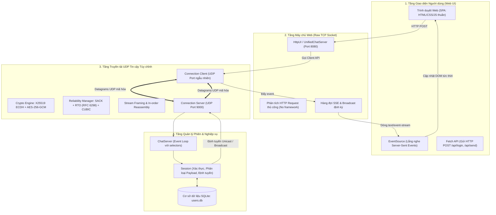
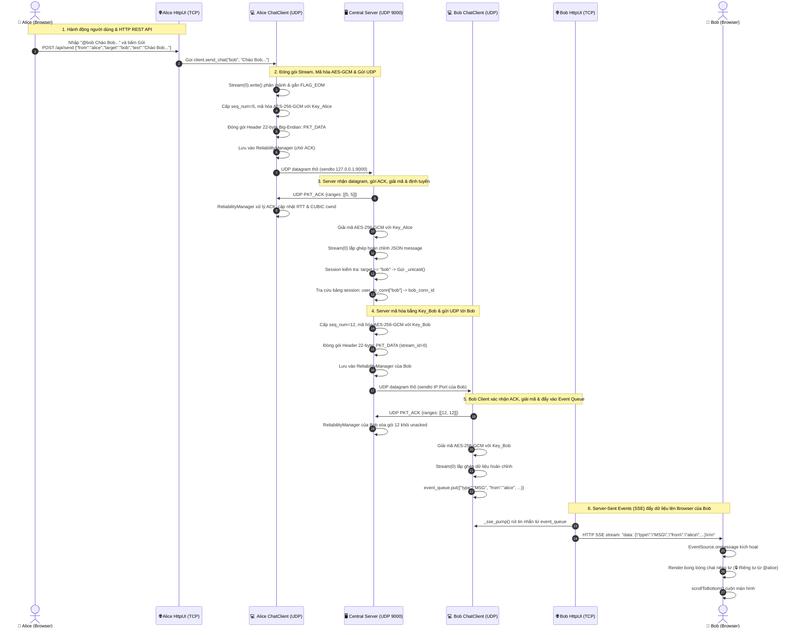

# StreamChat — Distributed Streaming Collaboration Application

Ứng dụng cộng tác Client-Server phân tán hỗ trợ chat thời gian thực và truyền file dựa trên giao thức truyền tải tùy chỉnh trên nền UDP (Selective ACK, kiểm soát tắc nghẽn CUBIC, trao đổi khóa X25519, mã hóa AES-GCM) kết hợp giao diện Web trực quan.

---

## Mục lục

1. [Tổng quan kiến trúc](#1-tổng-quan-kiến-trúc)
2. [Cấu trúc thư mục](#2-cấu-trúc-thư-mục)
3. [Yêu cầu môi trường & Cài đặt](#3-yêu-cầu-môi-trường--cài-đặt)
4. [Hướng dẫn khởi chạy](#4-hướng-dẫn-khởi-chạy)
5. [Tài khoản đăng nhập mẫu](#5-tài-khoản-đăng-nhập-mẫu)
6. [Hướng dẫn sử dụng & Kiểm thử tính năng](#6-hướng-dẫn-sử-dụng--kiểm-thử-tính-năng)
7. [Tham số dòng lệnh (CLI Parameters)](#7-tham-số-dòng-lệnh-cli-parameters)
8. [Cách dừng chương trình](#8-cách-dừng-chương-trình)
9. [Chi tiết giải thích tất cả các file và hàm trong hệ thống](#9-chi-tiết-giải-thích-tất-cả-các-file-và-hàm-trong-hệ-thống)
10. [Luồng hoạt động toàn hệ thống & Phân tích ví dụ chi tiết (Alice gửi tin nhắn cho Bob)](#10-luồng-hoạt-động-toàn-hệ-thống--phân-tích-ví-dụ-chi-tiết-alice-gửi-tin-nhắn-cho-bob)

---

## 1. Tổng quan kiến trúc

Hệ thống hoạt động theo mô hình Client-Server phân tán với 2 thành phần chính:

- **Server trung tâm (`run_server.py`)**:
  - Lắng nghe qua giao thức UDP (mặc định tại `127.0.0.1:9000`).
  - Quản lý phiên (`Session`), điều phối kết nối non-blocking với `selectors`.
  - Thực hiện bắt tay bảo mật (Handshake trao đổi khóa X25519 Diffie-Hellman), mã hóa/giải mã AES-GCM 256-bit.
  - Chuyển tiếp tin nhắn phòng chung (Broadcast) và tin nhắn riêng tư (Unicast).
- **Client (`run_client.py`)**:
  - Giao tiếp dữ liệu UDP bảo mật hai chiều với Server.
  - Tích hợp sẵn một máy chủ HTTP nội bộ (mặc định tại cổng `8080`) phục vụ giao diện người dùng (HTML/CSS/JavaScript thuần) và cập nhật dữ liệu thời gian thực thông qua Server-Sent Events (SSE).

---

## 2. Cấu trúc thư mục

```text
ComputerNetwork_BTL_1/
├── Config/                   # Cấu hình báo cáo LaTeX
├── Content/                  # Nội dung báo cáo LaTeX
├── src/
│   ├── client/               # Mã nguồn Client & HTTP Web UI Server
│   │   ├── static/           # Giao diện Web (index.html, style.css, app.js)
│   │   ├── client.py         # Quản lý kết nối Client UDP
│   │   └── http_ui.py        # Web Server phục vụ UI & SSE events
│   ├── common/               # Định nghĩa giao thức & tiện ích dùng chung
│   │   ├── constants.py      # Định dạng packet header, cờ, cổng mặc định
│   │   ├── crypto.py         # Hàm mã hóa X25519 & AES-GCM
│   │   └── packet.py         # Đóng gói và giải gói tin
│   ├── server/               # Mã nguồn Server trung tâm
│   │   ├── server.py         # Event loop xử lý datagram UDP
│   │   └── session.py        # Quản lý phiên làm việc, xác thực, chuyển tiếp tin
│   └── transport/            # Tầng truyền tải tin cậy tùy chỉnh trên UDP
│       ├── connection.py     # Quản lý vòng đời kết nối, handshake, keepalive
│       ├── reliability.py    # Selective ACK, CUBIC congestion control, RTO
│       └── stream.py         # Ghép nối stream dữ liệu tuần tự
├── requirements.txt          # Danh sách thư viện phụ thuộc
├── run_server.py             # Script khởi chạy Server
├── run_client.py             # Script khởi chạy Client
├── run_all.py                # Script khởi chạy toàn bộ hệ thống (Server + Clients)
├── run_all.bat               # File khởi chạy nhanh 1-click trên Windows
└── README.md                 # Tài liệu hướng dẫn sử dụng
```

---

## 3. Yêu cầu môi trường & Cài đặt

- **Python**: Phiên bản `3.8` trở lên (đã kiểm thử tương thích với Python 3.10 - 3.14).
- **Hệ điều hành**: Windows, Linux, macOS.

Cài đặt các thư viện cần thiết bằng lệnh:

```bash
pip install -r requirements.txt
```

*(Yêu cầu thư viện: `cryptography>=41.0.0`)*

---

## 4. Hướng dẫn khởi chạy

### Cách 1: Khởi chạy nhanh toàn bộ hệ thống bằng 1 lệnh duy nhất (Khuyên dùng)

Bạn có thể chạy toàn bộ hệ thống (1 Server trung tâm + 2 Client cho Alice và Bob + tự động mở trình duyệt web) bằng một tệp duy nhất:

```bash
python run_all.py
```

*Hoặc nhấp đúp trực tiếp vào file **`run_all.bat`** trên Windows.*
Nếu lệnh `python` trỏ đến một bản Python khác với bản bạn đã cài dependency, hãy dùng
`py -3 run_all.py` trên Windows để chọn bản Python 3 mặc định của Python Launcher.

> [!TIP]
> - Nhấn `Ctrl + C` tại cửa sổ Terminal để tự động dừng cả Server và tất cả Client cùng lúc.
> - Bạn có thể kiểm tra cú pháp toàn bộ code Python trong dự án bằng lệnh: `python run_all.py --check`

---

### Cách 2: Khởi chạy thủ công từng bước

Để kiểm thử tính năng cộng tác giữa 2 người dùng (ví dụ: `alice` và `bob`) qua các terminal riêng biệt, bạn mở **3 cửa sổ Terminal**:

#### Bước 1: Khởi động Server trung tâm (Terminal 1)

```bash
python run_server.py
```

*Dấu hiệu thành công:*
```text
===========================================
  StreamChat Server
  Lang nghe tai 127.0.0.1:9000 (UDP)
===========================================
[SERVER] INFO Server đang lắng nghe tại 127.0.0.1:9000 (UDP)
```

---

#### Bước 2: Truy cập Web UI & WebSocket trên cổng 8080 (Mở các Client)

Hệ thống hoạt động theo kiến trúc Client-Server chuẩn: chỉ cần **1 địa chỉ duy nhất** `http://127.0.0.1:8080` (hoặc IP máy chủ trong mạng LAN). Mỗi tab trình duyệt tạo một kết nối WebSocket độc lập, cho phép mở hàng trăm tài khoản khác nhau cùng lúc.

- Mở tab trình duyệt 1: [http://127.0.0.1:8080](http://127.0.0.1:8080) -> Đăng nhập tài khoản `alice` / `password123`.
- Mở tab trình duyệt 2 (hoặc từ máy khác trong LAN): [http://127.0.0.1:8080](http://127.0.0.1:8080) -> Đăng nhập tài khoản `bob` / `secret456`.
- Mở tab trình duyệt 3: [http://127.0.0.1:8080](http://127.0.0.1:8080) -> Đăng nhập `charlie`, `demo`, hoặc `user1`..`user50`.

*(Hoặc dùng lệnh `python run_client.py` để tự động mở thêm tab trình duyệt).*

---

## 5. Tài khoản đăng nhập mẫu

Hệ thống tích hợp sẵn các tài khoản thử nghiệm sau:

| Tên đăng nhập (Username) | Mật khẩu (Password) | Ghi chú |
| :--- | :--- | :--- |
| `alice` | `password123` | Người dùng 1 |
| `bob` | `secret456` | Người dùng 2 |
| `charlie` | `hello789` | Người dùng 3 |
| `demo` | `demo` | Tài khoản test nhanh |

---

## 6. Hướng dẫn sử dụng & Kiểm thử tính năng

### 6.1. Đăng nhập
- Tại Tab 1 `http://127.0.0.1:8080`: Nhập username `alice` và mật khẩu `password123` rồi bấm **Đăng nhập**.
- Tại Tab 2 `http://127.0.0.1:8080`: Nhập username `bob` và mật khẩu `secret456` rồi bấm **Đăng nhập**.
- Trình duyệt sẽ tự động kết nối WebSocket (`ws://127.0.0.1:8080/ws`), xác thực tức thời qua cơ sở dữ liệu SQLite và hiển thị trạng thái trực tuyến của các người dùng trên thanh sidebar.

### 6.2. Chat phòng chung (Broadcast)
- Nhập bất kỳ nội dung nào vào ô chat bên dưới và nhấn **Enter** hoặc bấm nút **Gửi**.
- Toàn bộ các client đang trực tuyến sẽ nhận được tin nhắn tức thời kèm theo tên người gửi và thời gian gửi.

### 6.3. Chat riêng tư (Unicast)
- Nhắn tin riêng cho một người cụ thể bằng cú pháp tiền tố `@<username>`:
  ```text
  @bob Chào Bob, mình là Alice đây!
  ```
- Tin nhắn này chỉ được gửi tới đúng tài khoản `bob`, các client khác sẽ không thấy nội dung này.

### 6.4. Gửi file (File Transfer)
1. Bấm vào biểu tượng kẹp ghim `📎` ở góc trên bên phải khung chat.
2. Hộp thoại gửi file mở ra:
   - **Đường dẫn file**: Nhập đường dẫn tuyệt đối đến file trên máy (ví dụ: `C:\ComputerNetwork\Assignment1\ComputerNetwork_BTL_1\requirements.txt`).
   - **Gửi đến**: Nhập `all` (gửi cho tất cả) hoặc nhập username cụ thể (ví dụ: `bob`).
3. Bấm **Gửi** để bắt đầu truyền stream file qua UDP có đảm bảo tin cậy. Thanh tiến trình truyền file sẽ được hiển thị trên thanh công cụ bên trái.

---

## 7. Tham số dòng lệnh (CLI Parameters)

### Server (`run_server.py`)
```bash
python run_server.py [-h] [--host HOST] [--port PORT]
```
- `--host`: Địa chỉ IP lắng nghe (mặc định: `127.0.0.1`).
- `--port`: Cổng UDP lắng nghe (mặc định: `9000`).

### Client (`run_client.py`)
```bash
python run_client.py [-h] [--server-ip SERVER_IP] [--server-port SERVER_PORT] [--http-port HTTP_PORT]
```
- `--server-ip`: Địa chỉ IP của Server (mặc định: `127.0.0.1`).
- `--server-port`: Cổng UDP của Server (mặc định: `9000`).
- `--http-port`: Cổng Web UI cục bộ trên trình duyệt (mặc định: `8080`).

---

## 8. Cách dừng chương trình

Để dừng Server hoặc Client, chuyển đến cửa sổ Terminal tương ứng và bấm tổ hợp phím:

```text
Ctrl + C
```

Client và Server sẽ tiến hành giải phóng tài nguyên, đóng socket và ngắt kết nối an toàn.

---

## 9. Chi tiết giải thích tất cả các file và hàm trong hệ thống

Phần này cung cấp bản tài liệu kỹ thuật chi tiết về cấu trúc mã nguồn, vai trò của từng tệp tin và mô tả chức năng của toàn bộ các hàm/phương thức trong dự án.

---

### 9.1. Bộ điều phối & Biên dịch kiểm tra toàn hệ thống

#### 📄 `run_all.py`
Tệp trung tâm quản lý vòng đời toàn bộ hệ thống StreamChat. Đảm nhận việc tự động hóa kiểm tra môi trường, khởi chạy song song Server UDP và nhiều Client Web UI, tự động mở trình duyệt và tích hợp chức năng biên dịch kiểm tra tính toàn vẹn cú pháp của toàn bộ dự án.

- **`check_all_python_files() -> bool`**:
  - *Chức năng*: Quét toàn bộ cây thư mục dự án (`.` và `src/`), tìm kiếm tất cả các tệp `.py`.
  - *Cơ chế*: Sử dụng module `py_compile` của Python để biên dịch kiểm tra lỗi cú pháp (syntax validation) từng file mà không cần chạy chương trình thực tế.
  - *Giá trị trả về*: `True` nếu 100% các file đều hợp lệ, `False` nếu phát hiện bất kỳ file nào có lỗi cú pháp.
- **`check_dependencies() -> None`**:
  - *Chức năng*: Kiểm tra xem thư viện bắt buộc `cryptography` đã được cài đặt trong môi trường hiện tại hay chưa.
  - *Cơ chế*: Thử nghiệm lệnh import; nếu phát sinh `ImportError`, hàm sẽ tự động gọi lệnh `pip install -r requirements.txt` để cài đặt tự động cho người dùng.
- **`cleanup_processes() -> None`**:
  - *Chức năng*: Thu dọn và giải phóng toàn bộ tài nguyên khi chương trình dừng lại.
  - *Cơ chế*: Duyệt qua danh sách `child_processes`, gửi tín hiệu ngắt `proc.terminate()` tới Server và tất cả các Client con. Sau một khoảng chờ ngắn, nếu tiến trình nào chưa kịp dừng sẽ dùng `proc.kill()` để chấm dứt dứt điểm, ngăn chặn hiện tượng zombie process hoặc chiếm dụng cổng mạng trên hệ điều hành.
- **`handle_exit(signum, frame) -> None`**:
  - *Chức năng*: Trình xử lý tín hiệu hệ thống (Signal Handler) khi người dùng nhấn `Ctrl + C` (`SIGINT`) hoặc khi nhận tín hiệu đóng `SIGTERM`.
  - *Cơ chế*: Kích hoạt `cleanup_processes()` rồi gọi `sys.exit(0)`.
- **`main() -> None`**:
  - *Chức năng*: Điểm vào (entry point) của script điều phối.
  - *Cơ chế*: Phân tích các cờ dòng lệnh CLI (`--clients`, `--server-port`, `--start-http-port`, `--no-browser`, `--check`). Nếu có cờ `--check`, thực hiện kiểm tra mã nguồn rồi thoát; nếu không, lần lượt khởi chạy Server tiến trình nền, chờ socket sẵn sàng, tiếp tục khởi chạy các Client Web UI tương ứng, mở tự động các tab trình duyệt web bằng `webbrowser.open()`, và duy trì vòng lặp giám sát sức khỏe của các tiến trình con.

#### 📄 `run_all.bat`
Tệp thực thi script dạng Batch dành riêng cho môi trường Microsoft Windows.
- *Chức năng*: Giúp người dùng khởi động nhanh toàn bộ hệ thống bằng thao tác 1-click (nhấp đúp chuột).
- *Cơ chế*: Tự động chuyển đổi bảng mã console sang UTF-8 (`chcp 65001`), hiển thị banner thông báo, chuyển tiếp toàn bộ tham số dòng lệnh sang `python run_all.py %*` và giữ cửa sổ dòng lệnh bằng lệnh `pause` nếu tiến trình kết thúc.

---

### 9.2. Scripts khởi chạy thành phần độc lập

#### 📄 `run_server.py`
Điểm vào độc lập dành cho Máy chủ trung tâm (UDP Server).
- **`main() -> None`**:
  - Cấu hình mã hóa hiển thị UTF-8 trên Windows console.
  - Thiết lập thư viện phân tích cú pháp dòng lệnh `argparse` với các tham số cấu hình: `--host` (mặc định: `127.0.0.1`) và `--port` (mặc định: `9000`).
  - Khởi tạo thực thể `server = ChatServer()` và bắt đầu lắng nghe với `server.start_server(host, port)`.
  - Bắt ngoại lệ `KeyboardInterrupt` để tắt máy chủ an toàn.

#### 📄 `run_client.py`
Điểm vào độc lập dành cho Máy khách (UDP Client kết hợp Web UI Server).
- **`main() -> None`**:
  - Phân tích các tham số cấu hình CLI: `--server-ip`, `--server-port` (địa chỉ Server đích), và `--http-port` (cổng HTTP Web UI nội bộ).
  - Khởi tạo đối tượng giao tiếp mạng `client = ChatClient(server_ip, server_port)`.
  - Khởi tạo máy chủ web `http_ui = HttpUI(port=args.http_port, client=client)`.
  - Khởi động HTTP UI bằng `http_ui.start()`.
  - Khi người dùng nhấn `Ctrl + C`, tự động thực hiện quy trình dọn dẹp: gọi `http_ui.stop()` đóng máy chủ HTTP và `client.disconnect()` giải phóng socket UDP.

---

### 9.3. Tầng giao thức & Tiện ích chung (`src/common/`)

#### 📄 `src/common/constants.py`
Định nghĩa tập trung toàn bộ các hằng số kỹ thuật của giao thức truyền tải tùy chỉnh trên nền UDP:
- **Magic Number**: `PROTOCOL_MAGIC = b"\xDE\xAD\xBE\xEF"` (4 bytes nhận diện).
- **Loại gói tin (Packet Types - 1 byte uint8)**:
  - `PKT_HELLO` (`0x01`): Client khởi tạo quá trình bắt tay trao đổi khóa.
  - `PKT_HELLO_ACK` (`0x02`): Server phản hồi bắt tay kèm khóa công khai của server.
  - `PKT_DATA` (`0x03`): Gói tin mang dữ liệu ứng dụng (chat, file, RPC).
  - `PKT_ACK` (`0x04`): Gói tin xác nhận Selective ACK.
  - `PKT_HEARTBEAT` (`0x05`) & `PKT_HEARTBEAT_ACK` (`0x06`): Duy trì và kiểm tra trạng thái sống của kết nối.
  - `PKT_CLOSE` (`0x07`): Thông báo kết thúc phiên kết nối.
  - `PKT_AUTH_REQ` (`0x08`) & `PKT_AUTH_RESP` (`0x09`): Yêu cầu và phản hồi xác thực.
- **Cờ điều khiển (Flags Bitmask - 1 byte uint8)**:
  - `FLAG_NONE` (`0x00`): Không bật cờ.
  - `FLAG_EOM` (`0x01`): Đánh dấu chunk cuối cùng của một bản tin ứng dụng (End of Message).
  - `FLAG_FIN` (`0x02`): Đánh dấu kết thúc một luồng Stream.
  - `FLAG_SYN` (`0x04`): Đánh dấu khởi tạo luồng Stream.
  - `FLAG_ENCRYPTED` (`0x08`): Đánh dấu Payload đã được mã hóa bằng AES-256-GCM.
- **Quy chuẩn Header nhị phân (22 bytes, Big-Endian)**:
  - Cấu trúc format: `!BIIBHIHI` tương ứng: `msg_type` (1B), `conn_id` (4B), `seq_num` (4B), `flags` (1B), `stream_id` (2B), `offset` (4B), `payload_len` (2B), `reserved` (4B).
- **Kích thước gói & MTU**:
  - `MAX_UDP_PAYLOAD = 1400` bytes (giới hạn an toàn chống phân mảnh IP).
  - `MAX_APP_PAYLOAD = 1378` bytes (sau khi trừ 22 bytes header).
  - `RECV_BUFFER_SIZE = 65535` bytes.
- **Thời gian & Timeout**:
  - `INITIAL_RTO = 1.0`s, `MIN_RTO = 0.2`s, `MAX_RTO = 10.0`s.
  - `HEARTBEAT_INTERVAL = 5.0`s, `IDLE_TIMEOUT = 30.0`s, `TICK_INTERVAL = 0.05`s (50ms).
- **Thuật toán tắc nghẽn CUBIC**:
  - `CUBIC_C = 0.4`, `CUBIC_BETA = 0.7`, `INITIAL_CWND = 10`, `MIN_CWND = 2`, `MAX_CWND = 1024`, `SSTHRESH_INITIAL = 64`.
- **Mật mã học**:
  - `AES_KEY_SIZE = 32` bytes (AES-256), `GCM_NONCE_SIZE = 12` bytes (96-bit), `GCM_TAG_SIZE = 16` bytes.

#### 📄 `src/common/crypto.py`
Cung cấp các phép toán mật mã học bảo mật tầng truyền tải:
- **`generate_keypair() -> tuple[X25519PrivateKey, bytes]`**:
  - Sinh cặp khóa bất đối xứng trên đường cong Elliptic Curve25519 (X25519) dùng cho quá trình trao đổi khóa Diffie-Hellman.
  - Trả về tuple chứa đối tượng khóa riêng `X25519PrivateKey` và mảng 32 bytes của khóa công khai.
- **`derive_shared_secret(private_key: X25519PrivateKey, peer_public_bytes: bytes) -> bytes`**:
  - Thực hiện phép nhân điểm ECDH giữa khóa riêng của endpoint hiện tại với khóa công khai của bên đối tác để tìm điểm bí mật chung.
  - Dùng thuật toán HKDF (HMAC-based Extract-and-Expand Key Derivation Function) với hàm băm SHA-256 để trích xuất ra một khóa phiên đối xứng AES-256 (32 bytes) duy nhất.
- **`encrypt(payload: bytes, session_key: bytes, packet_num: int) -> bytes`**:
  - Mã hóa dữ liệu ứng dụng bằng thuật toán AES-256-GCM (Authenticated Encryption with Associated Data).
  - Sử dụng số thứ tự gói tin (`packet_num`) được chuyển đổi thành chuỗi 12 bytes Big-Endian để làm Nonce duy nhất cho từng gói tin (chống tấn công lặp lại - Replay Attack).
  - Trả về chuỗi bytes gồm `ciphertext` gắn kèm 16 bytes Authentication Tag.
- **`decrypt(ciphertext: bytes, session_key: bytes, packet_num: int) -> bytes`**:
  - Tái tạo Nonce 12-byte từ `packet_num` và thực hiện xác thực tính toàn vẹn cùng giải mã bằng AES-GCM.
  - Trả về dữ liệu gốc (plaintext). Bắn ngoại lệ `InvalidTag` nếu gói tin bị giả mạo hoặc sai lệch trên đường truyền.

#### 📄 `src/common/packet.py`
Chịu trách nhiệm tuần tự hóa (serialization) và giải tuần tự hóa (deserialization) cấu trúc Header nhị phân 22-byte:
- **Lớp `Header(NamedTuple)`**:
  - Biểu diễn cấu trúc 8 trường thông tin metadata của gói tin: `msg_type`, `conn_id`, `seq_num`, `flags`, `stream_id`, `offset`, `payload_len`, `reserved`.
- **`pack(msg_type, conn_id, seq_num, flags, stream_id, offset, payload) -> bytes`**:
  - Tính toán độ dài `payload_len`, sử dụng hàm `struct.pack("!BIIBHIHI", ...)` để đóng gói chính xác 22 bytes header theo thứ tự mạng (Network Byte Order - Big Endian), sau đó nối liền với mảng bytes của `payload`.
- **`unpack(raw_bytes: bytes) -> tuple[Header, bytes]`**:
  - Kiểm tra độ dài tối thiểu $\ge 22$ bytes. Bóc tách 22 bytes đầu tiên thành thực thể `Header`, trích xuất phần `payload` còn lại dựa trên trường `payload_len`, trả về bộ dữ liệu `(header, payload)`.

---

### 9.4. Tầng truyền tải tin cậy tùy chỉnh trên UDP (`src/transport/`)

#### 📄 `src/transport/connection.py`
Mô phỏng một kết nối logic hướng kết nối, có trạng thái (Stateful) trên nền giao thức UDP phi trạng thái (Stateless).

- **Lớp `Connection`**:
  - **`__init__(sock, remote_addr, conn_id=0, is_server=False, on_app_message=None)`**: Khởi tạo kết nối với socket UDP đã bind, địa chỉ bên nhận `remote_addr`, sinh mã định danh kết nối `conn_id`, khởi tạo các luồng stream, đối tượng `ReliabilityManager` và các khóa mật mã.
  - **`_alloc_seq() -> int`**: Cấp phát số thứ tự gói tin kế tiếp (`seq_num`) đảm bảo an toàn đơn luồng/đa luồng nhờ `threading.Lock`.
  - **`get_or_create_stream(stream_id: int) -> Stream`**: Tìm kiếm hoặc tạo mới đối tượng `Stream` tương ứng với mã định danh luồng `stream_id`.
  - **`allocate_stream() -> Stream`**: Cấp phát tự động một luồng mới với ID duy nhất (phía Client sử dụng các ID số lẻ $1, 3, 5...$, phía Server dùng các số chẵn $2, 4, 6...$ để tránh xung đột).
  - **`_stream_send_callback(stream_id, offset, chunk, flags)`**: Hàm callback nội bộ được đối tượng Stream kích hoạt khi có một đoạn dữ liệu (chunk) cần gửi ra mạng; chuyển tiếp dữ liệu này thành gói tin `PKT_DATA`.
  - **`send_packet(packet_type, stream_id, payload, flags=FLAG_NONE, offset=0)`**: Cấp phát `seq_num`, thực hiện mã hóa AES-GCM (nếu gói là `PKT_DATA` và đã hoàn tất bắt tay), gắn cờ `FLAG_ENCRYPTED`, đóng gói qua `packet.pack()`, lưu vào bộ đệm của `ReliabilityManager` (để theo dõi ACK và truyền lại) và gửi trực tiếp qua socket.
  - **`_raw_send(data: bytes)`**: Thực hiện lệnh `self.sock.sendto(data, self.remote_addr)` để gửi các byte dữ liệu thô ra mạng qua socket UDP.
  - **`receive_packet(raw_bytes: bytes)`**: Tiếp nhận dữ liệu UDP thô, cập nhật mốc thời gian nhận cuối (`_last_recv_time`), giải mã header và chuyển tiếp xử lý tùy theo `msg_type`:
    - Gói `PKT_ACK` $\to$ chuyển cho `_handle_ack()`.
    - Gói `PKT_DATA` $\to$ chuyển cho `_handle_data()`.
    - Gói `PKT_HELLO` $\to$ chuyển cho `_handle_hello()`.
    - Gói `PKT_HELLO_ACK` $\to$ chuyển cho `_handle_hello_ack()`.
    - Gói `PKT_HEARTBEAT` $\to$ gọi `_send_heartbeat_ack()`.
  - **`_handle_ack(payload: bytes)`**: Phân tích dữ liệu JSON chứa danh sách các dải xác nhận `ranges` từ đối phương và chuyển cho `reliability.process_sack()` để xóa các gói tin đã đến đích an toàn.
  - **`_handle_data(header: packet.Header, payload: bytes)`**: Gửi phản hồi xác nhận ngay lập tức qua `_send_ack(header.seq_num)`. Nếu dữ liệu được đánh dấu mã hóa, thực hiện giải mã bằng khóa phiên. Sau đó chuyển chunk dữ liệu kèm offset và cờ `FLAG_EOM` vào `Stream` tương ứng. Nếu `Stream` đã thu thập đủ toàn bộ tin nhắn, hàm gọi tiếp callback `on_app_message`.
  - **`_send_ack(seq_num: int)`**: Đóng gói số thứ tự `seq_num` vào dải SACK dưới dạng JSON và gửi gói `PKT_ACK` về phía bên gửi.
  - **`handle_handshake()`**: Khởi tạo tiến trình bắt tay từ phía Client: sinh cặp khóa X25519 và gửi gói `PKT_HELLO` chứa public key sang Server.
  - **`_handle_hello(header, payload)`**: Phía Server xử lý yêu cầu bắt tay: đọc public key của Client, sinh cặp khóa X25519 của Server, dẫn xuất khóa phiên chung qua ECDH + HKDF, gửi gói phản hồi `PKT_HELLO_ACK` chứa public key của Server và bật cờ `handshake_complete`.
  - **`_handle_hello_ack(header, payload)`**: Phía Client xử lý phản hồi bắt tay: đọc public key của Server, hoàn tất tính toán khóa phiên AES-256 và kích hoạt sự kiện `handshake_complete.set()`.
  - **`_send_heartbeat()`**: Gửi gói tin `PKT_HEARTBEAT` để kiểm tra độ trễ và giữ cho kết nối không bị ngắt quãng.
  - **`_send_heartbeat_ack()`**: Phản hồi gói `PKT_HEARTBEAT_ACK` khi nhận được heartbeat từ đối tác.
  - **`tick()`**: Hàm tuần hoàn được vòng lặp điều phối gọi định kỳ (50ms):
    - Đóng kết nối nếu thời gian im lặng vượt quá `IDLE_TIMEOUT` (30 giây).
    - Tự động kích hoạt gửi `PKT_HEARTBEAT` nếu quá `HEARTBEAT_INTERVAL` (5 giây) chưa có trao đổi.
    - Quét bộ đệm `reliability.get_retransmits()` để lấy danh sách các gói tin bị quá thời gian chờ (RTO timeout) và truyền lại ngay lập tức.

#### 📄 `src/transport/reliability.py`
Triển khai cơ chế Sliding Window, đo đạc thời gian khứ hồi RTT theo RFC 6298 và thuật toán kiểm soát tắc nghẽn CUBIC.

- **Lớp nội bộ `_InFlightPacket`**:
  - Dataclass đại diện cho một gói tin đang trên đường bay (chờ ACK): lưu số hiệu `packet_num`, nội dung `raw_data`, thời điểm gửi `sent_time` và số lần đã truyền lại `retransmit_count`.
- **Lớp `ReliabilityManager`**:
  - **`__init__()`**: Thiết lập các giá trị ban đầu cho cửa sổ tắc nghẽn `cwnd`, ngưỡng slow-start `ssthresh`, các biến đo RTT (`srtt`, `rttvar`, `rto`), và từ điển lưu các gói đang chờ ACK `_unacked`.
  - **`mark_sent(packet_num: int, packet_data: bytes)`**: Ghi nhận gói tin mới gửi vào `_unacked` cùng mốc thời gian `monotonic()` hiện tại.
  - **`process_sack(ack_ranges: list[tuple[int, int]])`**: Tiếp nhận dải số thứ tự Selective ACK, loại bỏ các gói tin đã được bên nhận xác nhận thành công. Đối với các gói chưa từng bị truyền lại, tính toán mẫu độ trễ `sample_rtt = time.monotonic() - pkt.sent_time` và gọi `update_rtt(sample_rtt)`. Sau đó gọi `update_cwnd(is_loss=False)`.
  - **`get_retransmits() -> list[bytes]`**: So sánh thời gian tồn tại của từng gói tin trong `_unacked` với giá trị timeout `rto`. Nếu vượt quá RTO, đưa gói vào danh sách truyền lại, cập nhật thời gian gửi mới, tăng biến đếm `retransmit_count` và gọi `update_cwnd(is_loss=True)` để báo hiệu tắc nghẽn mạng.
  - **`update_rtt(sample_rtt: float)`**: Cập nhật giá trị RTT theo chuẩn **RFC 6298**:
    - Độ trễ trơn: $SRTT = (1 - \alpha) \times SRTT + \alpha \times sample\_rtt$ ($\alpha = 0.125$).
    - Độ biến thiên: $RTTVAR = (1 - \beta) \times RTTVAR + \beta \times |SRTT - sample\_rtt|$ ($\beta = 0.25$).
    - Hạn định thời gian: $RTO = SRTT + \max(G, 4 \times RTTVAR)$, kẹp trong dải $[MIN\_RTO, MAX\_RTO]$.
  - **`update_cwnd(is_loss: bool)`**: Cập nhật kích thước cửa sổ tắc nghẽn:
    - *Khi mất gói (`is_loss=True`)*: Lưu $W_{max} = cwnd$, giảm ngưỡng $ssthresh = \max(cwnd \times \beta_{cubic}, MIN\_CWND)$, đưa $cwnd$ về $ssthresh$ và đặt lại mốc thời gian chu kỳ CUBIC.
    - *Khi trong pha Khởi động chậm (Slow-start, $cwnd < ssthresh$)*: Tăng tuyến tính $cwnd += 1.0$ cho mỗi ACK hợp lệ.
    - *Khi trong pha Tránh tắc nghẽn (Congestion Avoidance)*: Điều chỉnh $cwnd$ theo đường cong hàm bậc ba $W_{cubic}(t) = C(t - K)^3 + W_{max}$, trong đó $K = \sqrt[3]{(W_{max} - cwnd) / C}$.
  - **`can_send() -> bool`**: Kiểm tra điều kiện truyền tin: trả về `True` nếu số gói tin đang bay (`in_flight`) nhỏ hơn cửa sổ `cwnd`.
  - **Thuộc tính `in_flight`**: Trả về số lượng gói tin hiện đang chờ ACK.

#### 📄 `src/transport/stream.py`
Hiện thực hóa việc phân mảnh dữ liệu (Framing) và sắp xếp tái lắp ghép dòng byte (Reassembly) theo thứ tự offset cho từng luồng dữ liệu độc lập.

- **Lớp `Stream`**:
  - **`__init__(stream_id: int, send_callback=None)`**: Khởi tạo luồng logic với con trỏ offset ghi dữ liệu `_write_offset`, bộ đệm chứa các chunk nhận `_recv_buffer`, offset mong đợi kế tiếp `_expected_offset` và offset kết thúc bản tin `_eom_offset`.
  - **`write(data: bytes) -> int`**: Phân chia mảng byte lớn thành các chunk nhỏ có kích thước tối đa không vượt quá `MAX_APP_PAYLOAD` (1378 bytes), gán offset tăng dần tương ứng với vị trí trong luồng, gắn cờ `FLAG_EOM` cho chunk cuối cùng, và gọi `send_callback` để đẩy dữ liệu xuống tầng kết nối.
  - **`read_incoming(offset: int, data: bytes, is_eom: bool) -> Optional[bytes]`**: Tiếp nhận chunk dữ liệu kèm vị trí `offset` và cất vào bộ đệm `_recv_buffer`. Nếu có cờ `is_eom`, ghi nhận tổng độ dài dự kiến của message. Sau đó kích hoạt hàm `_try_assemble()` để thử ghép nối dữ liệu.
  - **`_try_assemble() -> Optional[bytes]`**: Quét qua các mảnh dữ liệu trong `_recv_buffer` theo thứ tự `offset` tăng dần từ vị trí `_expected_offset`. Nếu dữ liệu liên tục không bị lỗ hổng (không khuyết gói tin nào) đến điểm kết thúc EOM, nối các chuỗi byte lại thành bản tin hoàn chỉnh, dọn dẹp bộ đệm và trả về; nếu còn thiếu mảnh dữ liệu nào, trả về `None` để chờ thêm.
  - **`get_complete_messages() -> list[bytes]`**: Lấy ra toàn bộ danh sách các bản tin đã được lắp ráp hoàn chỉnh và xóa sạch bộ đệm hàng đợi bản tin.

---

### 9.5. Tầng Server trung tâm (`src/server/`)

#### 📄 `src/server/server.py`
Bộ điều phối I/O bất đồng bộ non-blocking dựa trên `selectors` xử lý tất cả các datagram UDP tại cổng trung tâm.

- **Lớp `ChatServer`**:
  - **`__init__()`**: Khởi tạo bảng ánh xạ session: `_sessions` (lưu theo `conn_id`), `_addr_to_conn` (ánh xạ IP/Port sang `conn_id`), `_user_to_conn` (ánh xạ username sang `conn_id`).
  - **`start_server(host, port)`**: Mở socket UDP non-blocking, bind vào IP/Port chỉ định, đăng ký với `selectors.DefaultSelector()` để giám sát sự kiện đọc, khởi chạy luồng nền `_tick_loop()` và bước vào event loop chính để tiếp nhận gói tin.
  - **`_read_datagrams()`**: Đọc vét cạn toàn bộ các datagram đang có trong hàng đợi của socket bằng vòng lặp `recvfrom()` cho đến khi nhận tín hiệu `BlockingIOError`.
  - **`handle_datagram(data: bytes, addr: tuple[str, int])`**: Trích xuất `conn_id` từ header của datagram. Khi client đổi địa chỉ, chỉ cập nhật `remote_addr` sau khi một gói DATA mã hóa có AAD hợp lệ được xác minh bằng khóa phiên; địa chỉ đang được ánh xạ sang kết nối khác sẽ bị từ chối. Mapping địa chỉ cũ chỉ bị xóa nếu vẫn trỏ tới chính session này.
  - **`_create_session(conn_id, addr)`**: Tạo mới cặp đối tượng `Connection` và `Session`, liên kết các callback xử lý ứng dụng, broadcast/unicast, đăng nhập và đăng xuất.
  - **`_on_auth_success(conn_id, username)`**: Áp dụng chính sách một tài khoản chỉ có một session; lần đăng nhập thành công mới nhất sẽ kick session cũ.
  - **`_on_auth_logout(conn_id, username)`**: Xóa ánh xạ user nếu còn thuộc session hiện tại và cập nhật thông báo/danh sách user trực tuyến.
  - **`_on_app_message(conn_id, stream_id, data)`**: Chuyển dữ liệu Stream 0 tới `session.process_payload(data)`; dữ liệu trên stream khác chỉ được xử lý như chunk file sau khi metadata stream đã được xác thực.
  - **`_broadcast(sender: str, msg: dict, exclude: Optional[str]=None)`**: Mã hóa bản tin JSON và ghi vào Stream 0 của tất cả các phiên client đã xác thực thành công (trừ người gửi trong `exclude`).
  - **`_unicast(sender: str, target_username: str, msg: dict) -> bool`**: Tra cứu `conn_id` của người nhận thông qua `_user_to_conn`, xác minh session vẫn đăng nhập đúng username đích rồi mới gửi JSON vào Stream 0. Trả về `False` nếu người nhận offline, không tồn tại hoặc mapping không còn hợp lệ.
  - **`_tick_loop()`**: Vòng lặp chạy ngầm định kỳ mỗi 50ms, duyệt qua tất cả session để gọi `connection.tick()`. Nếu phát hiện session nào bị đánh dấu đã đóng (`connection.closed`), tiến hành xóa bỏ khỏi hệ thống.
  - **`_cleanup()`**: Đóng selector và UDP socket giải phóng tài nguyên hệ thống.
  - **`main()`**: Hàm khởi động trực tiếp cho Server.

#### 📄 `src/server/session.py`
Xử lý logic nghiệp vụ ứng dụng: xác thực tài khoản, kiểm soát quyền truy cập, định tuyến tin nhắn trò chuyện và thông báo truyền tệp.

- **Cơ sở dữ liệu người dùng**: Xác thực qua SQLite `users.db`; client và server cùng dùng SHA-256 dạng chuỗi hex. Username được chuẩn hóa thành chữ thường.
- **Lớp `Session`**:
  - **`__init__(conn_id, client_addr, connection, broadcast_fn, unicast_fn)`**: Khởi tạo trạng thái phiên, lưu địa chỉ client, liên kết đối tượng `Connection`, đặt cờ `authenticated = False`.
  - **`process_payload(app_msg: bytes)`**: Phân giải chuỗi JSON của tầng ứng dụng và điều hướng dựa theo trường `type`:
    - `"AUTH"` $\to$ gọi `_process_auth()`.
    - `"MSG"` $\to$ gọi `_process_msg()`.
    - `"FILE"` $\to$ gọi `_process_file()`.
    - `"FILE_DATA"` $\to$ gọi `_process_file_data()`.
  - **`_process_auth(msg: dict)`**: Trích xuất username và password_hash, gọi `verify_auth()` kiểm tra. Trả về phản hồi `AUTH_RESP`. Nếu thành công, kích hoạt bản tin thông báo `SYSTEM` phát cho toàn bộ phòng chat.
  - **`verify_auth(username: str, password_hash: str) -> bool`**: So khớp hash SHA-256 với SQLite. Một session đã đăng nhập có thể xác thực lại chính tài khoản đó; muốn đổi tài khoản cần đăng xuất trước. Nếu tài khoản đăng nhập từ session khác, session mới nhất được giữ và session cũ bị kick.
  - **`_process_logout()`**: Xóa trạng thái xác thực của session và gọi server dọn ánh xạ username; kết nối UDP vẫn mở để đăng nhập lại.
  - **`_process_msg(msg: dict)`**: Kiểm tra quyền đăng nhập; nếu hợp lệ, tạo cấu trúc tin nhắn hoàn chỉnh kèm timestamp rồi gọi `route_broadcast` (nếu gửi tới `"all"`) hoặc `route_unicast` (nếu gửi tới username cụ thể).
  - **`_process_file(msg: dict)`**: Chỉ nhận từ session đã xác thực; kiểm tra target, tên file, kích thước, SHA-256, `stream_id` và URL tải xuống trước khi chuyển tiếp thông báo tới người nhận.
  - **`_process_file_data(msg: dict)`**: Chỉ nhận từ session đã xác thực; yêu cầu `stream_id`, offset không âm và chunk dữ liệu không rỗng trong giới hạn kích thước, sau đó áp dụng cùng quy tắc target broadcast/unicast như chat.
  - **`process_file_chunk(stream_id, data)`**: Định tuyến chunk nhị phân trên stream riêng chỉ khi có metadata hợp lệ cho stream đó; ngăn chunk vượt kích thước file đã khai báo và xóa trạng thái truyền khi đủ dữ liệu.
  - **`route_broadcast(msg: dict)`**: Chỉ cho session đã xác thực gọi broadcast; server gửi tới các session đang xác thực, ngoại trừ username người gửi.
  - **`route_unicast(target_username: str, msg: dict)`**: Chỉ cho session đã xác thực gửi riêng; nếu người nhận offline hoặc không tồn tại, trả gói `"ERROR"` rõ ràng về cho người gửi.
  - **`_send_app_message(msg: dict)`**: Tiện ích chuyển đổi dict thành JSON byte và ghi vào Stream 0 của kết nối.

---

### 9.6. Tầng Client & Giao diện Web UI (`src/client/`)

#### 📄 `src/client/client.py`
Máy khách UDP, quản lý việc kết nối đến máy chủ trung tâm, truyền nhận file đa luồng và tương tác với giao diện Web thông qua hàng đợi sự kiện.

- **Lớp `ChatClient`**:
  - **`__init__(server_ip, server_port)`**: Mở UDP socket non-blocking ngẫu nhiên trên máy khách, tạo đối tượng `Connection`, khởi tạo hàng đợi `event_queue` và từ điển theo dõi trạng thái truyền file `_file_transfers`.
  - **`connect(username: str, password: str) -> bool`**: Khởi động bắt tay bảo mật qua `_connection.handle_handshake()`, khởi chạy các thread chạy ngầm `poll_network` và `_tick_loop`, chờ hoàn tất trao đổi khóa (tối đa 5s), băm SHA-256 mật khẩu và gửi bản tin xác thực `AUTH` lên Server.
  - **`send_chat(target: str, text: str)`**: Đóng gói nội dung tin nhắn dạng JSON và gửi qua Stream 0.
  - **`start_file_transfer(file_path: str, target: str = "all") -> Optional[int]`**: Kiểm tra tệp tin trên ổ đĩa, tính toán mã băm SHA-256 của toàn bộ file, yêu cầu Connection cấp phát một `Stream ID` riêng biệt, gửi bản tin metadata `FILE` qua Stream 0, và khởi tạo một thread nền chạy hàm `_transfer_file_data()`.
  - **`_transfer_file_data(file_path, stream, target)`**: Luồng truyền dữ liệu tệp tin: đọc file theo từng khối 4096 bytes, ghi vào luồng bằng `stream.write()`, kiểm soát lưu lượng dựa trên phản hồi của cửa sổ tắc nghẽn (`reliability.can_send()`), cập nhật tiến độ phần trăm và đẩy sự kiện `FILE_COMPLETE` vào `event_queue`.
  - **`poll_network()`**: Vòng lặp chạy trong thread riêng liên tục đọc datagram từ UDP socket và chuyển trực tiếp cho `_connection.receive_packet(data)`.
  - **`_tick_loop()`**: Vòng lặp nền gọi `_connection.tick()` định kỳ mỗi 50ms và đẩy thông báo `DISCONNECTED` vào `event_queue` khi kết nối bị ngắt.
  - **`_on_app_message(stream_id: int, data: bytes)`**: Callback khi nhận được một message hoàn chỉnh từ Server: phân tích JSON, cập nhật cờ `_authenticated` (nếu là `AUTH_RESP`) và đẩy bản tin vào `event_queue` để giao diện Web hiển thị tức thời.
  - **`_send_json(msg: dict)`**: Tiện ích serialize dữ liệu JSON và ghi vào Stream 0.
  - **`get_file_progress() -> dict[int, dict]`**: Truy xuất thông tin tiến độ truyền file thời gian thực (tên file, dung lượng, số byte đã gửi, trạng thái).
  - **`logout()`**: Gửi yêu cầu `LOGOUT` tới server, giữ kết nối UDP để có thể đăng nhập lại.
  - **`disconnect()`**: Dừng các vòng lặp và đóng UDP socket.
  - **Thuộc tính `is_authenticated` & `username`**: Lấy trạng thái đăng nhập và tên tài khoản hiện hành.

#### 📄 `src/client/http_ui.py`
Máy chủ Web HTTP nội bộ được lập trình bằng **Raw TCP Socket** thuần túy (không sử dụng framework ngoài như Flask, Django hay FastAPI), phục vụ các tệp giao diện Web tĩnh, các REST API và cung cấp kênh truyền thời gian thực Server-Sent Events (SSE).

- **Lớp `HttpUI`**:
  - **`__init__(port=8080, client=None)`**: Thiết lập cổng kết nối TCP và liên kết với thể hiện `ChatClient`.
  - **`set_client(client: ChatClient)`**: Gán đối tượng `ChatClient` sau khi khởi tạo nếu cần.
  - **`start()`**: Tạo raw socket TCP (`AF_INET`, `SOCK_STREAM`), bind tại `127.0.0.1`, bắt đầu lắng nghe (`listen(16)`), khởi động luồng đẩy sự kiện `_sse_pump()`, và tiếp nhận các kết nối duyệt web bằng `accept()` trong các thread độc lập.
  - **`handle_http_request(client_socket: socket.socket)`**: Đọc chuỗi HTTP request thô từ socket, phân tách Request Line, phương thức (GET, POST), đường dẫn URI và phần thân body JSON, sau đó điều phối tới các hàm xử lý tương ứng:
    - `GET /` $\to$ gọi `_serve_static(client_socket, "index.html")`.
    - `GET /events` $\to$ gọi `_handle_sse(client_socket)` để mở kênh Server-Sent Events.
    - `GET /static/<path>` $\to$ trả về file tĩnh CSS, JS, hình ảnh.
    - `GET /api/status` $\to$ gọi `_handle_status()`.
    - `GET /api/progress` $\to$ gọi `_handle_progress()`.
    - `POST /api/login` $\to$ gọi `_handle_login()`.
    - `POST /api/logout` $\to$ gọi `_handle_logout()` và gửi yêu cầu đăng xuất qua UDP.
    - `POST /api/send` $\to$ gọi `_handle_send()`.
    - `POST /api/file` $\to$ gọi `_handle_file_upload()`.
  - **`_serve_static(client_socket, filename)`**: Đọc file từ thư mục tĩnh `static/`, tự động nhận diện MIME type (`text/html`, `text/css`, `application/javascript`,...) và trả về nội dung với mã trạng thái HTTP 200 OK.
  - **`_handle_sse(client_socket)`**: Thiết lập kết nối SSE với các header đặc thù (`Content-Type: text/event-stream`, `Cache-Control: no-cache`, `Connection: keep-alive`) và giữ nguyên socket này trong danh sách `_sse_clients` để duy trì đường truyền mở liên tục.
  - **`_sse_pump()`**: Vòng lặp nền liên tục rút các thông điệp từ `client.event_queue` và gọi `_broadcast_sse()` để đẩy dữ liệu xuống tất cả các trình duyệt đang kết nối theo định dạng `data: <JSON>\n\n`. Nếu hàng đợi rỗng, định kỳ gửi bản tin `: heartbeat\n\n` để giữ cho kết nối không bị timeout.
  - **`_broadcast_sse(event: dict)`**: Định dạng sự kiện thành chuỗi SSE và gửi tới tất cả các kết nối SSE đang mở.
  - **`_broadcast_sse_raw(message: str)`**: Gửi trực tiếp chuỗi bytes thô đến danh sách socket SSE, tự động dọn dẹp các socket bị ngắt kết nối (broken pipe).
  - **`_handle_login(client_socket, body)`**: Đọc JSON chứa `username` và `password`, gọi phương thức `client.connect()`, và phản hồi lại cho frontend kết quả trạng thái kết nối.
  - **`_handle_logout(client_socket)`**: Gọi `client.logout()` để xóa trạng thái xác thực trên server mà không đóng kết nối UDP.
  - **`_handle_send(client_socket, body)`**: Đọc JSON chứa `target` và `text`, gọi `client.send_chat()`, phản hồi xác nhận gửi thành công.
  - **`_handle_file_upload(client_socket, body)`**: Đọc đường dẫn `file_path` và đối tượng nhận `target`, kích hoạt `client.start_file_transfer()`, phản hồi lại `stream_id` được gán cho tệp tin.
  - **`_handle_status(client_socket)`**: Trả về dữ liệu JSON biểu diễn tình trạng người dùng hiện tại (đã đăng nhập hay chưa, username, trạng thái kết nối UDP).
  - **`_handle_progress(client_socket)`**: Trả về đối tượng JSON chứa thông tin tiến độ truyền tải của các tệp tin đang gửi.
  - **`_send_response(client_socket, status_code, content_type, body)`**: Tiện ích tạo và gửi gói tin HTTP response chuẩn (bao gồm mã trạng thái, header `Content-Length`, `Access-Control-Allow-Origin: *` và dữ liệu body).
  - **`_send_json_response(client_socket, status_code, data)`**: Tiện ích đóng gói dữ liệu dictionary thành chuỗi JSON và gọi `_send_response` với MIME type `application/json`.
  - **`stop()`**: Đóng socket server TCP và ngắt toàn bộ các socket SSE đang hoạt động.

#### 📁 `src/client/static/` (Giao diện Web Frontend)
- **`index.html`**:
  - Xây dựng cấu trúc trực quan của ứng dụng: Màn hình đăng nhập (Modal), thanh bên trái chứa thông tin người dùng, danh sách các tài khoản đang trực tuyến, bảng theo dõi tiến độ truyền file, khung chat chính với phân vùng hiển thị tin nhắn phòng chung / riêng, và hộp thoại tải file (đính kèm tệp).
- **`style.css`**:
  - Định dạng thẩm mỹ hiện đại với phong cách Dark Theme, hiệu ứng mờ kính (Glassmorphism), màu sắc tương phản cao, định dạng bong bóng chat cho người gửi / người nhận, thanh tiến trình animated và hỗ trợ giao diện co giãn trên nhiều kích thước màn hình.
- **`app.js`**:
  - Mã nguồn JavaScript phía client:
    - Khởi tạo và lắng nghe kênh truyền `EventSource` từ endpoint `/events` (SSE) để cập nhật tin nhắn và trạng thái người dùng theo thời gian thực mà không cần tải lại trang (No reload).
    - Quản lý các sự kiện click, gõ phím (Enter để gửi tin nhắn).
    - Thực hiện các lời gọi API bất đồng bộ (`fetch()`) đến các endpoint `/api/login`, `/api/send`, `/api/file`, `/api/progress`.
    - Định dạng hiển thị tin nhắn chat (phân biệt tin hệ thống, tin nhắn riêng tư `@username`, tin nhắn quảng bá phòng chung, và thông báo tệp tin gửi kèm mã băm SHA-256).

---

## 10. Luồng hoạt động toàn hệ thống & Phân tích ví dụ chi tiết (Alice gửi tin nhắn cho Bob)

Phần này mô tả toàn diện luồng hoạt động tổng thể của dự án và phân tích chi tiết từng bước thực thi trong mã nguồn khi người dùng **Alice** gửi một tin nhắn riêng tư cho người dùng **Bob** (`@bob Chào Bob, mình là Alice đây!`).

---

### 10.1. Luồng hoạt động tổng thể của toàn bộ Project

Hệ thống **StreamChat** được thiết kế theo mô hình kiến trúc phân tầng kết hợp giữa **Web Client-Server (HTTP/1.1 REST & SSE qua Raw TCP Socket)** và **Custom Reliable Transport Protocol trên nền UDP Socket**. Toàn bộ hệ thống vận hành theo chu trình khép kín sau:



#### Chi tiết 5 giai đoạn trong vòng đời kết nối:

1. **Giai đoạn Khởi tạo & Lắng nghe**:
   - [run_server.py](file:///c:/261/ComputerNetwork/Assignment1/StreamChat_Assignment1/run_server.py) mở đồng thời 2 dịch vụ:
     - [ChatServer](file:///c:/261/ComputerNetwork/Assignment1/StreamChat_Assignment1/src/server/server.py): Mở socket UDP non-blocking tại cổng `9000`, đăng ký với `selectors.DefaultSelector` để lắng nghe các datagram đến.
     - [UnifiedChatServer](file:///c:/261/ComputerNetwork/Assignment1/StreamChat_Assignment1/src/server/web_server.py) / [HttpUI](file:///c:/261/ComputerNetwork/Assignment1/StreamChat_Assignment1/src/client/http_ui.py): Mở raw TCP socket tại cổng `8080`, phục vụ giao diện tĩnh và kênh SSE.
2. **Giai đoạn Bắt tay Bảo mật (X25519 ECDH Handshake)**:
   - Khi Client kết nối UDP đến Server, hàm [handle_handshake()](file:///c:/261/ComputerNetwork/Assignment1/StreamChat_Assignment1/src/transport/connection.py#L324-L346) sinh cặp khóa X25519 và gửi gói tin `PKT_HELLO` (chứa `public_key` của Client).
   - Server nhận `PKT_HELLO`, sinh cặp khóa X25519 của Server, dùng ECDH kết hợp HKDF-SHA256 để dẫn xuất khóa đối xứng `session_key` (AES-256), sau đó gửi lại gói `PKT_HELLO_ACK` chứa `public_key` của Server.
   - Client nhận `PKT_HELLO_ACK`, hoàn tất tính toán khóa `session_key` tương đương. Toàn bộ các gói tin dữ liệu về sau đều được mã hóa bằng **AES-256-GCM**.
3. **Giai đoạn Đăng nhập & Xác thực Phiên (Authentication)**:
   - Client băm mật khẩu bằng SHA-256 và gửi bản tin `AUTH` qua Stream 0.
   - [Session](file:///c:/261/ComputerNetwork/Assignment1/StreamChat_Assignment1/src/server/session.py) tại Server đối chiếu tài khoản với cơ sở dữ liệu SQLite [users.db](file:///c:/261/ComputerNetwork/Assignment1/StreamChat_Assignment1/users.db) qua [database.py](file:///c:/261/ComputerNetwork/Assignment1/StreamChat_Assignment1/src/server/database.py). Nếu hợp lệ, gán `authenticated = True`, lưu ánh xạ `username -> conn_id`, và phát thông báo `SYSTEM` cho toàn phòng chat.
4. **Giai đoạn Truyền dữ liệu Tin cậy & Kiểm soát Tắc nghẽn**:
   - Dữ liệu ứng dụng (tin nhắn, truyền file) được đưa vào [Stream](file:///c:/261/ComputerNetwork/Assignment1/StreamChat_Assignment1/src/transport/stream.py), phân chia thành các chunk tối đa 1378 bytes.
   - Mỗi gói tin gán số thứ tự tuần tự `seq_num`. Bên nhận gửi ngay gói xác nhận `PKT_ACK` chứa dải SACK `ranges: [[start, end]]`.
   - [ReliabilityManager](file:///c:/261/ComputerNetwork/Assignment1/StreamChat_Assignment1/src/transport/reliability.py) tính mẫu độ trễ `sample_rtt`, cập nhật $SRTT, RTTVAR, RTO$ theo chuẩn **RFC 6298** và điều chỉnh kích thước cửa sổ tắc nghẽn $cwnd$ theo hàm bậc ba của thuật toán **CUBIC**. Nếu quá hạn RTO mà chưa có ACK, gói tin sẽ được tự động truyền lại.
5. **Giai đoạn Giữ kết nối (Keepalive) & Đóng kết nối**:
   - Hàm [tick()](file:///c:/261/ComputerNetwork/Assignment1/StreamChat_Assignment1/src/transport/connection.py#L443-L469) chạy tuần hoàn mỗi 50ms: gửi gói tin `PKT_HEARTBEAT` nếu sau 5 giây không có dữ liệu, và đánh dấu đóng kết nối nếu im lặng quá `IDLE_TIMEOUT = 30` giây.

---

### 10.2. Phân tích chi tiết ví dụ: Alice gửi tin nhắn cho Bob

Giả sử cả **Alice** (tài khoản `alice`) và **Bob** (tài khoản `bob`) đều đã đăng nhập thành công vào hệ thống.
Alice gõ vào thanh chat:
```text
@bob Chào Bob, mình là Alice đây!
```
và nhấn phím **Enter**. Dưới đây là toàn bộ diễn biến chi tiết từ giao diện web, mã hóa tầng mạng cho tới khi tin nhắn hiện lên màn hình của Bob.

#### Sơ đồ tuần tự tương tác (Sequence Diagram)



---

#### Chi tiết 7 bước thực thi dựa trên từng hàm trong mã nguồn:

#### 🔹 Bước 1: Trình duyệt Alice xử lý sự kiện giao diện (`app.js`)
1. Người dùng Alice nhập `@bob Chào Bob, mình là Alice đây!` vào ô `#msgInput` và nhấn phím `Enter`.
2. Hàm [sendMessage()](file:///c:/261/ComputerNetwork/Assignment1/StreamChat_Assignment1/src/client/static/app.js#L378-L415) trong [src/client/static/app.js](file:///c:/261/ComputerNetwork/Assignment1/StreamChat_Assignment1/src/client/static/app.js) được kích hoạt.
3. Biểu thức chính quy `text.match(/^@(\S+)\s+(.+)$/)` phát hiện tiền tố `@bob`:
   - Trích xuất người nhận: `target = "bob"`.
   - Trích xuất nội dung thực tế: `actualText = "Chào Bob, mình là Alice đây!"`.
4. Trình duyệt gửi một HTTP Request bằng `fetch()` đến máy chủ Web cục bộ:
   - **Method**: `POST`
   - **URL**: `http://127.0.0.1:8080/api/send`
   - **Headers**: `Content-Type: application/json`
   - **Body JSON**:
     ```json
     {
       "from": "alice",
       "target": "bob",
       "text": "Chào Bob, mình là Alice đây!"
     }
     ```

#### 🔹 Bước 2: Máy chủ Web cục bộ chuyển tiếp sang UDP Client (`http_ui.py` & `client.py`)
1. Hàm [handle_http_request()](file:///c:/261/ComputerNetwork/Assignment1/StreamChat_Assignment1/src/client/http_ui.py#L111-L200) của [HttpUI](file:///c:/261/ComputerNetwork/Assignment1/StreamChat_Assignment1/src/client/http_ui.py) đọc byte dữ liệu thô từ TCP socket, bóc tách header HTTP/1.1 và điều hướng tới [_handle_send()](file:///c:/261/ComputerNetwork/Assignment1/StreamChat_Assignment1/src/client/http_ui.py#L347-L375).
2. [_handle_send()](file:///c:/261/ComputerNetwork/Assignment1/StreamChat_Assignment1/src/client/http_ui.py#L347-L375) phân tích JSON body và gọi:
   ```python
   self._client.send_chat(target="bob", text="Chào Bob, mình là Alice đây!")
   ```
3. Trong [src/client/client.py](file:///c:/261/ComputerNetwork/Assignment1/StreamChat_Assignment1/src/client/client.py), hàm [send_chat()](file:///c:/261/ComputerNetwork/Assignment1/StreamChat_Assignment1/src/client/client.py#L120-L133) đóng gói message ứng dụng:
   ```json
   {
     "type": "MSG",
     "target": "bob",
     "text": "Chào Bob, mình là Alice đây!"
   }
   ```
4. Hàm [_send_json()](file:///c:/261/ComputerNetwork/Assignment1/StreamChat_Assignment1/src/client/client.py#L296-L305) lấy đối tượng luồng Stream 0 qua `self._connection.get_or_create_stream(0)` và gọi `stream.write(data)`.

#### 🔹 Bước 3: Phân mảnh Stream, Mã hóa AES-GCM và Đóng gói Header UDP (`stream.py`, `crypto.py`, `packet.py`, `connection.py`)
1. **Phân mảnh luồng ([Stream.write()](file:///c:/261/ComputerNetwork/Assignment1/StreamChat_Assignment1/src/transport/stream.py#L38-L62))**:
   - Chuỗi JSON byte có độ dài khoảng 65 bytes, nhỏ hơn rất nhiều so với `MAX_APP_PAYLOAD = 1378` bytes.
   - Do đó, toàn bộ bản tin nằm trọn trong 1 chunk duy nhất với `offset = 0`.
   - Vì là chunk cuối cùng của bản tin, Stream kích hoạt cờ `FLAG_EOM` (`0x01`).
   - Kích hoạt callback [_stream_send_callback()](file:///c:/261/ComputerNetwork/Assignment1/StreamChat_Assignment1/src/transport/connection.py#L155-L167).
2. **Cấp phát số thứ tự và Mã hóa ([Connection.send_packet()](file:///c:/261/ComputerNetwork/Assignment1/StreamChat_Assignment1/src/transport/connection.py#L170-L210))**:
   - Cấp phát thread-safe số thứ tự gói tin mới: `seq = self._alloc_seq()` (ví dụ: `seq = 5`).
   - Nhận thấy kết nối đã có `_session_key` (được thương lượng thành công từ bước bắt tay ECDH X25519 với Server) và `packet_type == PKT_DATA`:
     - Gọi hàm [encrypt(payload, session_key, seq)](file:///c:/261/ComputerNetwork/Assignment1/StreamChat_Assignment1/src/common/crypto.py#L55-L77).
     - Hàm chuyển đổi số `seq = 5` thành chuỗi 12-byte Big-Endian để làm **Nonce** duy nhất.
     - Sử dụng thuật toán **AES-256-GCM** mã hóa `payload` thành `ciphertext` kèm theo 16 bytes Authentication Tag nối ở đuôi.
     - Bật cờ `FLAG_ENCRYPTED` (`0x08`) $\to$ Tổng cờ `flags = FLAG_EOM | FLAG_ENCRYPTED = 0x09`.
3. **Đóng gói nhị phân 22-byte Header ([packet.pack()](file:///c:/261/ComputerNetwork/Assignment1/StreamChat_Assignment1/src/common/packet.py#L42-L72))**:
   - Sử dụng định dạng mạng Big-Endian `!BIIBHIHI`:
     - `msg_type = PKT_DATA (0x03)` (1 byte)
     - `conn_id = alice_conn_id` (4 bytes)
     - `seq_num = 5` (4 bytes)
     - `flags = 0x09` (1 byte)
     - `stream_id = 0` (2 bytes)
     - `offset = 0` (4 bytes)
     - `payload_len = len(ciphertext)` (2 bytes)
     - `reserved = 0` (4 bytes)
   - Ghép 22 bytes header với mảng `ciphertext` tạo thành gói tin datagram nhị phân hoàn chỉnh.
4. **Ghi nhận độ tin cậy ([ReliabilityManager.mark_sent()](file:///c:/261/ComputerNetwork/Assignment1/StreamChat_Assignment1/src/transport/reliability.py#L65-L77))**:
   - Lưu gói tin cùng mốc thời gian `monotonic()` vào từ điển `_unacked[5]` để tính RTO và truyền lại nếu xảy ra rớt mạng.
5. **Gửi Socket UDP**:
   - Gọi `self.sock.sendto(raw, ('127.0.0.1', 9000))` để truyền gói tin ra tầng mạng UDP.

#### 🔹 Bước 4: Máy chủ trung tâm tiếp nhận, Phản hồi ACK, Giải mã và Định tuyến (`server.py` & `session.py`)
1. **Tiếp nhận gói tin ([ChatServer._read_datagrams()](file:///c:/261/ComputerNetwork/Assignment1/StreamChat_Assignment1/src/server/server.py#L102-L113))**:
   - Vòng lặp `selectors` tại Server phát hiện socket UDP có dữ liệu đọc, gọi `recvfrom()`.
   - Hàm [handle_datagram()](file:///c:/261/ComputerNetwork/Assignment1/StreamChat_Assignment1/src/server/server.py#L116-L146) gọi [packet.unpack()](file:///c:/261/ComputerNetwork/Assignment1/StreamChat_Assignment1/src/common/packet.py#L75-L103) bóc tách 22 bytes header, đọc được `conn_id` của Alice và chuyển gói tin cho `session_alice.connection.receive_packet(data)`.
2. **Gửi phản hồi ACK tức thời ([Connection._handle_data()](file:///c:/261/ComputerNetwork/Assignment1/StreamChat_Assignment1/src/transport/connection.py#L270-L301))**:
   - Server gọi ngay [_send_ack(seq_num=5)](file:///c:/261/ComputerNetwork/Assignment1/StreamChat_Assignment1/src/transport/connection.py#L302-L321), tạo gói tin `PKT_ACK` mang payload JSON `{"ranges": [[5, 5]]}` gửi ngược lại ngay lập tức về IP:Port của Alice.
   - Khi Alice nhận được gói này, hàm [process_sack()](file:///c:/261/ComputerNetwork/Assignment1/StreamChat_Assignment1/src/transport/reliability.py#L79-L107) phía Alice sẽ:
     - Xóa gói 5 khỏi danh sách chờ `_unacked`.
     - Tính mẫu RTT: `sample_rtt = time.monotonic() - sent_time`.
     - Cập nhật RTO theo chuẩn RFC 6298 và tăng kích thước cửa sổ tắc nghẽn CUBIC $cwnd$.
3. **Giải mã dữ liệu**:
   - Kiểm tra thấy cờ `FLAG_ENCRYPTED`, Server gọi [decrypt(payload, session_key_alice, seq_num=5)](file:///c:/261/ComputerNetwork/Assignment1/StreamChat_Assignment1/src/common/crypto.py#L80-L104) để xác minh tính toàn vẹn (Authentication Tag) và giải mã thu lại dữ liệu gốc.
4. **Tái lắp ghép luồng Stream ([Stream.read_incoming()](file:///c:/261/ComputerNetwork/Assignment1/StreamChat_Assignment1/src/transport/stream.py#L64-L85))**:
   - Đưa chunk vào bộ đệm Stream 0. Vì gói có `offset = 0` khớp với `_expected_offset = 0` và có cờ `is_eom = True`, hàm [_try_assemble()](file:///c:/261/ComputerNetwork/Assignment1/StreamChat_Assignment1/src/transport/stream.py#L87-L113) hoàn tất ghép bản tin và trả về mảng bytes JSON.
5. **Xử lý nghiệp vụ tại Session ([Session.process_payload()](file:///c:/261/ComputerNetwork/Assignment1/StreamChat_Assignment1/src/server/session.py#L60-L89))**:
   - Server chuyển tiếp dữ liệu đến `session_alice.process_payload(complete_msg)`.
   - Nhận diện `msg["type"] == "MSG"`, hàm [_process_msg()](file:///c:/261/ComputerNetwork/Assignment1/StreamChat_Assignment1/src/server/session.py#L141-L168) kiểm tra:
     - `self.authenticated` là `True`.
     - `target = "bob"` (không phải `"all"`).
   - Đóng gói cấu trúc bản tin hoàn chỉnh:
     ```json
     {
       "type": "MSG",
       "from": "alice",
       "text": "Chào Bob, mình là Alice đây!",
       "timestamp": 1729876543.21
     }
     ```
   - Kích hoạt [route_unicast("bob", chat_msg)](file:///c:/261/ComputerNetwork/Assignment1/StreamChat_Assignment1/src/server/session.py#L223-L241).
6. **Định tuyến Unicast ([ChatServer._unicast()](file:///c:/261/ComputerNetwork/Assignment1/StreamChat_Assignment1/src/server/server.py#L218-L245))**:
   - Server tra cứu từ điển `self._user_to_conn.get("bob")` và tìm thấy mã `bob_conn_id`.
   - Lấy đối tượng `session_bob = self._sessions[bob_conn_id]`.
   - Nếu Bob không online: Server lập tức gửi một gói báo lỗi `{"type": "ERROR", "message": "Người dùng 'bob' không trực tuyến."}` trả về Stream 0 của Alice.
   - Vì Bob đang online: Server lấy Stream 0 của Bob (`session_bob.connection.get_or_create_stream(0)`) và gọi `stream.write(data)`.

#### 🔹 Bước 5: Server mã hóa và truyền tiếp gói tin UDP tới Bob (`connection.py`)
1. Hàm `send_packet()` của kết nối Bob trên Server được kích hoạt:
   - Cấp phát `seq_num` mới cho phiên giao tiếp với Bob (ví dụ: `seq = 12`).
   - Sử dụng **khóa phiên đối xứng riêng giữa Server và Bob** (`session_key_bob`) để mã hóa AES-256-GCM với Nonce dẫn xuất từ `seq = 12`.
   - Đóng gói 22 bytes header với `conn_id = bob_conn_id`, `stream_id = 0`, `flags = FLAG_ENCRYPTED | FLAG_EOM`.
   - Lưu vào `ReliabilityManager` của Bob trên Server để theo dõi xác nhận ACK.
   - Gửi datagram UDP qua socket tới địa chỉ `remote_addr` của Bob (IP và cổng mạng Bob đang lắng nghe).

#### 🔹 Bước 6: Bob Client tiếp nhận gói UDP, Gửi ACK, Giải mã và đẩy vào Event Queue (`client.py`)
1. Luồng chạy ngầm [poll_network()](file:///c:/261/ComputerNetwork/Assignment1/StreamChat_Assignment1/src/client/client.py#L236-L253) trên Client của Bob liên tục thực hiện `self._sock.recvfrom()`.
2. Khi nhận được datagram, hàm gọi `self._connection.receive_packet(data)`.
3. Hàm [_handle_data()](file:///c:/261/ComputerNetwork/Assignment1/StreamChat_Assignment1/src/transport/connection.py#L270-L301) phía Bob:
   - Gửi gói tin `PKT_ACK` chứa `ranges: [[12, 12]]` ngược lại cho Server. (Server nhận được ACK này sẽ xóa gói 12 khỏi danh sách unacked của Bob).
   - Dùng `_session_key` của Bob và `seq_num = 12` để giải mã payload bằng AES-256-GCM.
   - Đẩy dữ liệu vào `Stream(0)` phía Bob để ráp nối chuỗi byte.
   - Kích hoạt callback [ChatClient._on_app_message()](file:///c:/261/ComputerNetwork/Assignment1/StreamChat_Assignment1/src/client/client.py#L266-L293).
4. `_on_app_message()` phân giải JSON và đẩy bản tin vào hàng đợi sự kiện:
   ```python
   self.event_queue.put({
       "type": "MSG",
       "from": "alice",
       "text": "Chào Bob, mình là Alice đây!",
       "timestamp": 1729876543.21
   })
   ```

#### 🔹 Bước 7: Đẩy sự kiện qua Server-Sent Events (SSE) và Hiển thị trên màn hình Bob (`http_ui.py` & `app.js`)
1. **Đẩy SSE ([HttpUI._sse_pump()](file:///c:/261/ComputerNetwork/Assignment1/StreamChat_Assignment1/src/client/http_ui.py#L280-L298))**:
   - Luồng nền `_sse_pump()` liên tục rút dữ liệu từ `client.event_queue`.
   - Nhận được đối tượng tin nhắn của Alice, hàm đóng gói thành định dạng chuẩn SSE:
     ```text
     data: {"type": "MSG", "from": "alice", "text": "Chào Bob, mình là Alice đây!", "timestamp": 1729876543.21}\n\n
     ```
   - Gửi chuỗi byte này qua kết nối TCP mở sẵn của trình duyệt Bob (`_broadcast_sse_raw()`).
2. **Xử lý sự kiện tại trình duyệt Bob ([app.js](file:///c:/261/ComputerNetwork/Assignment1/StreamChat_Assignment1/src/client/static/app.js))**:
   - Đối tượng JavaScript `eventSource.onmessage` trên tab trình duyệt của Bob bắt được sự kiện.
   - Hàm [handleServerEvent()](file:///c:/261/ComputerNetwork/Assignment1/StreamChat_Assignment1/src/client/static/app.js#L192-L220) kiểm tra `data.type === "MSG"`, gọi [handleChatMessage()](file:///c:/261/ComputerNetwork/Assignment1/StreamChat_Assignment1/src/client/static/app.js#L332-L335).
   - Hàm [addChatMessage()](file:///c:/261/ComputerNetwork/Assignment1/StreamChat_Assignment1/src/client/static/app.js#L337-L366) tạo các phần tử DOM:
     - Thẻ `div.message.incoming.private-msg` với tiêu đề `@alice <span class="private-badge">🔒 Riêng tư</span>`.
     - Thẻ `div.message-bubble` hiển thị: `Chào Bob, mình là Alice đây!`.
     - Thẻ `div.message-time` hiển thị thời gian nhận.
   - Chèn phần tử mới vào khung chat `#messages` và gọi [scrollToBottom()](file:///c:/261/ComputerNetwork/Assignment1/StreamChat_Assignment1/src/client/static/app.js#L82-L86) để tự động cuộn màn hình xuống tin nhắn mới nhất.

> [!NOTE]
> **Trường hợp triển khai qua UnifiedChatServer (`src/server/web_server.py`) trên cổng 8080**:
> Luồng xử lý tương tự về mặt logic nghiệp vụ: Trình duyệt Alice gửi `POST /api/send` qua HTTP/1.1 Raw TCP Socket; Server bóc tách body JSON, kiểm tra `target == "bob"`, tìm kiếm `SSEClient` có `username == "bob"` trong danh sách `_clients` và kích hoạt phương thức `client_bob.send_event(msg_event)` để đẩy trực tiếp qua kết nối SSE của Bob, đồng thời Server UDP cổng 9000 chạy song song để phục vụ các Client UDP độc lập.

---

### 10.3. Bảng tổng hợp trạng thái dữ liệu qua các chặng

| Chặng | Tầng (Layer) | Giao thức | Dạng thức dữ liệu (Data Format) | Biến đổi / Mã hóa |
| :--- | :--- | :--- | :--- | :--- |
| **Alice UI $\to$ Local Web** | Application / UI | HTTP/1.1 POST | JSON Text (Plaintext) | DOM Event $\to$ REST Request |
| **Local Web $\to$ Alice UDP** | Transport Framing | Internal Python API | Python `dict` $\to$ Byte stream | Phân mảnh Stream 0, gán `offset = 0`, bật `FLAG_EOM` |
| **Alice UDP $\to$ Server UDP** | Network / Transport | Custom UDP Datagram | 22-byte Header + AES-GCM Ciphertext | Mã hóa AES-256-GCM với `Key_Alice`, Nonce=`seq_num`, bọc Header Big-Endian |
| **Server $\to$ Alice UDP** | Reliability | Custom UDP Datagram | 22-byte Header + JSON SACK | Gói `PKT_ACK` xác nhận `ranges: [[5, 5]]`, kích hoạt CUBIC cwnd & RTO update |
| **Server Internal** | Application Routing | Python Memory | Plaintext Python `dict` | Giải mã AES-GCM, tái lắp ráp Stream, tra cứu `_user_to_conn["bob"]` |
| **Server UDP $\to$ Bob UDP** | Network / Transport | Custom UDP Datagram | 22-byte Header + AES-GCM Ciphertext | Mã hóa AES-256-GCM với `Key_Bob`, gán `seq_num` mới cho Bob, bọc Header Big-Endian |
| **Bob UDP $\to$ Server UDP** | Reliability | Custom UDP Datagram | 22-byte Header + JSON SACK | Gói `PKT_ACK` từ Bob xác nhận số gói tin cho Server |
| **Bob UDP $\to$ Bob Web UI** | Event Pumping | Python Queue | Python `dict` $\to$ SSE String | Đưa vào `event_queue`, format thành `data: <JSON>\n\n` |
| **Bob Web UI $\to$ Bob Browser**| Presentation | HTTP/1.1 SSE | Raw SSE Text Stream | TCP Socket gửi qua stream `text/event-stream` mở sẵn |
| **Bob Browser** | DOM Rendering | JavaScript DOM | HTML Nodes (Glassmorphism Bubble) | `EventSource.onmessage` $\to$ Render bong bóng chat kèm badge `🔒 Riêng tư` |
