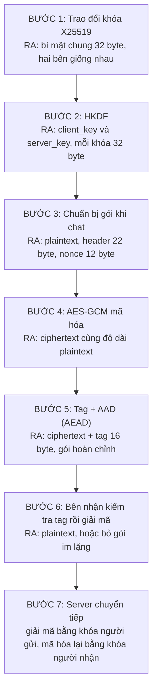
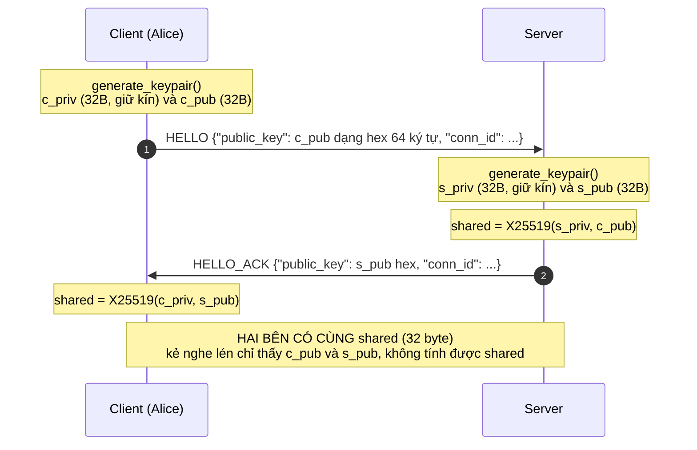
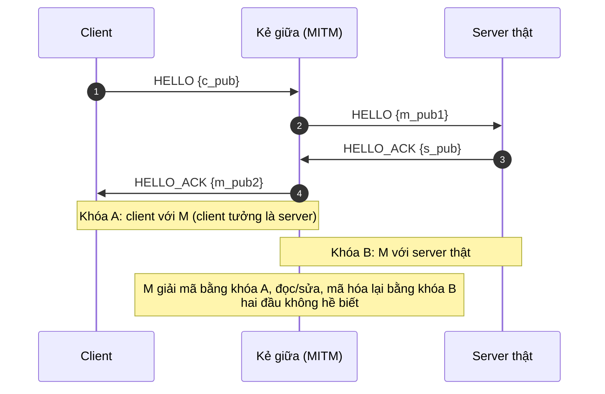
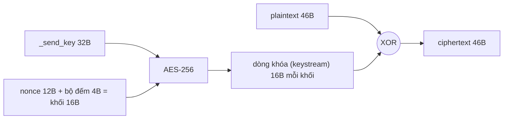
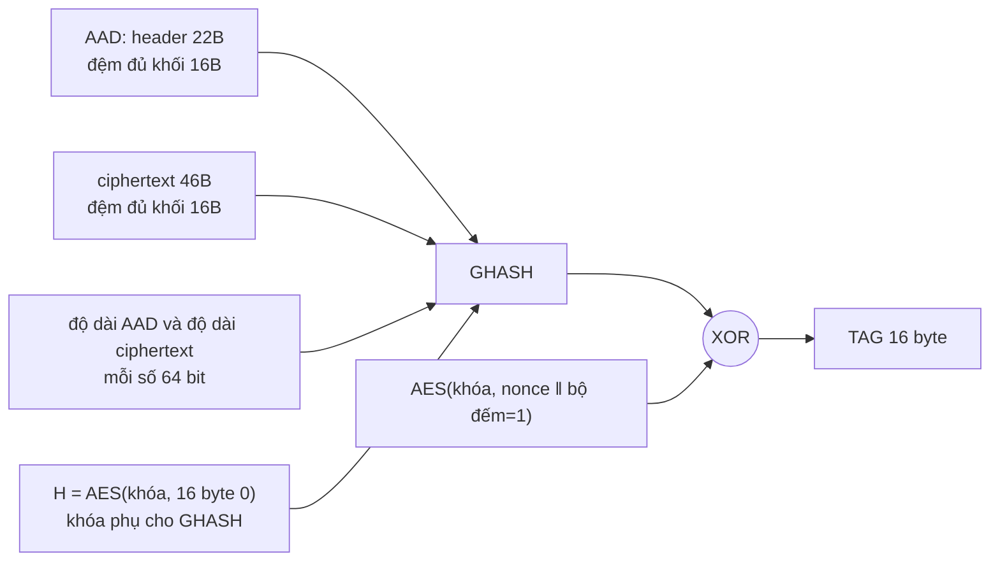
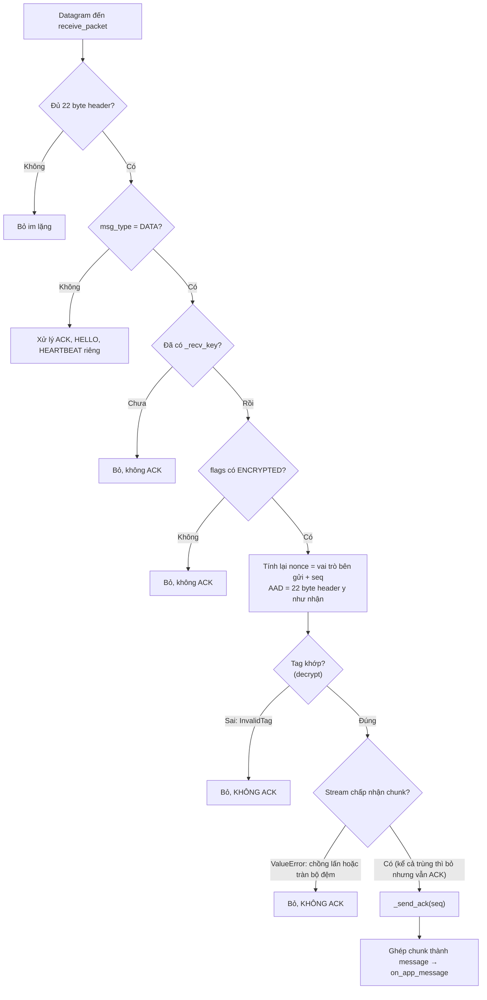
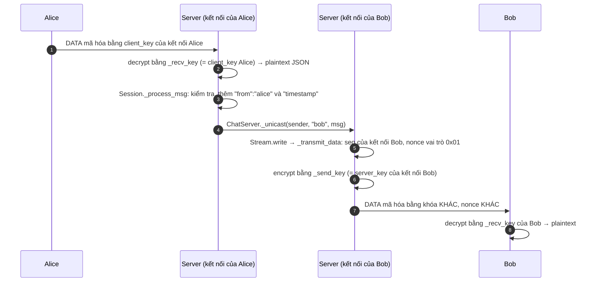
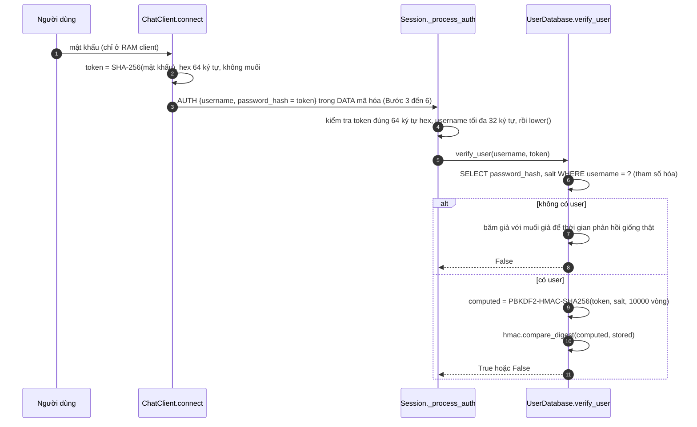
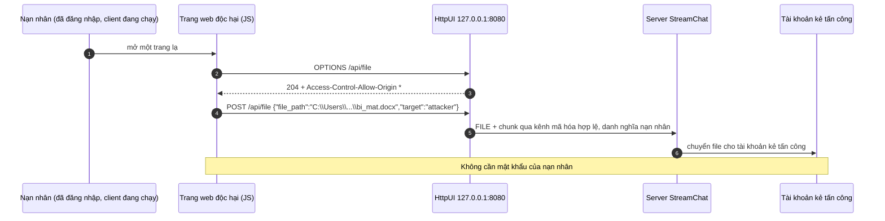

# Bảo mật trong StreamChat — đi theo từng bước

Tài liệu này đi theo **hành trình của một tin nhắn**, từ lúc hai máy chưa biết gì về nhau cho tới lúc người nhận đọc được chữ. Mỗi bước có cùng một khung:

> **VÀO** → cái gì đi vào bước này · **XỬ LÝ** → bước này làm gì · **RA** → kết quả để bước sau dùng · **HÀM** → nằm ở đâu trong code · **VÌ SAO** → ý nghĩa bảo mật

> **Phạm vi và độ tin cậy.** Phân tích **tĩnh** từ mã nguồn ở commit `fc99211` (nhánh `test`). Mình **chưa khai thác thử** các điểm yếu ở Phần B. Mức "Cao / Trung bình / Thấp" là đánh giá của mình, không phải kết quả pentest.
> Diagram dùng Mermaid: xem bằng VS Code (extension _Markdown Preview Mermaid Support_) hoặc <https://mermaid.live>.
> Các con số trong ví dụ (seq, offset, conn_id) là **ví dụ minh họa**. Mình không bịa giá trị khóa hay ciphertext; chỗ nào là dữ liệu mật mã thì chỉ ghi kích thước.

## Mục lục

**Phần A — Hành trình một tin nhắn**

- [Từ vựng cần biết](#từ-vựng-cần-biết)
- [Bản đồ 7 bước](#bản-đồ-7-bước)
- [Bước 1 — Trao đổi khóa (X25519)](#bước-1--trao-đổi-khóa-x25519)
- [Bước 2 — Biến bí mật chung thành khóa dùng được (HKDF)](#bước-2--hkdf)
- [Bước 3 — Khi chat: chuẩn bị gói trước khi mã hóa](#bước-3--chuẩn-bị-gói-trước-khi-mã-hóa)
- [Bước 4 — AES-GCM mã hóa dữ liệu](#bước-4--aes-gcm-mã-hóa-dữ-liệu)
- [Bước 5 — Tag, AAD và AEAD](#bước-5--tag-aad-và-aead)
- [Bước 6 — Bên nhận kiểm tra rồi mới giải mã](#bước-6--bên-nhận-kiểm-tra-rồi-mới-giải-mã)
- [Bước 7 — Server chuyển tiếp cho người nhận](#bước-7--server-chuyển-tiếp)
- [Đăng nhập: mật khẩu đi qua đường nào](#đăng-nhập-mật-khẩu-đi-qua-đường-nào)
- [Những gì KHÔNG được bảo vệ](#những-gì-không-được-bảo-vệ)
- [Lớp Web UI cục bộ](#lớp-web-ui-cục-bộ)

**Phần B — Đánh giá**

- [Mô hình đe dọa](#mô-hình-đe-dọa)
- [Sổ đăng ký rủi ro](#sổ-đăng-ký-rủi-ro)
- [Những điểm làm tốt](#những-điểm-làm-tốt)
- [Lộ trình cải thiện](#lộ-trình-cải-thiện)
- [Tự kiểm chứng](#tự-kiểm-chứng)

---

# PHẦN A — HÀNH TRÌNH MỘT TIN NHẮN

## Từ vựng cần biết

| Thuật ngữ                  | Hiểu đơn giản                                                                                | Trong dự án                                   |
| -------------------------- | -------------------------------------------------------------------------------------------- | --------------------------------------------- |
| **Plaintext / Ciphertext** | Dữ liệu gốc / dữ liệu đã mã hóa                                                              | JSON tin nhắn / các byte trông như ngẫu nhiên |
| **Khóa (key)**             | Bí mật dùng để mã hóa                                                                        | 32 byte (AES-256)                             |
| **Nonce**                  | Số chỉ dùng **một lần** cho mỗi lần mã hóa với cùng một khóa. Không cần giữ bí mật           | 12 byte, làm từ `seq_num`                     |
| **Tag**                    | "Con dấu niêm phong" 16 byte. Sai một bit là biết bị sửa                                     | Nằm cuối payload                              |
| **AAD**                    | Dữ liệu **không mã hóa nhưng được niêm phong** cùng tag                                      | 22 byte header của gói                        |
| **AEAD**                   | Mã hóa **có xác thực**, kèm AAD. AES-GCM là một AEAD                                         | Cách dự án bảo vệ gói DATA                    |
| **KDF (HKDF)**             | Máy "nghiền" một bí mật thành một hoặc nhiều khóa tốt                                        | Bước 2                                        |
| **ECDH (X25519)**          | Hai bên mỗi người giữ một số bí mật, đổi số công khai, rồi **cùng tính ra một bí mật chung** | Bước 1                                        |

## Bản đồ 7 bước



**Ví dụ xuyên suốt:** Alice gõ `hi` gửi riêng cho `bob`. Ta theo dõi chính tin này qua cả 7 bước.

---

## Bước 1 — Trao đổi khóa (X25519)

|            |                                                                                                                                                   |
| ---------- | ------------------------------------------------------------------------------------------------------------------------------------------------- |
| **VÀO**    | Không có bí mật nào từ trước. Hai máy chỉ biết địa chỉ của nhau                                                                                   |
| **XỬ LÝ**  | Mỗi bên sinh một **cặp khóa tạm** (riêng + công khai), gửi khóa **công khai** cho nhau, rồi mỗi bên tự tính bí mật chung                          |
| **RA**     | **Bí mật chung 32 byte**, hai bên tính ra **giống hệt nhau** và **không bao giờ được gửi qua mạng**                                               |
| **HÀM**    | `Connection.handle_handshake` (client), `_handle_hello` (server), `_handle_hello_ack` (client), `crypto.generate_keypair`, `derive_shared_secret` |
| **VÌ SAO** | Cho phép hai máy chưa từng gặp nhau thống nhất được một bí mật **giữa đường truyền công khai** mà kẻ nghe lén không tính lại được                 |



**Ví dụ bằng lời:** giống như hai người pha màu sơn. Mỗi người có một màu bí mật, trộn vào một màu nền công khai rồi trao nhau hỗn hợp. Người kia trộn thêm màu bí mật của mình vào hỗn hợp nhận được. Cả hai cùng ra một màu cuối, còn người đứng ngoài chỉ thấy các hỗn hợp trung gian.

**Hai tính chất đáng nhớ:**

- **Khóa tạm cho mỗi kết nối** (khóa riêng chỉ ở RAM) → **forward secrecy**: lộ gì sau này cũng không giải mã lại được lưu lượng cũ đã ghi.
- **Gửi lại HELLO nếu mất** (tối đa 5 lần, mỗi 1 giây). Nếu HELLO_ACK mất, server **không sinh khóa mới** mà gửi lại đúng HELLO_ACK cũ (`_hello_ack_raw`), để hai bên giữ cùng khóa.

> ⚠ **Điểm yếu gốc (R1):** client **không có cách nào biết** `s_pub` có thật sự của server hay không. Không có chữ ký, chứng chỉ hay fingerprint được ghim. Xem [R1](#sổ-đăng-ký-rủi-ro).



---

## Bước 2 — HKDF

|            |                                                                                                                                                                                    |
| ---------- | ---------------------------------------------------------------------------------------------------------------------------------------------------------------------------------- |
| **VÀO**    | `shared` (32 byte) từ Bước 1                                                                                                                                                       |
| **XỬ LÝ**  | HKDF-SHA256 chạy **hai lần liên tiếp**, rồi cắt 64 byte thành **hai khóa 32 byte**                                                                                                 |
| **RA**     | `client_key` (32B) và `server_key` (32B). Hai bên tính ra cùng một cặp                                                                                                             |
| **HÀM**    | `crypto.derive_session_keys` (gọi `derive_shared_secret`), `Connection._install_keys`                                                                                              |
| **VÌ SAO** | Kết quả thô của X25519 **không nên dùng thẳng làm khóa**: không đảm bảo phân bố đều, và chỉ có một giá trị trong khi ta cần nhiều khóa. HKDF chuẩn hóa và tách ra các khóa độc lập |

### Bên trong HKDF

HKDF có hai nửa:

- **Extract:** `PRK = HMAC-SHA256(salt, đầu vào)`: nén đầu vào thành một khóa đồng đều. Dự án để `salt=None` (hệ thống dùng chuỗi byte 0 mặc định).
- **Expand:** `T(1) = HMAC(PRK, info + 0x01)`, `T(2) = HMAC(PRK, T(1) + info + 0x02)`, ... nối các khối 32 byte lại cho đủ độ dài cần.

### Hai lần gọi trong code

```
shared       = X25519(khóa riêng, khóa công khai đối tác)                32 byte

shared_secret = HKDF(shared,        length=32, info="…directional-session-keys")
key_material  = HKDF(shared_secret, length=64, info="…directional-key-expansion")

client_key = key_material[0:32]      ← chỉ dùng cho chiều client → server
server_key = key_material[32:64]     ← chỉ dùng cho chiều server → client
```

Sau đó `_install_keys` chọn khóa theo vai trò:

|            | `_send_key` (khóa để gửi) | `_recv_key` (khóa để nhận) |
| ---------- | ------------------------- | -------------------------- |
| **Client** | `client_key`              | `server_key`               |
| **Server** | `server_key`              | `client_key`               |

`_session_key` (khóa chung không theo chiều, tính bằng `derive_shared_secret`) vẫn được lưu nhưng **chỉ để tương thích/chẩn đoán**, không dùng mã hóa lưu lượng.

**Vì sao cần hai khóa theo chiều?**

- Kẻ tấn công không thể bắt gói client→server rồi ném lại thành gói server→client (tấn công phản xạ), vì khóa để giải mã khác.
- Chuỗi `info` khác nhau cho từng mục đích gọi là **tách miền** (domain separation): khóa tạo cho mục đích này không bị dùng nhầm cho mục đích khác.

**Tình trạng sau Bước 2:** mỗi bên đang cầm sẵn `_send_key` và `_recv_key`. Bây giờ mới sẵn sàng chat.

---

## Bước 3 — Chuẩn bị gói trước khi mã hóa

Alice gõ `hi` cho `bob`. Đi từ chữ trên màn hình tới lúc sắp mã hóa:

| #   | Giai đoạn                         | Hàm                                                          | Dữ liệu tại đây                                                                                        |
| --- | --------------------------------- | ------------------------------------------------------------ | ------------------------------------------------------------------------------------------------------ |
| 1   | Trình duyệt gửi cho client cục bộ | `app.js sendMessage` → `HttpUI._handle_send`                 | `POST /api/send {"target":"bob","text":"hi"}` (HTTP thuần, trên loopback)                              |
| 2   | Đóng gói JSON                     | `ChatClient.send_chat` → `_send_json`                        | **plaintext 46 byte**: `{"type": "MSG", "target": "bob", "text": "hi"}`                                |
| 3   | Chia chunk                        | `Stream.write`                                               | 46 ≤ 1362 nên chỉ **1 chunk**, `flags = FLAG_EOM`, `offset` = số byte đã gửi trên stream 0 (ví dụ 118) |
| 4   | Xếp hàng                          | `Connection.send_packet` → `_tx_queue` → `_flush_send_queue` | Chỉ đi tiếp khi `reliability.can_send()` (cửa sổ `cwnd` còn chỗ)                                       |
| 5   | Cấp số thứ tự                     | `Connection._alloc_seq`                                      | `seq = 7` (ví dụ). Tăng dần, không bao giờ lặp trong một kết nối                                       |
| 6   | Dựng **header 22 byte**           | `packet.pack` (xem bên dưới)                                 | Sẽ làm **AAD** ở Bước 5                                                                                |
| 7   | Dựng **nonce 12 byte**            | `crypto._construct_nonce(seq, is_server)`                    | Sẽ dùng ở Bước 4                                                                                       |

### Header 22 byte của gói (ví dụ)

| Trường        | Kích thước | Ví dụ        | Ý nghĩa                               |
| ------------- | ---------- | ------------ | ------------------------------------- |
| `msg_type`    | 1B         | `0x03`       | DATA                                  |
| `conn_id`     | 4B         | `0x1A2B3C4D` | Mã kết nối                            |
| `seq_num`     | 4B         | `7`          | Số thứ tự gói                         |
| `flags`       | 1B         | `0x09`       | `EOM (0x01)` + `ENCRYPTED (0x08)`     |
| `stream_id`   | 2B         | `0`          | Stream 0 = chat/điều khiển            |
| `offset`      | 4B         | `118`        | Vị trí chunk trong stream             |
| `payload_len` | 2B         | `62`         | **Độ dài ciphertext + tag** = 46 + 16 |
| `reserved`    | 4B         | `0`          | —                                     |

**Chi tiết dễ bỏ sót:** `payload_len` phải bằng độ dài **sau khi mã hóa** (46 + 16 = 62), nhưng lúc dựng header ta chưa có ciphertext. Code giải quyết bằng cách dựng header thử với một payload giả 62 byte toàn số 0, rồi **chỉ lấy 22 byte đầu** (`pack(...)[:HEADER_SIZE]`). Nhờ vậy header đưa vào AAD có `payload_len` đúng.

### Nonce 12 byte

```
nonce = [ 1 byte vai trò ] + [ 11 byte seq_num, big-endian ]
        0x00 = client, 0x01 = server

Ví dụ client, seq = 7:
nonce = 00 | 00 00 00 00 00 00 00 00 00 00 07
```

- Mỗi gói có `seq` riêng nên **mỗi gói một nonce riêng**.
- Byte vai trò cho client và server **không bao giờ cùng nonce** dù cả hai đều đếm từ 0.
- Nonce **không cần gửi riêng**: bên nhận đọc `seq_num` ở header rồi tự tính lại.

**RA của Bước 3:** `plaintext` (46B), `header_aad` (22B), `nonce` (12B), và `_send_key` (32B) đã có từ Bước 2.

---

## Bước 4 — AES-GCM mã hóa dữ liệu

|            |                                                                                     |
| ---------- | ----------------------------------------------------------------------------------- |
| **VÀO**    | `_send_key` (32B) · `nonce` (12B) · `plaintext` (46B) · `AAD` = header (22B)        |
| **XỬ LÝ**  | Biến AES thành **bộ sinh dòng khóa** (chế độ đếm — CTR), rồi **XOR** với plaintext  |
| **RA**     | `ciphertext` — **cùng độ dài** plaintext (46B), trông như dữ liệu ngẫu nhiên        |
| **HÀM**    | `crypto.encrypt` (bên trong gọi `AESGCM(key).encrypt`)                              |
| **VÌ SAO** | Kẻ nghe lén chỉ thấy các byte vô nghĩa. Không có khóa thì không khôi phục được `hi` |



### Chạy từng khối 16 byte

46 byte plaintext = **3 khối** (16 + 16 + 14):

```
khối 1: keystream₁ = AES(khóa, nonce ‖ bộ đếm=2)   →   C₁ = P₁ XOR keystream₁
khối 2: keystream₂ = AES(khóa, nonce ‖ bộ đếm=3)   →   C₂ = P₂ XOR keystream₂
khối 3: keystream₃ = AES(khóa, nonce ‖ bộ đếm=4)   →   C₃ = P₃ XOR (14 byte đầu của keystream₃)
```

(Bộ đếm bắt đầu từ **2**; giá trị **1** được dành để tạo tag ở Bước 5.)

### Vì sao nonce phải khác nhau

Nếu hai tin khác nhau dùng cùng (khóa, nonce) thì keystream giống hệt nhau:

```
C1 = P1 XOR K        C2 = P2 XOR K        →    C1 XOR C2 = P1 XOR P2
```

Dòng khóa K triệt tiêu, kẻ nghe lén thấy quan hệ giữa hai tin. JSON tin nhắn rất dễ đoán nên rất nguy hiểm. Với GCM, dùng lại nonce còn có thể làm lộ khóa xác thực và cho phép **giả mạo gói**.

### Ba lớp bảo vệ để không bao giờ lặp nonce

1. **Khóa mới cho mỗi kết nối** (Bước 1–2), nên đếm lại `seq` từ 0 là an toàn.
2. **Truyền lại không mã hóa lại.** Gói bị mất được gửi lại bằng **đúng các byte đã lưu** trong `_unacked`. Mã hóa lại chính là dùng lại nonce.
3. **`_used_nonces`:** trước khi mã hóa, `encrypt()` kiểm tra cặp `(dấu vân tay khóa, nonce)` đã dùng chưa. Nếu rồi, ném `ValueError`.

> Điểm yếu nhỏ (R8): `_used_nonces` không bao giờ xóa nên phình dần khi truyền file lớn.

---

## Bước 5 — Tag, AAD và AEAD

|            |                                                                                                         |
| ---------- | ------------------------------------------------------------------------------------------------------- |
| **VÀO**    | `ciphertext` (46B) · `AAD` = header (22B) · khóa · nonce                                                |
| **XỬ LÝ**  | Tính **tag 16 byte** bằng GHASH trên (AAD + ciphertext + độ dài), rồi che bằng một giá trị AES          |
| **RA**     | Payload = `ciphertext (46B) + tag (16B) = 62B`. Gói hoàn chỉnh trên dây = `header 22B + 62B = 84B`      |
| **HÀM**    | Cũng nằm trong `AESGCM.encrypt`. Phía dự án: `Connection._transmit_data` ghép `header_aad + ciphertext` |
| **VÌ SAO** | Mã hóa chỉ che nội dung. **Tag mới chứng minh gói không bị sửa**, kể cả phần header không mã hóa        |

### Ba khái niệm trong một câu

- **AAD (Associated Data):** phần **không mã hóa** nhưng **được niêm phong**. Ở đây là 22 byte header. Ai cũng đọc được, nhưng **không ai sửa được mà không bị phát hiện**.
- **Tag:** con dấu 16 byte tính từ khóa + AAD + ciphertext. Đổi **một bit** ở bất kỳ phần nào, tag không còn khớp.
- **AEAD:** viết tắt của _Authenticated Encryption with Associated Data_: **mã hóa + xác thực + niêm phong dữ liệu đi kèm**, tất cả trong một phép toán. AES-GCM là một AEAD.

### Tag được tính thế nào (đủ để hiểu)



- **GHASH** là phép "băm" có khóa H: nó trộn lần lượt từng khối của AAD, rồi của ciphertext, rồi khối độ dài.
- Kết quả được **XOR với `AES(khóa, nonce‖1)`** (cái bộ đếm = 1 dành riêng ở Bước 4) để ra tag cuối.
- Vì tag phụ thuộc vào **cả AAD lẫn ciphertext lẫn khóa**, chỉ người có khóa mới tạo được tag đúng.

### Gói hoàn chỉnh trên dây

```
 byte  0         1         5         9    10     12        16        18       22                              84
       ├─────────┼─────────┼─────────┼─────┼──────┼─────────┼─────────┼────────┼───────────────────────┬─────────┤
       │msg_type │ conn_id │ seq_num │flags│stream│ offset  │pay_len  │reserved│  CIPHERTEXT (46 byte) │TAG 16B  │
       │  0x03   │   4B    │    7    │0x09 │  0   │  118    │   62    │   0    │ (che nội dung "hi")   │         │
       └─────────┴─────────┴─────────┴─────┴──────┴─────────┴─────────┴────────┴───────────────────────┴─────────┘
       └──────── HEADER 22B = AAD: đọc được, nhưng được NIÊM PHONG ────────┘└── MÃ HÓA ──┘└── NIÊM PHONG ┘
```

### Header được niêm phong thì chống được gì

| Kẻ tấn công thử                                  | Vì sao thất bại                                                        |
| ------------------------------------------------ | ---------------------------------------------------------------------- |
| Sửa 1 bit trong ciphertext                       | Tag tính lại ở bên nhận không khớp → `InvalidTag`                      |
| Sửa `offset` để chèn dữ liệu sai chỗ trong file  | `offset` là AAD → tag sai                                              |
| Đổi `stream_id` để chuyển chunk sang stream khác | `stream_id` là AAD → tag sai                                           |
| Đổi `seq_num`                                    | Vừa là AAD vừa là một phần của nonce → giải mã ra sai và tag sai       |
| Gỡ bit `ENCRYPTED` khỏi `flags`                  | `flags` là AAD; bên nhận cũng **bỏ gói không có cờ này** sau handshake |
| Ném lại gói client→server như gói server→client  | Khóa theo chiều + byte vai trò trong nonce → giải mã thất bại          |

### Cái AEAD **không** làm

- **Không chống phát lại (replay):** gói cũ bắt được rồi gửi lại y nguyên vẫn có tag đúng. Dự án chỉ chống ở tầng `Stream` (bỏ dữ liệu có `offset` đã giao). Xem [R6](#sổ-đăng-ký-rủi-ro).
- **Không giấu metadata** vì header để trần (kích thước, `stream_id`, `offset`, `seq`).

---

## Bước 6 — Bên nhận kiểm tra rồi mới giải mã

|            |                                                                                                              |
| ---------- | ------------------------------------------------------------------------------------------------------------ |
| **VÀO**    | 84 byte datagram                                                                                             |
| **XỬ LÝ**  | Tách header → tính lại nonce → **kiểm tra tag trước** → chỉ khi đúng mới trả plaintext                       |
| **RA**     | `plaintext` 46B (`{"type": "MSG", ...}`) và một gói `ACK`. Nếu sai: **bỏ im lặng, không ACK**                |
| **HÀM**    | `Connection.receive_packet` → `packet.unpack` → `_handle_data` → `crypto.decrypt`                            |
| **VÌ SAO** | Tag được kiểm tra **trước khi** dữ liệu được dùng, nên gói giả hoặc gói bị sửa không bao giờ đi vào ứng dụng |



**Các chi tiết quan trọng:**

- Tham số `is_server` của `decrypt` là **vai trò của bên gửi**. Nên bên nhận truyền `is_server = not self.is_server`.
- AAD là **22 byte header đúng như đã nhận** (`raw_bytes[:HEADER_SIZE]`), không phải header dựng lại.
- **Chỉ ACK sau khi tag đúng và Stream chấp nhận.** Gói giả không thể "lừa" bên gửi xóa dữ liệu thật khỏi hàng chờ.
- Gói không được ACK sẽ được bên gửi **truyền lại bản gốc** (xem `PACKET_LOSS_HANDLING.md`).

---

## Bước 7 — Server chuyển tiếp

Đây là điểm mấu chốt: **server không chỉ chuyển byte** mà **giải mã rồi mã hóa lại**.



|                                                  | Kết nối Alice ↔ Server    | Kết nối Bob ↔ Server   |
| ------------------------------------------------ | ------------------------- | ---------------------- |
| Khóa                                             | cặp riêng của kết nối này | cặp **khác hoàn toàn** |
| Bộ đếm `seq`                                     | riêng                     | riêng                  |
| Byte vai trò trong nonce (chiều server → client) | —                         | `0x01`                 |

**Hệ quả:**

- Server thấy plaintext (`process_payload` cần đọc JSON để định tuyến) → đây là mã hóa **theo từng chặng (hop-by-hop)**, **không phải E2EE**.
- Server **tự gán** `"from": self.username`, nên Alice không giả mạo được tên người gửi.

| Kẻ quan sát           | Chat / file            | Mật khẩu / token | Metadata |
| --------------------- | ---------------------- | ---------------- | -------- |
| Nghe lén thụ động     | Không                  | Không            | **Có**   |
| MITM chủ động         | **Có** (do Bước 1, R1) | **Có** (token)   | Có       |
| Kẻ ngoài đường truyền | Không                  | Không            | Không    |
| Quản trị server       | **Có**                 | Token thoáng qua | Có       |
| Người nhận hợp lệ     | Có                     | Không            | Có       |

File đi theo cách tương tự: client Alice gửi chunk thô trên một `stream_id` riêng, server giải mã, kiểm tra (`process_file_chunk`), rồi `_route_file_chunk` ghi lại sang stream của người nhận.

---

## Đăng nhập: mật khẩu đi qua đường nào

Trong thực tế đăng nhập (`AUTH`) xảy ra **ngay sau Bước 2**, và gói AUTH được bảo vệ bằng đúng cơ chế Bước 3–6. Tách riêng vì nội dung là mật khẩu nên có thêm lớp băm.



| Giá trị                     | Client | Đường truyền           | Server (RAM)      | `users.db`         |
| --------------------------- | ------ | ---------------------- | ----------------- | ------------------ |
| Mật khẩu gốc                | Có     | Không                  | **Không bao giờ** | Không              |
| `token = SHA-256(mật khẩu)` | Có     | Có (trong DATA mã hóa) | Có, thoáng qua    | Không              |
| `PBKDF2(token, salt)`       | Không  | Không                  | Có                | **Có**, kèm `salt` |

**Điểm tốt:** SQL tham số hóa (chống SQL injection) · `hmac.compare_digest` (so sánh thời gian không đổi) · băm giả khi user không tồn tại · muối ngẫu nhiên 16 byte mỗi tài khoản · server không biết mật khẩu gốc.

**Điểm yếu (R9):** `token` là "mật khẩu thứ hai" (ai có token là đăng nhập được, kể cả khi MITM thu được) · PBKDF2 chỉ 10 000 vòng (OWASP khuyến nghị ≥ 600 000) · không giới hạn số lần thử · tài khoản mẫu có mật khẩu công khai trong README (`alice/password123`, `user1…user50/password123`...).

---

## Những gì KHÔNG được bảo vệ

| Loại gói                     | Mã hóa? | Xác thực? | Ghi chú                                                                 |
| ---------------------------- | ------- | --------- | ----------------------------------------------------------------------- |
| `HELLO`, `HELLO_ACK`         | Không   | **Không** | Chứa khóa công khai. Không bí mật nhưng không chứng minh danh tính (R1) |
| `DATA`                       | **Có**  | **Có**    | Chat, file, AUTH, danh sách user                                        |
| `ACK`                        | Không   | **Không** | JSON `{"ranges":[[seq,seq]]}`                                           |
| `HEARTBEAT`, `HEARTBEAT_ACK` | Không   | **Không** | Payload rỗng                                                            |
| `CLOSE`                      | Không   | **Không** | Chỉ cần `conn_id` đúng và địa chỉ nguồn khớp (R5)                       |

**Kẻ nghe lén thụ động vẫn thấy được (header để trần):**

| Lộ ra                    | Từ trường                      | Suy luận                                             |
| ------------------------ | ------------------------------ | ---------------------------------------------------- |
| Ai nói chuyện với server | IP, cổng, `conn_id`            | Danh tính theo mạng                                  |
| Kích thước               | `payload_len`, độ dài datagram | Gói ~1400B liên tục là truyền file; gói ngắn là chat |
| Cấu trúc hội thoại       | `stream_id`                    | `0` = chat/điều khiển, khác `0` = một file           |
| Tiến độ                  | `offset`, `seq_num`            | Kích thước file xấp xỉ, tốc độ gửi                   |
| Chất lượng mạng          | ACK, truyền lại                | Có mất gói hay không                                 |

> `PROTOCOL_MAGIC` được khai báo trong `constants.py` nhưng **không dùng** trong `packet.py`; header thực tế không có magic.

---

## Lớp Web UI cục bộ

`HttpUI` (`http_ui.py`) là HTTP thuần, bind `127.0.0.1`. Trình duyệt nói chuyện với client qua đây; **không có mã hóa ở lớp này** vì đi trong loopback. Việc chỉ bind loopback là đúng, nhưng **mọi trang web trong cùng trình duyệt vẫn gọi được nó**, nên nó phải được coi là một ứng dụng web thực thụ.

| Điểm                                               | Mã                                            | Hệ quả                                                                                       |
| -------------------------------------------------- | --------------------------------------------- | -------------------------------------------------------------------------------------------- |
| Mọi phản hồi có `Access-Control-Allow-Origin: *`   | `_send_response`, `_handle_sse`               | Trang web bất kỳ gọi và **đọc được** API cục bộ                                              |
| `OPTIONS` luôn trả 204 kèm header CORS             | `handle_http_request`                         | Preflight luôn qua, POST JSON từ trang khác được phép                                        |
| Không kiểm tra `Origin`/`Host`, không token CSRF   | toàn bộ router                                | Không chống CSRF, không chống DNS rebinding                                                  |
| `POST /api/file` (JSON) nhận **`file_path` tùy ý** | `_handle_file_upload` → `start_file_transfer` | Đọc file bất kỳ trên máy rồi gửi đi                                                          |
| `GET /static/<path>` ghép đường dẫn trực tiếp      | `_serve_static`                               | Không kiểm tra nằm trong `static/`; `filename` đã `unquote` nên `..%2f` có thể thoát thư mục |
| `/api/history`, `/api/users`, `/api/status`        | —                                             | Trang khác đọc được lịch sử chat và danh sách người dùng                                     |



**Điều kiện:** nạn nhân đã đăng nhập và kẻ tấn công đoán được cổng (8080, 8081…) và đường dẫn file. Mình **chưa chạy thử**; đây là suy luận từ mã.

**Cách sửa (R3, R4):** bỏ `Access-Control-Allow-Origin: *`, chỉ chấp nhận `Origin` bằng đúng `http://127.0.0.1:<cổng>` · kiểm tra `Host` · thêm token CSRF · **xóa nhánh `file_path` tùy ý** (chỉ giữ upload nhị phân) · trong `_serve_static` dùng `os.path.realpath` rồi kiểm tra kết quả bắt đầu bằng đường dẫn thật của `static/`.

---

# PHẦN B — ĐÁNH GIÁ

## Mô hình đe dọa

| Kẻ tấn công                                 | Năng lực giả định                             | Ví dụ                             |
| ------------------------------------------- | --------------------------------------------- | --------------------------------- |
| **A. Nghe lén thụ động**                    | Đọc mọi gói trên đường                        | Bạn cùng LAN bật Wireshark        |
| **B. Chủ động trên đường truyền (on-path)** | Sửa, chèn, chặn, phát lại gói; giả mạo server | ARP spoofing                      |
| **C. Ngoài đường truyền (off-path)**        | Gửi gói UDP giả, không thấy lưu lượng         | Máy lạ quét cổng UDP 9000         |
| **D. Người dùng hợp lệ nhưng xấu**          | Có tài khoản, gửi dữ liệu bất thường          | Tên file chứa `../`, tin khổng lồ |
| **E. Trang web độc hại trên máy nạn nhân**  | Chạy JS trong trình duyệt của người dùng      | Mở trang lạ khi client đang chạy  |
| **F. Quản trị server tò mò**                | Đọc RAM, log, cơ sở dữ liệu server            | Chủ server đọc tin riêng          |

**Ngoài phạm vi:** tấn công vật lý, mã độc đã cài trên máy, lỗi trong thư viện `cryptography`, tấn công kênh phụ.

## Kiểm tra dữ liệu đầu vào ở server

| Dữ liệu              | Quy tắc                                                         | Nơi kiểm tra                         |
| -------------------- | --------------------------------------------------------------- | ------------------------------------ |
| Một message ứng dụng | `bytes`, ≤ 64 KB                                                | `process_payload`                    |
| JSON                 | Phải là `dict`, có `type` kiểu `str`                            | `process_payload`                    |
| `username`           | Không rỗng, ≤ 32 ký tự, chuẩn hóa `lower()`                     | `_process_auth`, `_validated_target` |
| `password_hash`      | Đúng 64 ký tự hex                                               | `_process_auth`                      |
| Chat text            | `str`, không rỗng, ≤ 10 000 ký tự                               | `_process_msg`                       |
| `filename`           | ≤ 255, không ký tự điều khiển, **không chứa `/` hoặc `\`**      | `_process_file`                      |
| `size`               | `int` (không phải `bool`), `0 ≤ size ≤ 2⁶³−1`                   | `_process_file`                      |
| `sha256`             | 64 ký tự hex                                                    | `_process_file`                      |
| `stream_id`          | `int`, `1..65535`, chưa dùng                                    | `_process_file`                      |
| Chunk file           | 1..48 KB, có metadata trước, **tổng không vượt `size` đã khai** | `process_file_chunk`                 |
| Bộ đệm mỗi stream    | ≤ 16 MB và ≤ 65 536 chunk rời                                   | `Stream.read_incoming`               |
| Dải SACK             | `int` không âm, `start ≤ end`                                   | `process_sack`                       |
| Khóa công khai       | Đúng 32 byte                                                    | `derive_shared_secret`               |

Phía nhận file: so khớp SHA-256 với metadata, lưu bằng `os.path.basename(filename)`. **Lưu ý:** hash do người gửi cung cấp qua server nên chỉ phát hiện lỗi đường truyền, không chứng minh nguồn gốc (R13).

## Quản lý phiên

| Cơ chế                               | Hàm                                             | Tác dụng                                                  |
| ------------------------------------ | ----------------------------------------------- | --------------------------------------------------------- |
| Một tài khoản một phiên              | `ChatServer._on_auth_success`                   | Đăng nhập nơi khác thì phiên cũ nhận `KICKED` và bị đóng  |
| Server tự gán người gửi              | `_process_msg`, `_process_file_data`            | Client không giả mạo được `from`                          |
| Không đổi tài khoản giữa phiên       | `verify_auth`                                   | Phải `LOGOUT` trước                                       |
| Chặn khi chưa đăng nhập              | `process_payload`                               | Chỉ `AUTH`/`LOGOUT` được phép                             |
| Chặn DATA không mã hóa sau handshake | `_handle_data`                                  | Chống hạ cấp                                              |
| Chỉ ACK sau xác thực                 | `_handle_data`                                  | Gói giả không điều khiển bên gửi                          |
| Chống chuyển địa chỉ trái phép       | `handle_datagram` + `verify_migration_datagram` | Địa chỉ nguồn mới chỉ được nhận nếu là DATA mã hóa hợp lệ |

**Giới hạn:** `verify_migration_datagram` chỉ kiểm tra gói **giải mã được**, không kiểm tra **độ mới**. Kẻ bắt được một DATA cũ có thể phát lại từ địa chỉ của mình để ép server đổi địa chỉ gửi cho client (R6).

## Sổ đăng ký rủi ro

Mức độ là đánh giá của mình trong bối cảnh bài tập lớn chạy trong LAN.

| ID      | Vấn đề                                                                                   | Nơi trong code                                                                    | Kẻ TC     | Mức                           | Cách khắc phục                                                                                     |
| ------- | ---------------------------------------------------------------------------------------- | --------------------------------------------------------------------------------- | --------- | ----------------------------- | -------------------------------------------------------------------------------------------------- |
| **R1**  | Handshake không xác thực server → MITM đọc/sửa mọi thứ, thu token                        | `_handle_hello_ack`, `_handle_hello`                                              | B         | **Cao**                       | Server ký `public_key` bằng Ed25519; client ghim khóa/fingerprint                                  |
| **R2**  | Không phải E2EE: server đọc tin và file                                                  | `_broadcast`, `_unicast`, `_route_file_chunk`                                     | F         | **Trung bình** (do thiết kế)  | E2EE: khóa X25519 dài hạn mỗi client, mã hóa trước khi gửi                                         |
| **R3**  | CORS `*` + `file_path` tùy ý                                                             | `_send_response`, `_handle_file_upload`                                           | E         | **Cao**                       | Xem mục Web UI                                                                                     |
| **R4**  | `_serve_static` không chặn thoát thư mục                                                 | `_serve_static`                                                                   | E / local | **Trung bình**                | `realpath` + kiểm tra tiền tố                                                                      |
| **R5**  | `CLOSE`, `ACK`, `HEARTBEAT` không xác thực                                               | `handle_datagram`, `receive_packet`                                               | B         | **Trung bình**                | Đưa điều khiển vào AEAD; `CLOSE` chỉ hợp lệ khi qua DATA                                           |
| **R6**  | Không chống replay DATA; replay có thể đổi địa chỉ gửi của server                        | `verify_migration_datagram`, `_handle_data`                                       | B         | **Thấp–TB**                   | Theo dõi `seq` lớn nhất (hoặc cửa sổ bitmap), từ chối `seq` cũ                                     |
| **R7**  | Server tạo `Session` cho **mọi** `conn_id` lạ → tốn RAM/CPU                              | `handle_datagram` → `_create_session`                                             | C         | **Trung bình**                | Chỉ tạo session khi có HELLO hợp lệ; giới hạn số session theo IP                                   |
| **R8**  | `_used_nonces` tăng vô hạn                                                               | `crypto._used_nonces`                                                             | —         | **Thấp**                      | `seq` tăng đơn điệu, chỉ lưu `seq` lớn nhất mỗi hướng                                              |
| **R9**  | Mật khẩu: pass-the-hash, PBKDF2 10 000 vòng, không giới hạn thử, tài khoản mẫu công khai | `connect`, `database.py`                                                          | A/B/C     | **Trung bình**                | PAKE (OPAQUE/SRP) hoặc gửi mật khẩu qua kênh đã xác thực; Argon2id; giới hạn thử; bỏ tài khoản mẫu |
| **R10** | `print` debug in **plaintext tin nhắn** ra console                                       | `_transmit_data` (`[PAYLOAD]`, `[debug] encrypt()`), `_handle_send` (`HEHEHEHEH`) | F / local | **Cao** khi nộp hay chạy thật | Xóa hoặc dùng `logger.debug` có điều kiện                                                          |
| **R11** | Metadata để trần (kích thước, `stream_id`, `offset`)                                     | header 22 byte                                                                    | A         | **Thấp**                      | Đệm kích thước; mã hóa header (như header protection của QUIC)                                     |
| **R12** | Client không kiểm tra `conn_id` hay địa chỉ nguồn của gói nhận; nhận HELLO_ACK đầu tiên  | `receive_packet`, `poll_network`, `_handle_hello_ack`                             | C         | **Thấp–TB**                   | Bỏ gói có địa chỉ ≠ server hoặc `conn_id` ≠ của mình                                               |
| **R13** | SHA-256 file không chứng minh nguồn gốc                                                  | `_handle_incoming_file_chunk`                                                     | B / F     | **Thấp**                      | Chữ ký của người gửi (cần danh tính dài hạn)                                                       |

## Những điểm làm tốt

- Khóa tạm X25519 mỗi kết nối → **forward secrecy** ở tầng truyền tải.
- Khóa **theo chiều** + byte vai trò trong nonce → hai lớp chống tái sử dụng nonce giữa hai chiều.
- **Header làm AAD** → không sửa/hoán đổi `seq`, `offset`, `stream_id` được mà không bị phát hiện.
- Truyền lại dùng **byte cũ**, không mã hóa lại → không vi phạm quy tắc nonce.
- **Kiểm tra tag trước, ACK sau** → gói giả không điều khiển được bên gửi.
- Sau handshake **từ chối DATA không mã hóa** (chống hạ cấp).
- Kiểm tra đầu vào kỹ ở tầng ứng dụng; SQL tham số hóa; `compare_digest`; giả lập thời gian khi user không tồn tại.
- Server **tự gán** `from`, không tin client.
- Giới hạn tài nguyên: kích thước message, số chunk đệm, tổng byte file khai báo, dải SACK.
- Chỉ ghi nhận đổi địa chỉ khi có DATA mã hóa hợp lệ.

## Lộ trình cải thiện

Theo thứ tự nên làm (công sức tăng dần):

1. **Xóa `print` debug** (R10). Nhỏ nhất, nên làm trước khi nộp.
2. **Sửa Web UI** (R3, R4): bỏ CORS `*`, kiểm tra `Origin`/`Host`, bỏ `file_path` tùy ý, chặn thoát thư mục. Chỉ đụng `http_ui.py`.
3. **Ghim khóa server** (R1): sinh khóa Ed25519 một lần; client lưu fingerprint lần đầu (TOFU) hoặc nhúng sẵn; server ký `public_key` trong HELLO_ACK. **Cải thiện giá trị nhất.**
4. **Chống replay** (R6): lưu `seq` lớn nhất đã nhận mỗi hướng, từ chối `seq` cũ (cửa sổ trượt). Đồng thời giải quyết R8.
5. **Tạo session có điều kiện** (R7) và **kiểm tra nguồn gói ở client** (R12).
6. **Xác thực gói điều khiển** (R5): MAC cho `ACK`/`HEARTBEAT`/`CLOSE` bằng khóa phiên.
7. **Củng cố mật khẩu** (R9): tăng vòng PBKDF2 hoặc dùng Argon2id; giới hạn thử; bỏ tài khoản mẫu.
8. **E2EE** (R2, R13): hướng phát triển lớn.

**Phác thảo E2EE đơn giản:** mỗi client có cặp khóa X25519 dài hạn và gửi khóa công khai lên server khi đăng nhập. Alice lấy khóa công khai của Bob, tự tính khóa chung (ECDH + HKDF) và mã hóa `text` hoặc chunk file bằng AES-GCM **trước khi** đưa vào `_send_json`. Server chỉ chuyển ciphertext. Phần định tuyến giữ nguyên. Cần thêm xác minh khóa giữa người dùng (so fingerprint), nếu không server vẫn có thể phát khóa giả.

## Tự kiểm chứng

### Bằng Wireshark

1. Bắt trên đúng interface (Radmin hoặc Wi-Fi/Ethernet), filter `udp.port == 9000`.
2. **Bước 1 nhìn thấy được:** gói đầu là HELLO (`udp.payload[0] == 01`), đọc được `public_key` dạng hex trong JSON.
3. **Bước 5 nhìn thấy được:** gói DATA (`udp.payload[0] == 03`) từ byte 22 trở đi là dữ liệu ngẫu nhiên, không thấy chữ nào. Gói chat ngắn như ví dụ dài khoảng 84 byte payload UDP.
4. **Metadata lộ:** byte 5–8 (`seq_num`), 10–11 (`stream_id`), 12–15 (`offset`) và độ dài gói.
5. **Gói điều khiển không mã hóa:** `udp.payload[0] == 04` (ACK) hiện thẳng `{"ranges":[[n,n]]}`.

### Bằng code (cần Python có cài `cryptography`)

Lưu thành file riêng (ví dụ `check_crypto.py`) **ngoài** thư mục dự án, hoặc xóa sau khi chạy. Mình chưa chạy được đoạn này trên máy hiện tại vì không có Python nào cài sẵn `cryptography`; logic đã đối chiếu với `Connection._handle_data` trong code.

```python
import sys
sys.path.insert(0, "src")          # chỉnh thành đường dẫn tới thư mục src của dự án

from cryptography.exceptions import InvalidTag
from common.crypto import (
    generate_keypair, derive_session_keys, encrypt, decrypt, reset_nonce_tracker,
)

# Bước 1 + 2: hai bên suy ra cùng cặp khóa
a_priv, a_pub = generate_keypair()
b_priv, b_pub = generate_keypair()
assert derive_session_keys(a_priv, b_pub) == derive_session_keys(b_priv, a_pub)
client_key, server_key = derive_session_keys(a_priv, b_pub)
assert client_key != server_key            # khóa theo chiều
print("OK: khoa theo chieu khac nhau")

aad = b"H" * 22                            # giả lập header 22 byte

# Lưu ý: tham số is_server của encrypt VÀ decrypt đều là vai trò của BÊN GỬI.
# Ở đây client gửi nên luôn là is_server=False (đúng như code thật trong Connection:
# bên nhận gọi decrypt(..., is_server = not self.is_server)).

# Bước 4 + 5 + 6: mã hóa / giải mã bình thường
ct = encrypt(b"xin chao", client_key, 0, associated_data=aad, is_server=False)
assert decrypt(ct, client_key, 0, associated_data=aad, is_server=False) == b"xin chao"
print("OK: giai ma dung")

# Sửa 1 bit ciphertext → InvalidTag
bad = bytearray(ct); bad[0] ^= 1
try:
    decrypt(bytes(bad), client_key, 0, associated_data=aad, is_server=False)
    print("LOI: khong phat hien sua")
except InvalidTag:
    print("OK: sua ciphertext bi phat hien")

# Sửa header (AAD) → InvalidTag
try:
    decrypt(ct, client_key, 0, associated_data=b"X" * 22, is_server=False)
    print("LOI: khong phat hien sua header")
except InvalidTag:
    print("OK: sua header bi phat hien")

# Dùng sai chiều (phản xạ) → InvalidTag
try:
    decrypt(ct, client_key, 0, associated_data=aad, is_server=True)
    print("LOI: chap nhan sai chieu")
except InvalidTag:
    print("OK: sai chieu bi tu choi")

# Dùng lại nonce → ValueError
try:
    encrypt(b"khac", client_key, 0, associated_data=aad, is_server=False)
    print("LOI: cho phep dung lai nonce")
except ValueError:
    print("OK: chan dung lai nonce")

reset_nonce_tracker()
```

### Kiểm tra điểm yếu Web UI (chỉ trên máy của bạn)

Khi client đang chạy và đã đăng nhập, mở DevTools của **một trang web khác** (ví dụ tab `about:blank`) rồi chạy:

```javascript
fetch("http://127.0.0.1:8080/api/status")
  .then((r) => r.json())
  .then(console.log);
```

Nếu in ra `{authenticated: true, username: ...}` nghĩa là trang web khác đọc được API cục bộ (R3 đúng). Sau khi sửa CORS, lệnh này phải bị trình duyệt chặn. **Đừng** thử gửi file thật; đọc `status` là đủ để xác nhận vấn đề.
