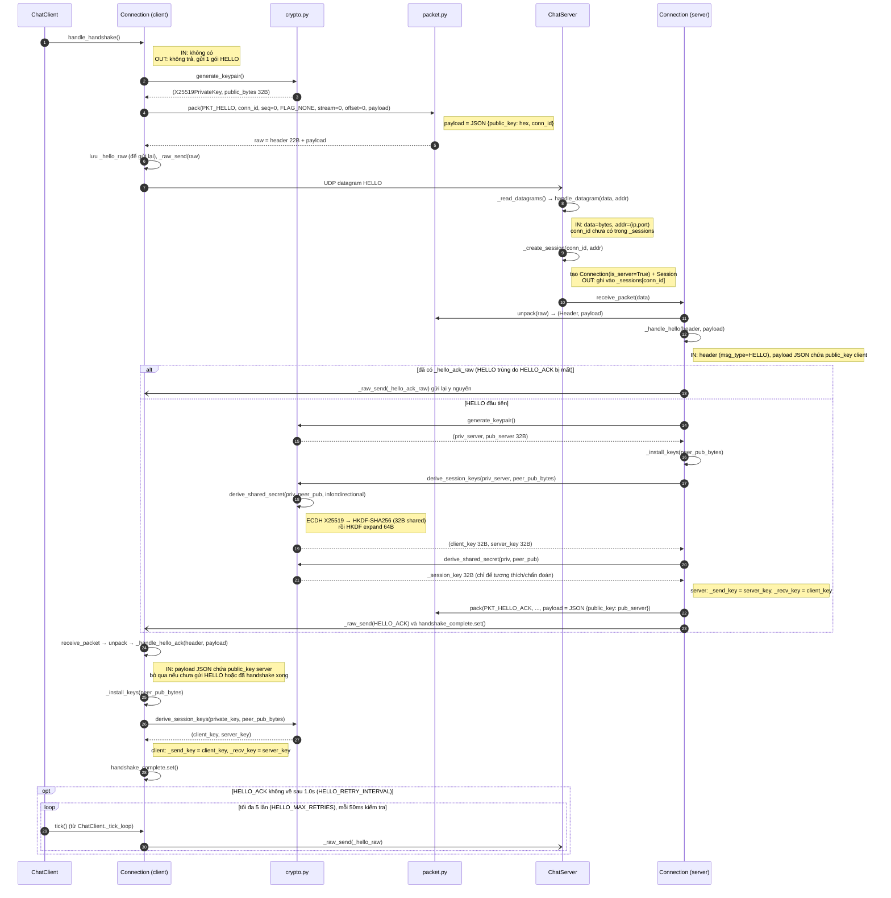
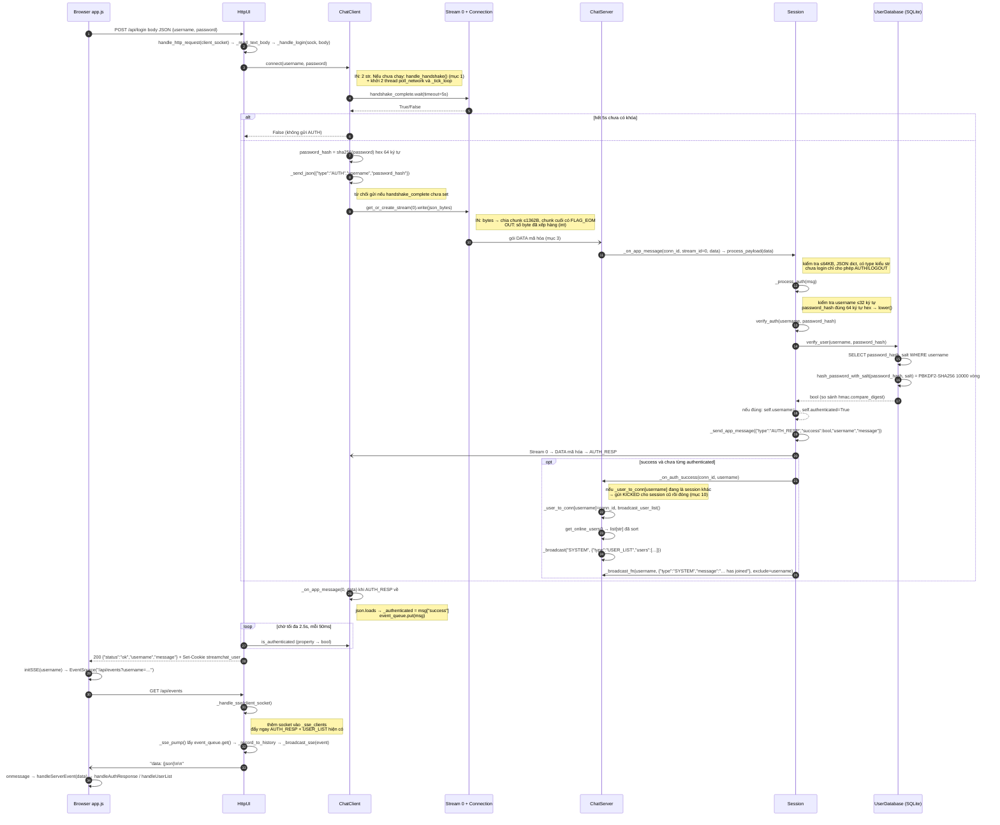
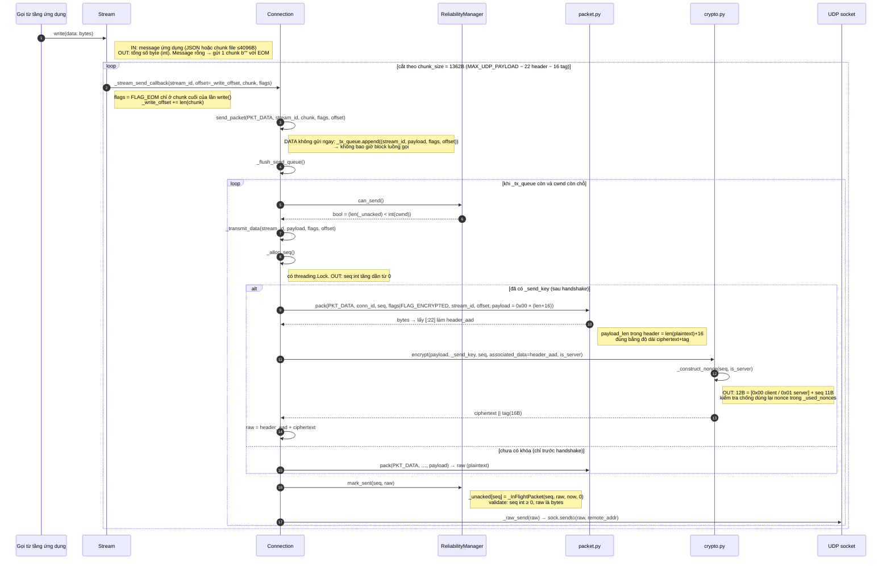
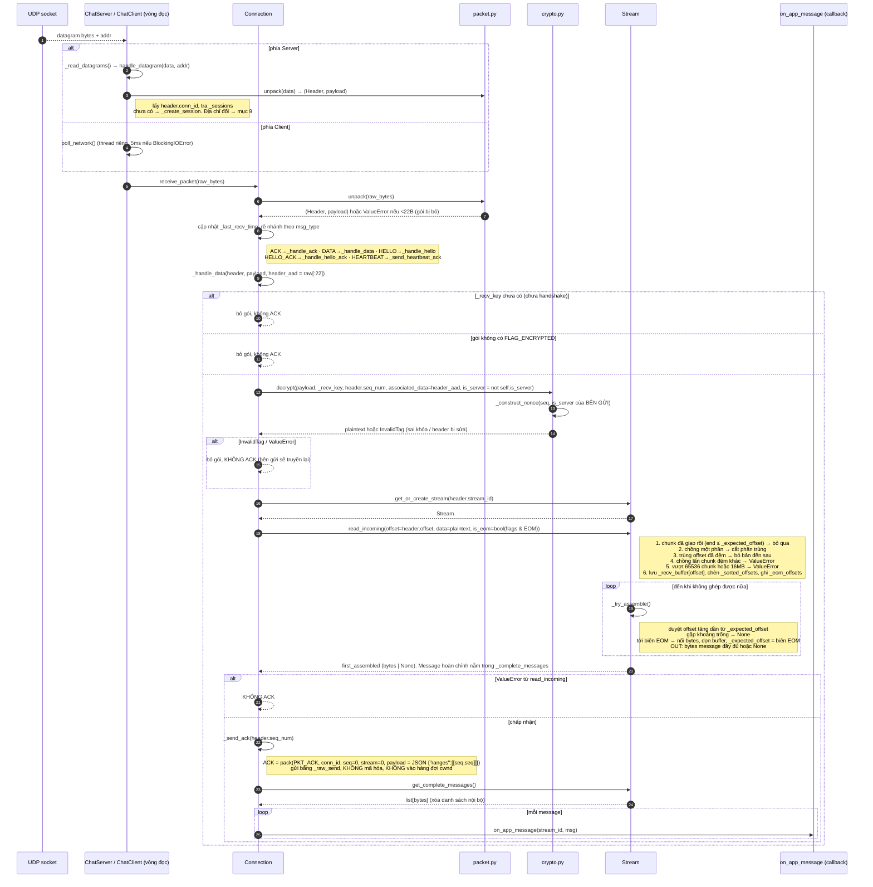
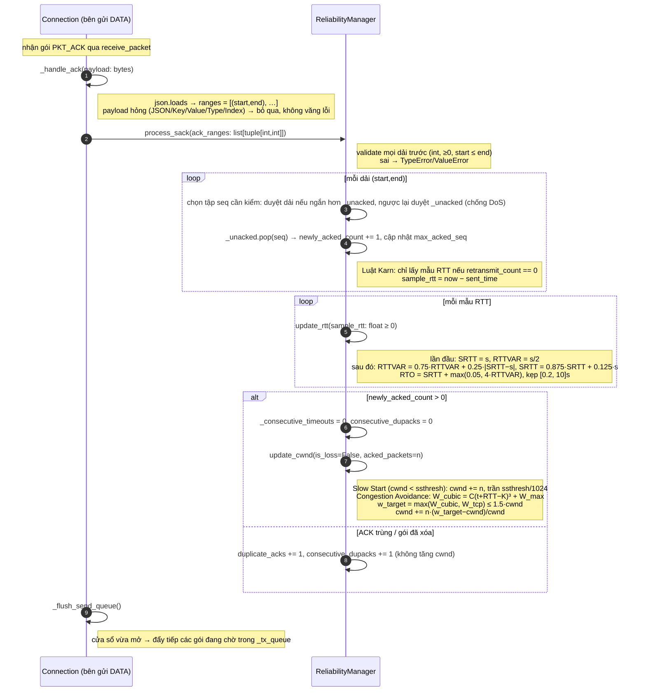
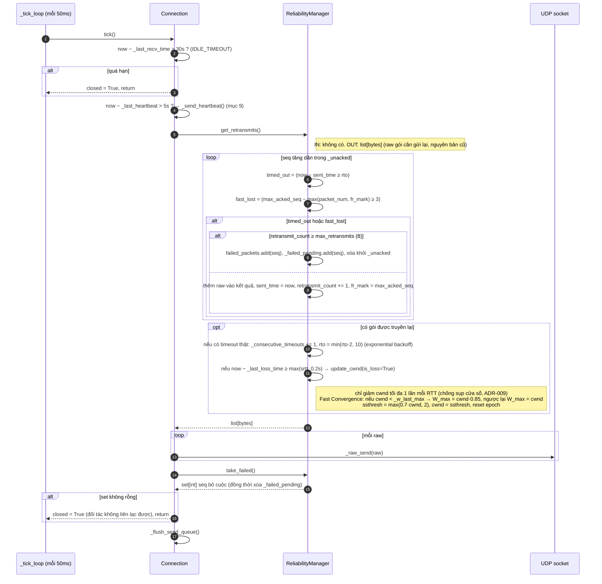
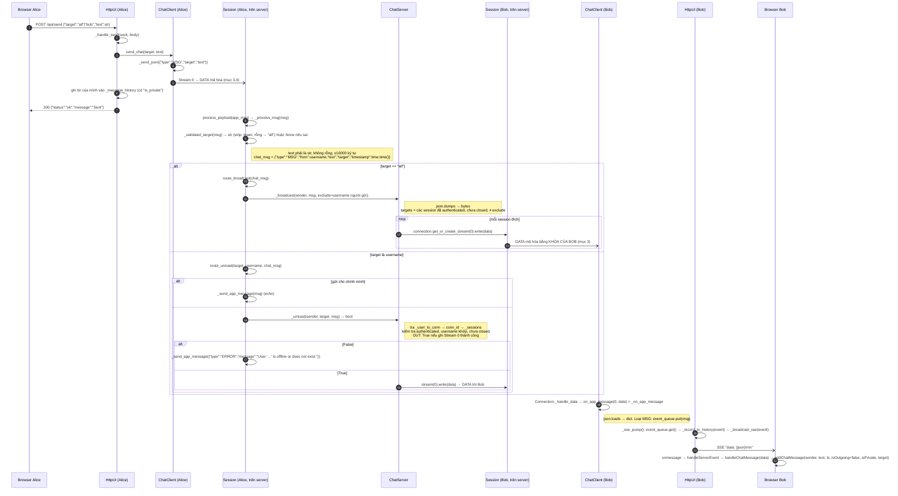
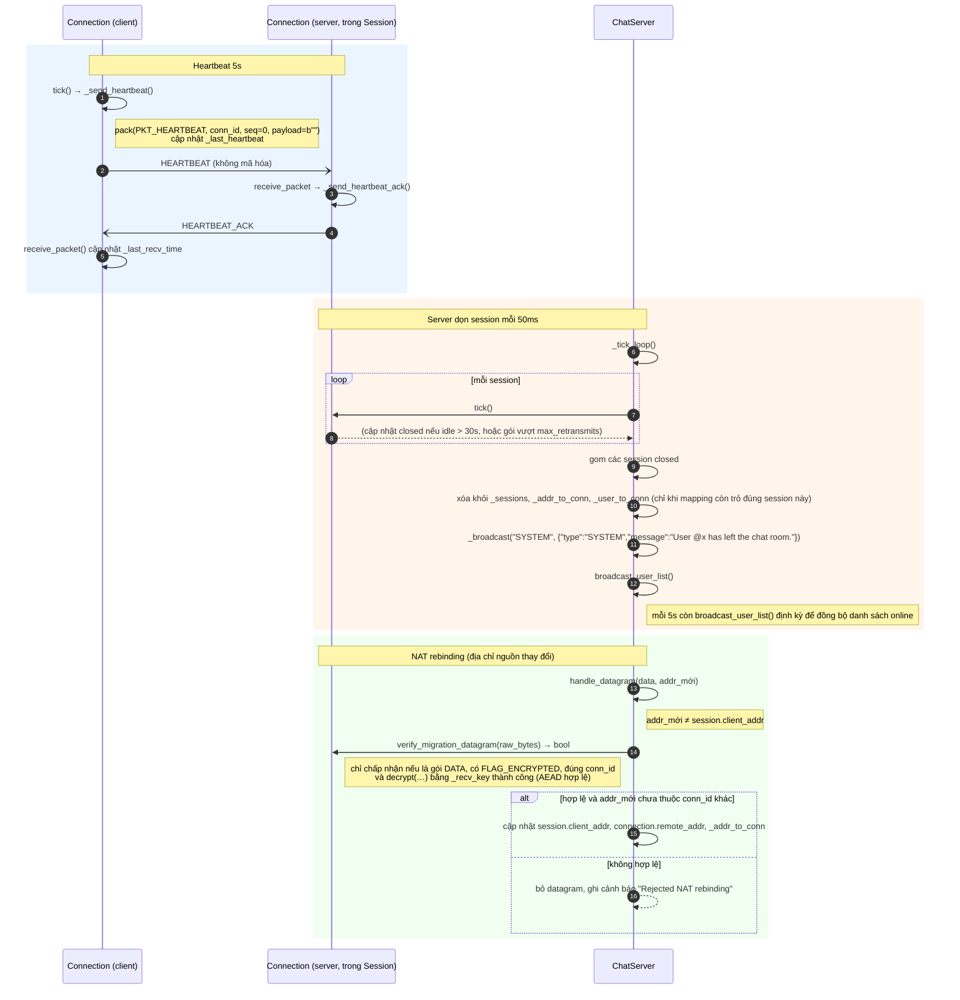
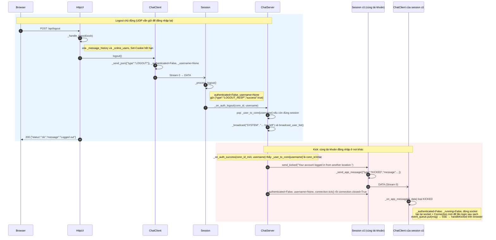

# StreamChat — Sequence Diagram mức hàm (function-level)

Tài liệu này mô tả luồng gọi **giữa các hàm do nhóm tự viết** (không vẽ hàm built-in của Python như `json.dumps`, `struct.pack`, `socket.sendto`...). Mỗi mũi tên ghi **tên hàm(đầu vào)**, mũi tên trả về ghi **đầu ra**; các `Note` mô tả **cấu trúc dữ liệu**.

> Xem bằng VS Code (extension _Markdown Preview Mermaid Support_), GitHub, hoặc dán từng khối vào <https://mermaid.live>.
> Số dòng tham chiếu theo code ở thời điểm viết. File nguồn: `src/common`, `src/transport`, `src/server`, `src/client`.

## Mục lục

0. [Từ điển cấu trúc dữ liệu](#0-từ-điển-cấu-trúc-dữ-liệu)
1. [Bắt tay mã hóa (HELLO / HELLO_ACK, X25519 + HKDF)](#1-bắt-tay-mã-hóa)
2. [Đăng nhập (Browser → HttpUI → ChatClient → Server → SQLite)](#2-đăng-nhập)
3. [Tầng truyền tải — GỬI một gói DATA](#3-gửi-một-gói-data)
4. [Tầng truyền tải — NHẬN một gói DATA](#4-nhận-một-gói-data)
5. [ACK / SACK / RTT / CUBIC](#5-ack--sack--rtt--cubic)
6. [Phát hiện mất gói & truyền lại (tick)](#6-phát-hiện-mất-gói--truyền-lại)
7. [Chat phòng chung & chat riêng](#7-chat-phòng-chung--chat-riêng)
8. [Gửi file qua server](#8-gửi-file-qua-server)
9. [Heartbeat, timeout, dọn session, NAT rebinding](#9-heartbeat-timeout-dọn-session-nat-rebinding)
10. [Logout & Kick (đăng nhập nơi khác)](#10-logout--kick)
11. [Ghi chú về file không nằm trong luồng](#11-ghi-chú)

---

## 0. Từ điển cấu trúc dữ liệu

### 0.1 Header gói tin 22 byte — `common/packet.py` (`!BIIBHIHI`, big-endian)

| Trường        | Kích thước | Ý nghĩa                                                                          |
| ------------- | ---------- | -------------------------------------------------------------------------------- |
| `msg_type`    | 1B         | `PKT_HELLO=1, HELLO_ACK=2, DATA=3, ACK=4, HEARTBEAT=5, HEARTBEAT_ACK=6, CLOSE=7` |
| `conn_id`     | 4B         | ID kết nối (client random 1..2³²-1; server dùng lại đúng ID của client)          |
| `seq_num`     | 4B         | Số thứ tự gói (chỉ DATA mới tăng, cấp bởi `_alloc_seq`)                          |
| `flags`       | 1B         | `EOM=0x01` (chunk cuối của 1 message), `ENCRYPTED=0x08`                          |
| `stream_id`   | 2B         | 0 = kênh điều khiển/JSON. Client cấp ID **lẻ** (1,3,5…), server **chẵn**         |
| `offset`      | 4B         | Vị trí byte của chunk trong stream                                               |
| `payload_len` | 2B         | Độ dài payload (với gói mã hóa = plaintext + 16B tag)                            |
| `reserved`    | 4B         | = 0                                                                              |

`Header` = `NamedTuple` cùng 8 trường trên. `unpack()` trả `(Header, payload_bytes)`.

### 0.2 Các payload quan trọng

| Tên                               | Cấu trúc                                                                                                                                         | Nơi tạo                                              |
| --------------------------------- | ------------------------------------------------------------------------------------------------------------------------------------------------ | ---------------------------------------------------- |
| HELLO / HELLO_ACK                 | JSON `{"public_key": "<hex 64 ký tự>", "conn_id": int}`                                                                                          | `handle_handshake`, `_handle_hello`                  |
| ACK (SACK)                        | JSON `{"ranges": [[seq, seq]]}` (hiện mỗi ACK chỉ 1 dải, `start==end`)                                                                           | `_send_ack`                                          |
| Tin nhắn ứng dụng                 | JSON UTF-8 có trường `type`: `AUTH`, `AUTH_RESP`, `MSG`, `FILE`, `FILE_READY`, `USER_LIST`, `SYSTEM`, `ERROR`, `LOGOUT`, `LOGOUT_RESP`, `KICKED` | `ChatClient._send_json`, `Session._send_app_message` |
| `AUTH`                            | `{"type":"AUTH","username":str,"password_hash":sha256_hex(64)}`                                                                                  | `ChatClient.connect`                                 |
| `MSG` (client→server)             | `{"type":"MSG","target":"all"\|username,"text":str}`                                                                                             | `ChatClient.send_chat`                               |
| `MSG` (server→client)             | thêm `"from":str,"timestamp":float`                                                                                                              | `Session._process_msg`                               |
| `FILE` (client→server)            | `{"type":"FILE","filename","size":int,"sha256","stream_id":int,"target"}`                                                                        | `ChatClient.start_file_transfer`                     |
| `FILE_READY` (server→người nhận)  | `FILE` + `"from"`, `"download_url"`, `"timestamp"`                                                                                               | `Session._process_file`                              |
| Chunk file                        | **bytes thô** (không JSON) trên `stream_id ≠ 0`, mỗi message ≤ 4096B                                                                             | `ChatClient._transfer_file_data`                     |
| Hàng đợi gửi `_tx_queue`          | `deque[(stream_id:int, payload:bytes, flags:int, offset:int)]`                                                                                   | `Connection.send_packet`                             |
| `_InFlightPacket`                 | `dataclass(packet_num, raw_data:bytes, sent_time:float, retransmit_count:int, fr_mark:int)`                                                      | `ReliabilityManager.mark_sent`                       |
| `ReliabilityManager._unacked`     | `dict[seq:int → _InFlightPacket]` (các gói đang bay)                                                                                             |                                                      |
| `Stream._recv_buffer`             | `dict[offset:int → chunk:bytes]` + `_sorted_offsets:list[int]` + `_eom_offsets:set[int]`                                                         | `Stream.read_incoming`                               |
| `ChatServer._sessions`            | `dict[conn_id → Session]`; `_addr_to_conn: dict[(ip,port) → conn_id]`; `_user_to_conn: dict[username → conn_id]`                                 |                                                      |
| `Session._file_transfers`         | `dict[stream_id → (target:str, expected_size:int, received_size:int)]`                                                                           | `_process_file`                                      |
| `ChatClient._incoming_files[sid]` | `{filename,size,sha256,from,target,received,chunks:list[bytes],file_path,status,download_url}`                                                   |                                                      |
| `ChatClient.event_queue`          | `queue.Queue[dict]` – mỗi phần tử là 1 event JSON gửi cho UI qua SSE                                                                             |                                                      |

### 0.3 Khóa mật mã (sau handshake)

`derive_session_keys()` trả `(client_key, server_key)` 32B mỗi khóa. Client gửi bằng `client_key`, nhận bằng `server_key`; server làm ngược lại (`_install_keys`). **Nonce AES-GCM 12B** = `[1 byte vai trò: 0x00 client / 0x01 server] + [11 byte seq_num big-endian]`. **AAD** = 22 byte header.

---

## 1. Bắt tay mã hóa

Hàm: `Connection.handle_handshake`, `_handle_hello`, `_handle_hello_ack`, `_install_keys`, `crypto.generate_keypair`, `derive_session_keys`, `derive_shared_secret`, `tick` (gửi lại HELLO).



---

## 2. Đăng nhập

Hàm: `app.js(submit handler)`, `HttpUI.handle_http_request`, `_handle_login`, `ChatClient.connect`, `_send_json`, `Stream.write`, `Session.process_payload`, `_process_auth`, `verify_auth`, `UserDatabase.verify_user`, `hash_password_with_salt`, `ChatServer._on_auth_success`, `broadcast_user_list`, `_broadcast`, `ChatClient._on_app_message`, `HttpUI._sse_pump`.

(Đường truyền gói DATA chi tiết xem mục 3 & 4; ở đây rút gọn thành "gửi/nhận qua Stream 0".)



---

## 3. Gửi một gói DATA

Hàm: `Stream.write`, `Connection._stream_send_callback`, `send_packet`, `_flush_send_queue`, `ReliabilityManager.can_send`, `_transmit_data`, `_alloc_seq`, `packet.pack`, `crypto.encrypt`, `_construct_nonce`, `ReliabilityManager.mark_sent`, `_raw_send`.



---

## 4. Nhận một gói DATA

Hàm: `ChatClient.poll_network` / `ChatServer._read_datagrams` → `handle_datagram` → `Connection.receive_packet` → `packet.unpack` → `_handle_data` → `crypto.decrypt` → `Stream.read_incoming` → `_try_assemble` → `_send_ack` → `Stream.get_complete_messages` → `on_app_message`.



**Điểm cần chú ý:** chunk trùng (do truyền lại) vẫn được ACK lại vì `read_incoming` trả `None` mà không ném lỗi — nên bên gửi sẽ ngừng truyền lại.

---

## 5. ACK / SACK / RTT / CUBIC

Hàm: `Connection._handle_ack`, `ReliabilityManager.process_sack`, `update_rtt`, `update_cwnd`, `Connection._flush_send_queue`.



---

## 6. Phát hiện mất gói & truyền lại

Hàm: `ChatClient._tick_loop` / `ChatServer._tick_loop` → `Connection.tick` → `ReliabilityManager.get_retransmits`, `update_cwnd(is_loss=True)`, `take_failed`, `_flush_send_queue`.

Có **hai cơ chế**: (a) hết RTO, (b) **fast retransmit dựa trên SACK** — khi đã có ≥ 3 gói có seq cao hơn được ACK.



---

## 7. Chat phòng chung & chat riêng

Hàm: `app.js sendMessage`, `HttpUI._handle_send`, `ChatClient.send_chat`, `_send_json`, `Session._process_msg`, `_validated_target`, `route_broadcast` / `route_unicast`, `ChatServer._broadcast` / `_unicast`, `ChatClient._on_app_message`, `HttpUI._sse_pump`, `app.js handleChatMessage`.



---

## 8. Gửi file qua server

Hàm: `HttpUI._handle_file_stream_upload`, `ChatClient.start_file_transfer`, `Connection.allocate_stream`, `ChatClient._transfer_file_data`, `Session._process_file`, `process_file_chunk`, `ChatServer._on_app_message`, `_route_file_chunk`, `ChatClient._handle_incoming_file_chunk`, `get_download_file`, `HttpUI._handle_download`.

> **File đi A → Server → B, không P2P.** Chunk raw được server giải mã bằng khóa của A rồi `write()` lại sang stream của B (mã hóa bằng khóa của B).

```mermaid
sequenceDiagram
    autonumber
    participant BA as Browser Alice
    participant HA as HttpUI (Alice)
    participant CA as ChatClient (Alice)
    participant CNA as Connection (Alice)
    participant SRV as ChatServer
    participant SS as Session (Alice, server)
    participant CNB as Connection (Bob, server)
    participant CB as ChatClient (Bob)
    participant HB as HttpUI (Bob)
    participant BB as Browser Bob

    BA->>HA: POST /api/file?filename=…&target=bob  body = bytes file
    HA->>HA: _handle_file_stream_upload(sock, query, headers, body_prefix, content_length)
    Note right of HA: ghi file vào %TEMP%/streamchat_uploads/<ts>_<uuid>/<filename>
    HA->>CA: start_file_transfer(file_path, target)
    Note right of CA: IN: đường dẫn str, target str<br/>OUT: stream_id:int hoặc None nếu file không tồn tại
    CA->>CA: tính SHA-256 file (đọc từng 8192B)
    CA->>CNA: allocate_stream()
    CNA-->>CA: Stream với stream_id LẺ (1,3,5…), _next_stream_id += 2
    CA->>CA: _send_json({"type":"FILE","filename","size","sha256","stream_id","target"})
    CA-)SS: Stream 0 → DATA mã hóa
    CA->>CA: tạo thread chạy _transfer_file_data(file_path, stream, target)
    CA->>CA: ghi _file_transfers[sid] (status "transferring") và _incoming_files[sid] (status "completed", cho bản của chính người gửi)
    HA-->>BA: 200 {"status":"ok","stream_id","filename","download_url","message"}

    SS->>SS: process_payload → _process_file(msg)
    Note right of SS: kiểm tra: filename (không chứa / \\, ≤255, không ký tự điều khiển)<br/>size int ≥0 · sha256 64 hex · stream_id 1..65535 chưa dùng · download_url ≤2048
    SS->>SS: file_info = {"type":"FILE_READY","from","filename","size","sha256","stream_id","target","download_url","timestamp"}
    alt target == "all"
        SS->>SRV: route_broadcast(file_info) → _broadcast(...)
        SS->>SS: _file_transfers[stream_id] = ("all", size, 0) nếu size > 0
    else target là username
        SS->>SRV: route_unicast(target, file_info) → _unicast(...) → bool
        SS->>SS: nếu True và size > 0: _file_transfers[stream_id] = (target, size, 0)
    end
    SRV-)CB: DATA (Stream 0) chứa FILE_READY
    CB->>CB: _on_app_message(0, data) loại "FILE_READY"
    Note right of CB: tạo _incoming_files[sid] = {…, received:0, chunks:[], status:"receiving"}<br/>size == 0 → tạo file rỗng ngay, status "completed"<br/>event_queue.put(msg) → SSE → handleFileReady

    loop đọc file từng 4096B
        CA->>CNA: _transfer_file_data → stream.write(chunk 4096B)
        Note right of CNA: Stream cắt 4096B → 3 chunk (1362+1362+1362 … chunk cuối EOM)<br/>mỗi lần write() = 1 "message" độc lập trên stream_id
        CNA-)SRV: DATA mã hóa trên stream_id lẻ (mục 3)
        CA->>CA: cập nhật _file_transfers[sid]["sent"]; chờ reliability.can_send() (ngủ 1ms)
        SRV->>SRV: Connection(Alice)._handle_data → on_app_message(stream_id≠0, msg)
        SRV->>SS: _on_app_message(conn_id, stream_id, data) → process_file_chunk(stream_id, data)
        Note right of SS: kiểm tra đã đăng nhập, stream_id hợp lệ, data không rỗng ≤48KB<br/>phải có metadata trong _file_transfers, received+len ≤ expected_size
        SS->>SRV: _file_chunk_fn = _route_file_chunk(sender, target, stream_id, data) → bool
        SRV->>CNB: get_or_create_stream(stream_id).write(data)
        CNB-)CB: DATA mã hóa bằng khóa của Bob trên cùng stream_id
        SS->>SS: cập nhật received_size, bằng expected_size thì xóa _file_transfers[stream_id]
        CB->>CB: _on_app_message(stream_id≠0, data) → _handle_incoming_file_chunk(stream_id, data)
        Note right of CB: chunks.append(data), received += len<br/>event_queue.put({"type":"FILE_PROGRESS","progress":%,…})
    end

    CA->>CA: hết file: _file_transfers[sid].status = "completed"; event_queue.put({"type":"FILE_COMPLETE",…})
    CB->>CB: received ≥ size: b"".join(chunks) → sha256 so với metadata
    alt hash sai
        CB->>CB: status "corrupted", event_queue.put({"type":"FILE_ERROR","message":"File integrity verification failed."})
    else hash đúng
        CB->>CB: ghi file %TEMP%/streamchat_downloads/<sid>_<tên>, status "completed"
        CB->>CB: event_queue.put({"type":"FILE_READY","download_url":"/api/download?stream_id=…","completed":true})
    end
    HB->>HB: _sse_pump → _record_to_history (gộp theo stream_id) → _broadcast_sse
    HB-)BB: SSE FILE_READY (completed)

    BB->>HB: GET /api/download?stream_id=sid&filename=…
    HB->>HB: _handle_download(sock, query_params)
    HB->>CB: get_download_file(stream_id)
    CB-->>HB: (filename, file_path) hoặc None
    HB-->>BB: 200 + Content-Disposition: attachment, nội dung file (không có kết nối nào tới máy Alice)
```

---

## 9. Heartbeat, timeout, dọn session, NAT rebinding

Hàm: `Connection.tick`, `_send_heartbeat`, `_send_heartbeat_ack`, `ChatServer._tick_loop`, `handle_datagram`, `Connection.verify_migration_datagram`, `ChatServer._broadcast`, `broadcast_user_list`.



---

## 10. Logout & Kick

Hàm: `app.js` (fetch `/api/logout`), `HttpUI._handle_logout`, `ChatClient.logout`, `Session._process_logout`, `ChatServer._on_auth_logout`, `ChatServer._on_auth_success` (kick), `Session.send_kicked`, `ChatClient._on_app_message` (nhánh `KICKED`).



---

## 11. Ghi chú

- **`src/server/web_server.py` (`UnifiedChatServer`) hiện không được import ở đâu** (`run_server.py` chỉ khởi tạo `ChatServer` UDP) nên **không xuất hiện** trong các diagram. Nếu nhóm còn dùng nó thì cần vẽ riêng.
- **README đã lỗi thời so với code** ở các điểm: khóa mã hóa là **hai khóa theo chiều** (`derive_session_keys`) chứ không phải một khóa chung; có **fast retransmit** dựa trên SACK (`FAST_RETRANSMIT_DUPTHRESH = 3`); DATA đi qua **hàng đợi `_tx_queue`** bị chặn bởi cwnd; handshake có **gửi lại HELLO** (K11).
- Gói `PKT_ACK`, `PKT_HEARTBEAT`, `PKT_HEARTBEAT_ACK` **không được mã hóa / xác thực** (chỉ DATA có AEAD). Đây là điểm nên ghi trong phần hạn chế của báo cáo.
- Trong code còn các lệnh `print` debug (`[debug] encrypt()…`, `[PAYLOAD]`, `[DEBUG] … hex`, `HEHEHEHEH:`) in **nội dung tin nhắn dạng rõ** ra console — nên xóa trước khi nộp.
