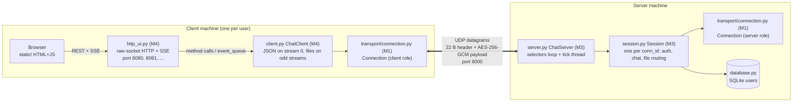
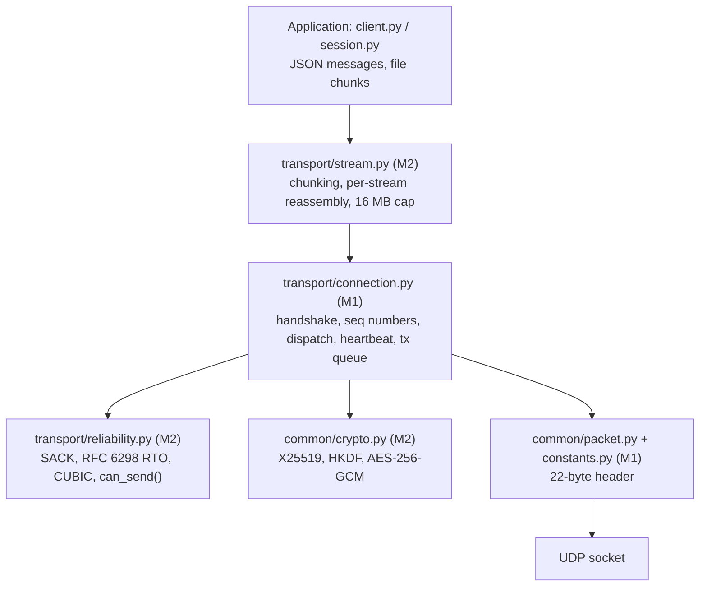

# STREAMCHAT Architecture

Status: reconciled with the repository code on 2026-11-13. The implemented transport behavior is covered by unit and Connection loopback tests; the multi-client browser-to-server full stack has not been verified. Section 6 remains a **target design, not implemented**.

Sequence diagrams live in [`sequence_diagram.md`](sequence_diagram.md).

## 1. Big picture

One central UDP server (default `127.0.0.1:9000`). Each user runs their own client process, which has two halves: a `ChatClient` that speaks the custom UDP protocol, and a small raw-socket HTTP server (`http_ui.py`) that serves the browser UI and bridges it to the `ChatClient`.

Layering inside every `Connection` (same code on both sides, `is_server` flag selects the role):

## 2. Components and responsibilities

| Layer       | File                               | Owner | What it does                                                                                                                                         |
| :---------- | :--------------------------------- | :---- | :--------------------------------------------------------------------------------------------------------------------------------------------------- |
| Browser UI  | `client/static/`                   | M4    | Chat UI; talks only to its local `http_ui.py`                                                                                                        |
| HTTP bridge | `client/http_ui.py`                | M4    | `POST /api/login`, `/api/logout`, `/api/send`, `/api/file`; `GET /api/status`, `/api/progress`; SSE stream pushes `event_queue` items to the browser |
| Client core | `client/client.py`                 | M4    | Owns the UDP socket and one `Connection`; sends `AUTH`, `MSG`, `FILE`, `LOGOUT`; runs poll and tick threads                                          |
| Transport   | `transport/connection.py`          | M1    | Handshake, DATA encrypt/decrypt, ACK, heartbeat, retransmit tick, idle timeout, congestion-gated send queue                                          |
| Reliability | `transport/reliability.py`         | M2    | Tracks in-flight packets, SACK processing, RTO, CUBIC cwnd                                                                                           |
| Streams     | `transport/stream.py`              | M2    | Splits messages into chunks, reassembles by offset                                                                                                   |
| Crypto      | `common/crypto.py`                 | M2    | Keypair, directional key derivation, AEAD with header as AAD                                                                                         |
| Wire format | `common/packet.py`, `constants.py` | M1    | Pack/unpack header; packet types and flags                                                                                                           |
| Server core | `server/server.py`                 | M3    | Single UDP socket; routes datagram to `Session` by `conn_id`; NAT-rebinding check; broadcast/unicast; user list; per-tick cleanup                    |
| Session     | `server/session.py`                | M3    | Per-client state: validates and handles `AUTH`, `LOGOUT`, `MSG`, `FILE`, raw file chunks; size and format limits                                     |
| User store  | `server/database.py`               | M3    | SQLite credential check (`db.verify_user`)                                                                                                           |

## 3. Wire protocol

- Header: 22 bytes, big-endian. Fields: `msg_type, conn_id, seq_num, flags, stream_id, offset, payload_len, reserved`.
- Packet types: `HELLO 0x01`, `HELLO_ACK 0x02`, `DATA 0x03`, `ACK 0x04`, `HEARTBEAT 0x05`, `HEARTBEAT_ACK 0x06`, `CLOSE 0x07`, `AUTH_REQ 0x08`, `AUTH_RESP 0x09`. The last two are defined but unused: authentication travels as JSON inside `DATA` on stream 0.
- Flags: `EOM 0x01`, `FIN 0x02`, `SYN 0x04`, `ENCRYPTED 0x08`.
- Streams: `0` = JSON control and chat. Client streams are odd, server streams are even. Each file gets its own stream.
- Only `DATA` is reliable and encrypted. `HELLO`, `HELLO_ACK`, `ACK`, `HEARTBEAT*` and `CLOSE` are sent in clear and are not authenticated (see section 5).

### Application messages (JSON on stream 0)

| Direction | `type`                                           | Purpose                                                                                |
| :-------- | :----------------------------------------------- | :------------------------------------------------------------------------------------- |
| C to S    | `AUTH`                                           | `username`, `password_hash` (SHA-256 hex)                                              |
| S to C    | `AUTH_RESP`                                      | `success`, `message`                                                                   |
| C to S    | `MSG`                                            | `target` (`all` or username), `text`                                                   |
| S to C    | `MSG`                                            | adds `from`, `timestamp`                                                               |
| C to S    | `FILE`                                           | metadata: `filename, size, sha256, stream_id, target`                                  |
| S to C    | `FILE_READY`                                     | forwarded metadata to recipient(s)                                                     |
| both      | raw bytes on stream N                            | file content; server writes chunks onto the same stream id of the recipient connection |
| C to S    | `LOGOUT` / S to C `LOGOUT_RESP`                  | keep transport open, drop identity                                                     |
| S to C    | `SYSTEM`, `ERROR`, `KICKED`, user-list broadcast | notices                                                                                |

## 4. How client and server interact

1. **Connect.** Client creates a random `conn_id`, sends `HELLO(client_pub)`. Server creates a `Session` on first datagram for that `conn_id`, replies `HELLO_ACK(server_pub)`. Both run X25519 then HKDF and obtain `client_write_key` and `server_write_key`.
2. **Authenticate.** Client sends `AUTH` over stream 0 (encrypted). `Session` checks SQLite. On success the server maps `username -> conn_id`, kicks any older session for the same user, and broadcasts the user list.
3. **Chat.** `MSG` goes to the `Session`, which stamps `from`/`timestamp` and routes: broadcast to all authenticated sessions, or unicast via `_user_to_conn`.
4. **File.** Client sends `FILE` metadata on stream 0, then streams raw chunks on its own odd stream. The `Session` checks size, filename and per-stream byte count, then `ChatServer._route_file_chunk` writes each chunk onto the same stream id in each recipient `Connection`. The receiver verifies the SHA-256 from the metadata.
5. **Keep-alive and loss.** Heartbeat every 5 s, idle close after 30 s. Retransmission is driven by `tick()` (RTO and SACK fast retransmit). `ACK` is sent only after a DATA packet decrypts and the stream accepts it.
6. **Address change.** If a `conn_id` arrives from a new address, the server accepts it only if the datagram is an AEAD-valid encrypted DATA packet (`verify_migration_datagram`).

## 5. Security today (what the code does)

| Property                              | Status in code                                                                              |
| :------------------------------------ | :------------------------------------------------------------------------------------------ |
| Confidentiality and integrity of DATA | AES-256-GCM, header bound as AAD                                                            |
| Key separation                        | Directional keys (client to server, server to client)                                       |
| Nonce uniqueness                      | Directional nonce built from seq number, plus `_used_nonces` guard in `crypto.py`           |
| ACK only after authentication         | Yes (`_handle_data`)                                                                        |
| Plaintext DATA after handshake        | Dropped                                                                                     |
| NAT rebinding                         | Requires valid AEAD DATA                                                                    |
| Input validation                      | `Session`: username/hash format, filename, size, stream id, chunk length, declared-size cap |
| File integrity                        | Receiver verifies SHA-256 before saving; mismatches are reported as `FILE_ERROR`             |

Known gaps (these motivate section 6):

- `HELLO`/`HELLO_ACK` are unauthenticated: a man-in-the-middle can substitute public keys. The client has no way to verify it is talking to the real server.
- `PKT_ACK`, `HEARTBEAT*`, `CLOSE` carry no authentication. An off-path attacker who knows a `conn_id` can send a forged `CLOSE` (the server sets `closed = True` on it without authentication, `server.py:212`) or forged ACKs.
- `ChatClient.connect()`: a handshake timeout aborts login without sending `AUTH`; the HTTP UI reports the timeout.
- Password handling: the client sends `SHA-256(password)` as the authentication token. The server applies per-account salted PBKDF2-HMAC-SHA256, but a captured token remains replayable; transport protection is still required.
- Anyone can create a `Session` by sending any datagram with a fresh `conn_id` (no cookie or proof of address ownership), so session creation is spoofable and amplifies memory use.
- Keys are never rotated; the nonce space is per-session only.
- No replay window on `seq_num` beyond the nonce guard.
- The browser-to-`http_ui.py` hop is plain local HTTP with no origin check.

## 6. Target architecture (not implemented)

Goal: both ends apply every security feature. Labelled `PROPOSED`; none of it has an ADR yet, so each item needs one in `docs/project/DECISIONS.md` and M1/M3/M4 sign-off before code.

| #   | Feature                                                                                                                                                                                  | Where                                     | Closes gap                              |
| :-- | :--------------------------------------------------------------------------------------------------------------------------------------------------------------------------------------- | :---------------------------------------- | :-------------------------------------- |
| T1  | Server long-term identity (Ed25519 key); `HELLO_ACK` carries a signature over the handshake transcript; client pins the server public key (trust-on-first-use or pre-shared fingerprint) | `crypto.py`, `connection.py`, `client.py` | MITM on handshake                       |
| T2  | Handshake transcript hash fed into HKDF `info`/salt, so both sides prove they derived the same keys; add a key-confirmation `Finished` message                                           | `crypto.py`, `connection.py`              | Key substitution, downgrade             |
| T3  | Stateless retry cookie (HMAC of client addr + time) before the server allocates a `Session`                                                                                              | `server.py`, `connection.py`              | Spoofed session creation, amplification |
| T4  | Authenticate `ACK`, `HEARTBEAT*` and `CLOSE` with AEAD (empty plaintext, header as AAD), or fold them into encrypted frames                                                              | `connection.py`                           | Forged CLOSE / ACK                      |
| T5  | No cleartext fallback: client aborts when the handshake fails; server rejects `AUTH` unless the session is encrypted                                                                     | `client.py`, `session.py`                 | Credential downgrade                    |
| T6  | Password hashing: server stores salted slow hash (scrypt or PBKDF2 from stdlib `hashlib`); login uses a server-supplied nonce challenge so the transmitted value cannot be replayed      | `database.py`, `session.py`, `client.py`  | Replayable password hash                |
| T7  | Sliding replay window on received `seq_num`                                                                                                                                              | `connection.py`, `crypto.py`              | Replay                                  |
| T8  | Rekey before nonce or byte limits (new ephemeral DH inside the encrypted channel)                                                                                                        | `crypto.py`, `connection.py`              | Long-lived key exposure                 |
| T9  | Rate limits per address and per `conn_id` (handshakes, auth attempts, bytes)                                                                                                             | `server.py`, `session.py`                 | Brute force, DoS                        |
| T10 | Local UI hardening: bind `127.0.0.1`, per-launch random token required on `/api/*`, Origin check                                                                                         | `http_ui.py`                              | Other local pages driving the client    |

How the full-security flow looks end to end: see section 2 of `sequence_diagram.md`.

## 7. Current protocol and verification notes

- `HEADER_FORMAT` and `HEADER_STRUCT_FMT` now share `!BIIBHIHI`, the 22-byte format used by `packet.py`.
- `PROTOCOL_MAGIC` is a reserved constant only; it is not sent or checked on the wire.
- `PKT_AUTH_REQ` and `PKT_AUTH_RESP` exist in constants but authentication is carried as JSON `AUTH` / `AUTH_RESP` in DATA.
- `src/server/web_server.py` is a legacy monolithic server; the current `run_server.py` entry point starts `ChatServer` and does not use it.
- `client.py` reads file data in 4096-byte blocks and passes them to `stream.write`; Stream performs the MTU-safe chunking.
- The Connection loopback uses simulated sockets. It does not verify the full browser/HTTP UI/client/UDP server flow.
