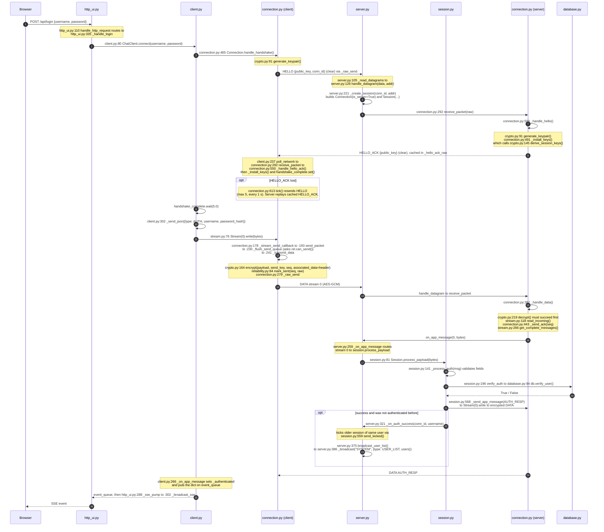
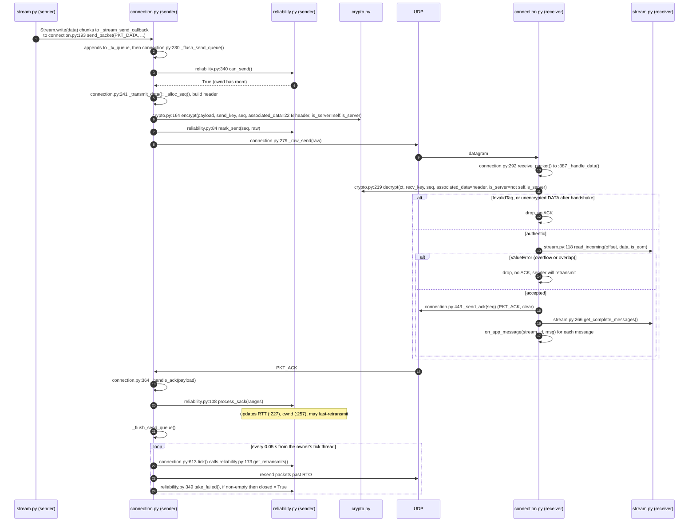
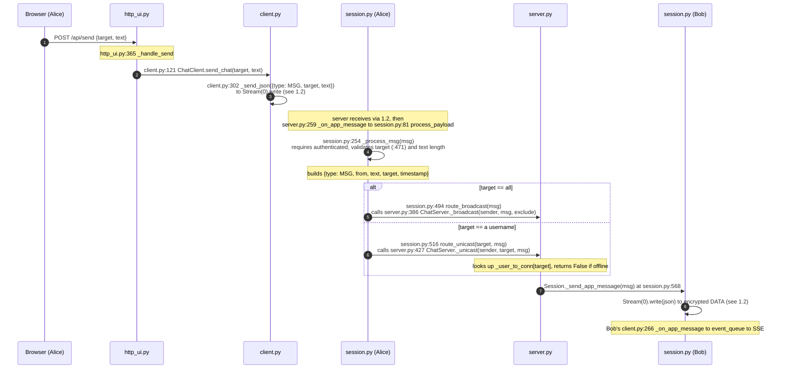
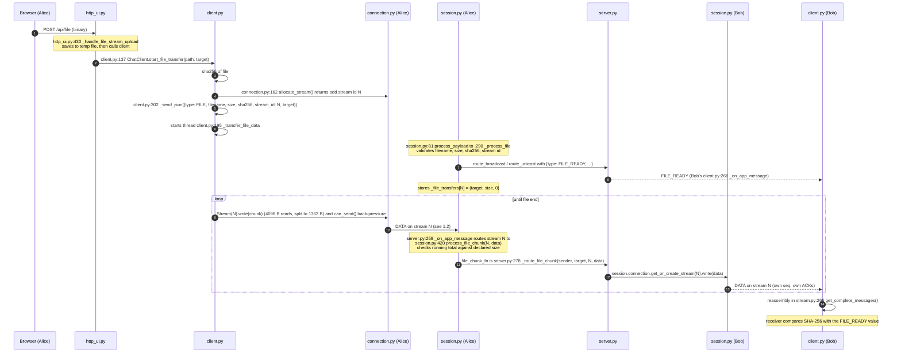
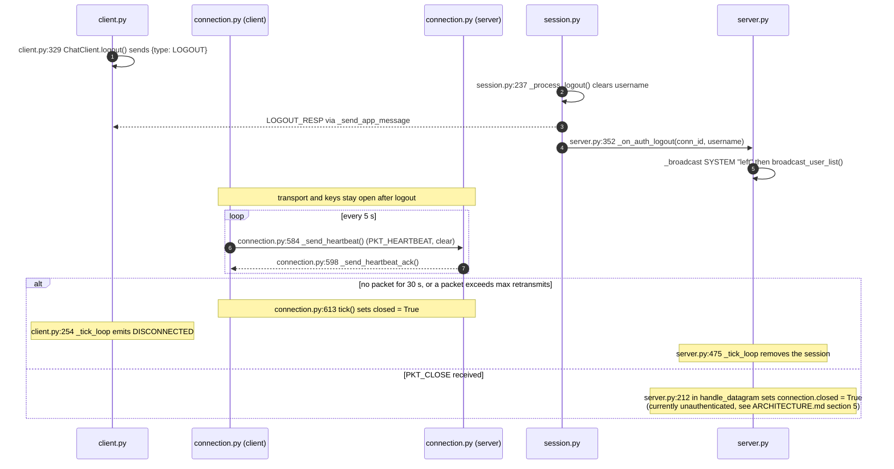
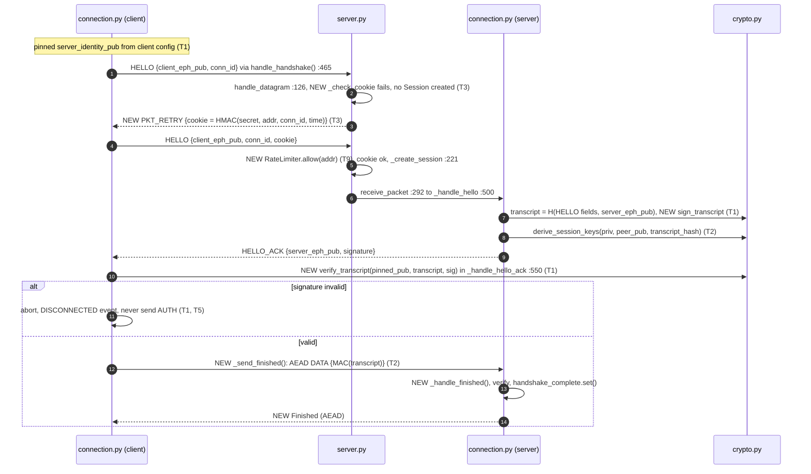
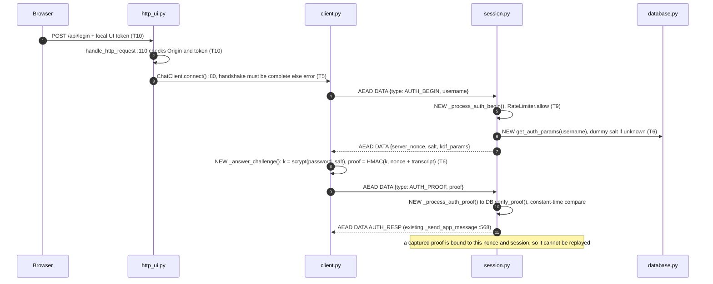
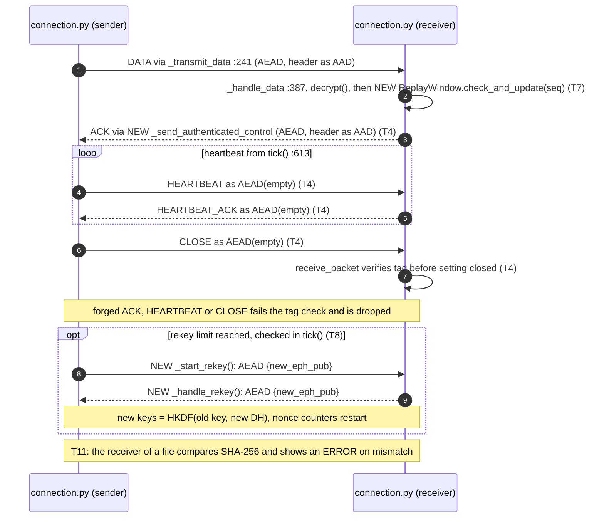

# STREAMCHAT Sequence Diagrams (with function and file locations)

Every arrow in Part 1 names the real function that runs, as `file:line Class.function()`, plus the owner (M1..M4). Line numbers are for branch `feat/Jaden`, commit `d869b8c`; if they drift, search the function name. Public signatures are in [`API_CONTRACT.md`](API_CONTRACT.md); the design is in [`ARCHITECTURE.md`](ARCHITECTURE.md).

Part 2 is the **proposed** secure design (T1..T11). Its functions **do not exist yet**: each is marked `NEW` with the file that should own it and the existing function it hooks into. Names there are suggestions, not agreed API.

## 0. How to read this

Participants are named by file so you can open the right one:

| Alias     | File                                                                        | Owner |
| :-------- | :-------------------------------------------------------------------------- | :---- |
| `http_ui` | `src/client/http_ui.py` `HttpUIServer`                                      | M4    |
| `client`  | `src/client/client.py` `ChatClient`                                         | M4    |
| `cconn`   | `src/transport/connection.py` `Connection` (client side, `is_server=False`) | M1    |
| `server`  | `src/server/server.py` `ChatServer`                                         | M3    |
| `session` | `src/server/session.py` `Session`                                           | M3    |
| `sconn`   | `src/transport/connection.py` `Connection` (server side, `is_server=True`)  | M1    |
| `stream`  | `src/transport/stream.py` `Stream`                                          | M2    |
| `rel`     | `src/transport/reliability.py` `ReliabilityManager`                         | M2    |
| `crypto`  | `src/common/crypto.py`                                                      | M2    |
| `db`      | `src/server/database.py` `db.verify_user`                                   | M3    |

`cconn` and `sconn` are the same class. Where the code is identical on both sides the diagram says "either side".

### Quick index: "I need to do X, which function do I call?"

| I want to                                  | Call                                                       | File:line                           | Owner |
| :----------------------------------------- | :--------------------------------------------------------- | :---------------------------------- | :---- |
| Start a connection and handshake (client)  | `Connection.handle_handshake()`                            | `connection.py:465`                 | M1    |
| Feed a received datagram into a connection | `Connection.receive_packet(raw)`                           | `connection.py:292`                 | M1    |
| Run timers (heartbeat, retransmit, idle)   | `Connection.tick()` every 0.05 s                           | `connection.py:613`                 | M1    |
| Send a JSON message                        | `Stream(0).write(bytes)` via `get_or_create_stream(0)`     | `stream.py:76`, `connection.py:144` | M2/M1 |
| Send a file                                | `Connection.allocate_stream()` then `Stream.write()`       | `connection.py:162`, `stream.py:76` | M1/M2 |
| Receive a complete message                 | set `on_app_message(stream_id, data)` in `Connection(...)` | `connection.py:70`                  | M1    |
| Encrypt / decrypt one packet               | `crypto.encrypt()` / `crypto.decrypt()`                    | `crypto.py:164`, `:219`             | M2    |
| Ask "may I send another packet?"           | `ReliabilityManager.can_send()`                            | `reliability.py:340`                | M2    |
| Send a chat message from the UI layer      | `ChatClient.send_chat(target, text)`                       | `client.py:121`                     | M4    |
| Start a file transfer from the UI layer    | `ChatClient.start_file_transfer(path, target)`             | `client.py:137`                     | M4    |
| Log a user in / out (client)               | `ChatClient.connect()` / `.logout()`                       | `client.py:80`, `:329`              | M4    |
| Send a server message to one client        | `Session._send_app_message(dict)`                          | `session.py:568`                    | M3    |
| Route to everyone / to one user            | `Session.route_broadcast()` / `route_unicast()`            | `session.py:494`, `:516`            | M3    |
| Check credentials                          | `db.verify_user(username, hash)`                           | `database.py:94`                    | M3    |

---

## Part 1: Current implementation

### 1.1 Handshake and login

### 1.2 One reliable encrypted DATA packet (either side)

This is the path every message and file chunk takes. Written once; sender and receiver are both `connection.py`.

Who calls `tick()`: the client from `client.py:254 ChatClient._tick_loop`; the server from `server.py:475 ChatServer._tick_loop`, which also removes sessions whose `connection.closed` is set.

### 1.3 Chat message (broadcast and unicast)

### 1.4 File transfer

### 1.5 Logout, heartbeat, idle and close

---

## Part 2: Target flow with full security (PROPOSED)

`NEW` = does not exist. `HOOK` = existing function that would call it. Names are placeholders; agree them in an ADR before coding. T-numbers match `ARCHITECTURE.md` section 6.

### 2.1 Proposed function map

| T   | New or changed function                                                                                                                 | File                            | Hooks into                                                      | Owner  |
| :-- | :-------------------------------------------------------------------------------------------------------------------------------------- | :------------------------------ | :-------------------------------------------------------------- | :----- |
| T1  | `NEW crypto.sign_transcript(identity_priv, transcript) -> bytes`, `NEW crypto.verify_transcript(identity_pub, transcript, sig) -> bool` | `crypto.py`                     | `Connection._handle_hello` (sign), `_handle_hello_ack` (verify) | M2     |
| T1  | `NEW` server identity key load, and pinned key in client config                                                                         | `server.py`, `client.py`        | `ChatServer.__init__`, `ChatClient.__init__`                    | M3, M4 |
| T2  | `NEW crypto.derive_session_keys(priv, peer_pub, transcript_hash)`: add optional `transcript_hash: bytes = b""` (backward compatible)    | `crypto.py`                     | `Connection._install_keys`                                      | M2     |
| T2  | `NEW Connection._send_finished()`, `_handle_finished()`                                                                                 | `connection.py`                 | after `_install_keys`                                           | M1     |
| T3  | `NEW ChatServer._make_cookie(addr, conn_id)`, `_check_cookie(...)`; reply `PKT_RETRY` before `_create_session`                          | `server.py`, `constants.py`     | `ChatServer.handle_datagram`                                    | M3, M1 |
| T4  | `NEW Connection._send_authenticated_control(msg_type)` and verification in `receive_packet` for `PKT_ACK/HEARTBEAT*/CLOSE`              | `connection.py`                 | `_send_ack`, `_send_heartbeat*`, `receive_packet`               | M1     |
| T5  | `ChatClient.connect`: replace the unencrypted fallback with an error event                                                              | `client.py`                     | `client.py:106`                                                 | M4     |
| T5  | `Session._process_auth`: reject unless `connection.handshake_complete` and keys installed                                               | `session.py`                    | `session.py:141`                                                | M3     |
| T6  | `NEW UserDatabase.get_auth_params(username)`, `verify_proof(username, nonce, proof)`                                                    | `database.py`                   | `Session.verify_auth`                                           | M3     |
| T6  | `NEW Session._process_auth_begin()`, `_process_auth_proof()`; client side `ChatClient._answer_challenge()`                              | `session.py`, `client.py`       | `process_payload` dispatch, `_on_app_message`                   | M3, M4 |
| T7  | `NEW ReplayWindow.check_and_update(seq) -> bool`                                                                                        | `reliability.py` or `crypto.py` | `Connection._handle_data` after decrypt                         | M2     |
| T8  | `NEW Connection._start_rekey()`, `_handle_rekey()`                                                                                      | `connection.py`                 | `tick()`, `_handle_data`                                        | M1     |
| T9  | `NEW RateLimiter.allow(key) -> bool`                                                                                                    | `server.py`                     | `handle_datagram`, `_process_auth`                              | M3     |
| T10 | token and Origin check in `HttpUIServer.handle_http_request`                                                                            | `http_ui.py`                    | `http_ui.py:110`                                                | M4     |
| T11 | surface SHA-256 mismatch as an `ERROR` event                                                                                            | `client.py`                     | file receive path                                               | M4     |

### 2.2 Authenticated handshake with cookie and key confirmation

### 2.3 Login with challenge and salted storage

### 2.4 Protected data and control path

